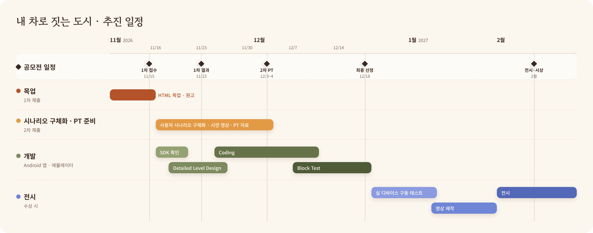

# 내 차로 짓는 도시

> 접수양식 "02 앱 프로젝트 소개 / 심사 자료"에 옮길 프로젝트 초안입니다.
> 상태: **제출용 초안** (2026-11-15)

앱명 / 프로젝트명: 내 차로 짓는 도시

## 1. 앱 한 줄 소개

> 양식 안내: 앱을 한 문장으로 소개해 주세요.

**“차로 가는 모든 순간이 게임 같아야 하니까”**

평범한 출퇴근도 주말의 작은 외출도 나만의 도시를 키우는 여정이 됩니다. 주차 후에는 도시를 꾸미며 내 차도 함께 돌보는, 차와 더 가까워지는 경험을 제공합니다.

## 2. 기획 배경

> 양식 안내: 어떤 고객의 니즈나 불편한 순간에 주목했으며, 왜 해결이 필요한지 작성해 주세요.

반복되는 일상 운전에 작은 기대를 더하고, 퀘스트를 통해 내 차에 대한 관심과 참여를 넓히고자 합니다. 다양한 차량 경험이 도시를 키우는 목표와 성취로 이어지도록 기획했습니다.

차량에서 일어나는 다양한 상황과 사용자의 행동에 목표와 보상을 연결하면, 평소 지나쳤던 순간에도 관심을 갖고 참여할 계기를 만들 수 있다고 보았습니다. 퀘스트를 달성하는 과정에서 차를 더 알아가고, 그 성취가 도시의 성장으로 이어지는 경험을 제공합니다.

이 과정에서 가장 중요하게 고려한 것은 운전의 안전과 차에 대한 지속적인 관심입니다. 즐거움과 보상이 주행 중 주의를 빼앗거나 불필요한 운행을 유도하지 않으면서, 평소의 이동과 차를 돌보는 행동 안에서 자연스럽게 참여와 성취를 느낄 수 있도록 기획했습니다.

## 3. 앱 주요 기능 및 차량 특화 요소

> 양식 안내: 앱의 핵심 기능을 소개하고, 이를 통해 어떤 문제를 해결하며 차량에서 어떤 새로운 경험을 제공하는지 설명해 주세요.

**앱 주요 기능**

일상 운행의 결과를 도시 성장으로 연결하고, 주차한 자리에서 놀이와 차량 관리를 함께 경험하도록 구성합니다.

- **운행 택배:** 주차하면 섬의 정류장에 택배 트럭이 도착합니다. 이번 운행의 거리 자재와 퀘스트 보상을 함께 확인하고 받을 수 있습니다. 운행 전후 누적 주행 거리와 변환 기준을 보상의 근거로 펼쳐 볼 수 있습니다.
- **도시 짓기와 돌보기:** 자재로 시설을 골라 원하는 자리에 짓습니다. 시설이 쌓아 둔 완성품을 거두어 골드를 얻고, 시설을 업그레이드하거나 장식을 사서 놓고, 주민을 쓰다듬으며 도시를 돌봅니다.
- **전체 지도와 도시 확장:** 대한민국 전체 지도에서 보유 도시와 시설 수익을 살펴보고, 차로 모은 자재로 새 도시를 엽니다. 골드로 시설의 레벨을 올리고, 정해진 단계에서는 자재로 건물을 한 단계 키웁니다. 실제로 지나간 도시는 발자국으로 남지만, 방문 여부가 도시를 여는 조건이나 추가 보상은 아닙니다.
- **퀘스트:** 매일 확인하는 일일 퀘스트와, 운행 상황이나 차량 상태를 계기로 생기는 돌발 퀘스트가 있습니다. 주행 중에는 기록만 하고, 결과 확인과 보상은 주차 후에 합니다. 쉬어 가기를 권하는 짧은 음성 안내만 예외입니다. 달성하면 자재를 얻고, 미달성이나 판정 불가에도 불이익은 없습니다.
  - 일일: 안전운전(운전 시간, 급가속과 급감속, 급제동, 방향 지시등), 함께 안전벨트 매기(점유 신호로 탑승자의 신원은 추정하지 않음)
  - 돌발: 쉬어 가기(연속 운전 중 음성으로 한 번 권유), 정비 시기 챙기기, 도로 주의 구간 지나오기, 차량 상태 회복 확인(워셔액, 오일 등 부족 신호가 정상으로 돌아오면 완료하되, 실제 정비나 보충의 증거로 단정하지 않음)
- **도시 이상 현상:** 차량 경고가 오면 실제 경고명과 안내 카드를 우선 표시하고, 섬의 길이 일렁이는 식으로 풍경에도 반영합니다. 경고가 풀리면 카드와 효과가 함께 사라집니다. 도시 효과가 실제 경고를 가리거나 늦추지 않습니다.

**차량 특화 요소**

차량 화면과 차량 데이터를 함께 쓰는 이유는 세 가지입니다. 

첫째, 보상의 근거입니다. 차량이 직접 잰 누적 주행 거리와 운전 신호를 자재와 안전운전 보상의 근거로 사용합니다. 

둘째, 운행이 끝난 순간입니다. 주차 직후 차량 화면에서 결과를 확인하고, 동승자와 같은 화면을 보며 무엇을 지을지 고를 수 있습니다. 

셋째, 안전 정보와의 연결입니다. 차량에서 받은 실제 경고와 도시의 변화를 한 화면에 함께 보여 주되, 실제 경고 안내를 우선합니다. 

주행 중에도 섬 애니메이션은 표시하되, 안전을 위해 게임 플레이와 화면 조작은 제한합니다. 출발하면 열려 있던 창을 닫고 모든 게임 조작을 막습니다. 화면에는 저절로 움직이는 섬과 "주행 중이에요" 한 줄만 남고, 급가속 같은 감지 사실도 알리지 않습니다. 신호 대기 같은 정차나 주행 여부를 판단할 수 없는 상태도 주행과 같이 다룹니다. 짓기, 거두기, 정비 기록 같은 모든 조작은 주차가 확인된 뒤에만 열립니다.

## 4. 주요 사용 시나리오

> 양식 안내: 누가, 어떤 상황에서, 어떻게 앱을 사용하는지 구체적인 이용 흐름을 설명해 주세요.

**"토요일 장보기"**

일상 운행부터 도시 꾸미기, 정비 확인까지 이어지는 이용 흐름입니다. 아래 목업의 차량 신호와 보상과 정비 수치는 설명용 가상 데이터입니다.

- 누가: 출퇴근, 장보기, 주말 외출에 차를 쓰고 도시 꾸미기를 가볍게 즐기는 차주
- 언제, 어디서: 토요일에 장을 보러 11km를 달린 뒤 주차한 차 안 (거리와 보상 수치는 설명용 예시입니다)
- 얻는 것: 방금 달린 결과가 섬을 키울 재료가 되고, 달리는 중에는 실제 차량 경고를, 주차한 자리에서는 다음 정비 시기를 알아차립니다

| 장면                             | 차량 상태           | 사용자가 하는 것과 앱이 하는 것                                                                                                                                                                                                                                                                              |
| -------------------------------- | ------------------- | ------------------------------------------------------------------------------------------------------------------------------------------------------------------------------------------------------------------------------------------------------------------------------------------------------------ |
| 1. 낮의 섬                       | 주차                | 출발 전에 앱을 엽니다. 주민이 돌아다니는 낮의 섬과 자재와 골드 잔액이 보입니다.                                                                                                                                                                                                                              |
| 2. 출발하면 주행 모드            | 주행                | 출발하면 앱이 열려 있던 창을 닫고 버튼을 숨깁니다. 화면에는 저절로 움직이는 섬과 "주행 중이에요" 한 줄만 남습니다. 운전자는 아무것도 누르지 않습니다. 앱은 운행 시작 시점의 누적 주행 거리와 안전운전 항목의 신호를 기록만 합니다.                                                                           |
| 3. 공기압 경고와 일렁이는 길     | 주행 (경고: 공기압) | 달리는 중에 공기압 경고 신호가 오면 주행 화면 위에 실제 경고명과 안내 카드가 뜨고, 섬의 길이 일렁입니다. 운전자는 아무것도 누르지 않아도 됩니다. 주차한 뒤에도 경고가 풀릴 때까지 어느 화면에 있든 카드가 맨 위에 남고, 경고가 풀리면 카드와 일렁임이 함께 사라집니다.                                       |
| 4. 주차하면 택배가 온다          | 주차                | 주차하면 내 차가 섬으로 돌아오고 정류장에 택배 트럭이 도착합니다. 택배를 누르면 "11km, 자재 11개"(예시)와 안전운전 칸이 나옵니다. 안전운전 칸에는 항목별 달성, 미달성, 판정 불가와 받은 자재가 나옵니다. [근거]를 누르면 운행 전후 누적 주행 거리와 변환 기준이 보입니다. [받기]를 누르면 잔액에 더해집니다. |
| 5. 시설 짓기                     | 주차                | 상점의 시설 탭을 누르면 시설 목록과 자재 비용이 나옵니다. 시설을 고르면 섬 위에 반투명으로 미리 보이고, [확정]을 누르면 자재가 줄고 완공 연출이 나옵니다.                                                                                                                                                    |
| 6. 거두고, 사고, 쓰다듬기        | 주차                | 빵집 위에 쌓인 완성품을 눌러 골드를 받습니다. 상점에서 골드로 장식을 사서 광장에 놓습니다. 머리 위에 하트가 뜬 주민을 쓰다듬습니다.                                                                                                                                                                          |
| 7. 정비소 주민의 정비 알림       | 주차                | 정비소 주민이 엔진오일 점검 시기가 왔다고 알립니다. 누르면 남은 거리와 기간(예시: 1,000km 또는 18일), 먼저 오는 쪽, 주기의 출처, "점검 권장"이 보입니다. 정비를 마친 뒤 교체 날짜와 당시 주행거리를 입력하면 자재를 받고 다음 주기가 시작됩니다.                                                             |
| 8. 전국 지도에서 내 도시 보기    | 주차                | 위 줄 지도를 열면 전국에서 내가 연 도시와 초당 수익 합계가 보입니다. 이 차가 지나간 도시에는 발자국이 남습니다. 발자국은 도시와 날짜만 저장하고, 위치 권한이 없으면 발자국 없이 동작합니다.                                                                                                                  |
| 9. 차로 모은 자재로 새 도시 열기 | 주차                | 아직 열지 않은 도시를 누르면 여는 가격, 내 자재, 연 뒤 다음 도시 가격이 보입니다. `열기` → `확정`을 누르면 자재가 줄고 도시가 켜집니다. 자재는 차에서만 얻고, 폰이나 골드로는 도시를 열 수 없습니다.                                                                                                    |

**스마트폰에서 도시 이어 돌보기 (향후 확대)**

차에 타지 않은 시간에도 도시를 둘러보고 시설을 돌보는 이용 흐름입니다. 차량에서의 보상 획득과 도시 확장 경험을 유지하도록 스마트폰의 기능을 제한합니다.

| 단계                      | 사용자가 하는 것과 앱이 하는 것                                                                                                                  |
| ------------------------- | ------------------------------------------------------------------------------------------------------------------------------------------------ |
| 1. 차량에서 연동          | 주차 중 차량 화면에서 전송 범위를 확인하고 동의한 뒤 스마트폰을 연동합니다.                                                                      |
| 2. 차 밖에서 돌보기       | 스마트폰에서 쌓인 골드를 거두고, 골드로 시설을 업그레이드합니다.                                                                                |
| 3. 차량 전용 기능 확인    | 스마트폰에서는 퀘스트 현황만 볼 수 있습니다. 자재를 얻고 쓰는 일, 택배 받기, 퀘스트 진행과 완료, 정비 기록은 차량에서만 할 수 있다고 안내합니다. |
| 4. 다음 주차 때 이어 하기 | 차량 화면을 열면 스마트폰에서 돌본 상태가 이어집니다. 연동된 차가 주행 중으로 확인되면 스마트폰에서도 게임 조작을 막습니다.                      |

스마트폰 연동은 확대 계획이며, HTML 목업의 스마트폰 화면은 이용 흐름을 보여 주는 예시입니다. 실제 기기 간 연동은 구현하지 않았습니다.

## 5. 개발 계획

> 양식 안내: Pleos Connect 환경에서 앱을 어떻게 구현할지 주요 개발 범위와 SDK/API 사용계획을 구체적으로 작성해 주세요.

**구현 구상**

Pleos Connect SDK를 바탕으로 차량 경험과 도시 성장을 연결합니다. Vehicle SDK의 주행 거리는 운행 택배의 자재가 되고, 방향 지시등, 브레이크, 안전벨트 신호는 안전운전 퀘스트의 근거가 됩니다. 오일과 워셔액 등 차량 관리 신호와 경고등 정보는 관리 퀘스트와 도시의 변화로 이어집니다.

NaviHelper의 도로 주의 구간 정보로 운행 상황에 맞는 돌발 퀘스트를 구성하고, FusedLocation의 차량 위치로 전체 지도에 지나온 도시의 발자국을 남깁니다. TextToSpeech는 장거리 운행 중 쉬어 가기를 권하는 짧은 음성 안내에 활용합니다.

도시, 자원, 퀘스트와 정비 기록은 기기에 저장합니다. 향후 스마트폰 연동 시에는 사용자 동의를 받은 게임 상태와 주행 여부만 전송하고, 속도, 위치, 운전 관측값, 정비 기록은 보내지 않는 구상입니다. 주행 중에는 섬 애니메이션만 유지하고, 게임 조작은 주차가 확인된 상태에서만 허용합니다.

현재 HTML 목업은 가상 차량 신호로 운행 보상, 도시 건설, 정비 안내와 전체 지도 등 아홉 장면의 이용 흐름을 보여 줍니다. 실제 Pleos SDK와 AAOS API에는 연결하지 않았습니다. 아래 표는 문서에서 제공 여부를 확인한 API의 활용 계획이며, 실제 신호 수신과 권한 동작은 아직 검증하지 않았습니다.

**Pleos SDK 활용 계획**

| SDK와 제공 정보                                   | 서비스에서 활용하는 방법                                                                                          |
| ------------------------------------------------- | ----------------------------------------------------------------------------------------------------------------- |
| Vehicle Odometer (누적 주행 거리)                 | 운행 전후 거리 차이를 건축 자재로 바꾸고, 마지막 정비 기록 이후 달린 거리로 다음 정비까지 남은 거리를 계산합니다. |
| Vehicle Odometer (트립 시간)                      | 일일 운전 시간 항목과 장거리 운행 중 쉬어 가기 퀘스트에 사용합니다.                                               |
| Vehicle TurnSignal (방향 지시등 상태)             | 방향 지시등 사용을 관측해 주차 후 일일 퀘스트 결과에 반영합니다.                                                  |
| Vehicle Brake (브레이크 페달 상태)                | 속도 변화와 함께 급제동 여부를 판단하는 보조 정보로 사용합니다.                                                   |
| Vehicle Seat (좌석 점유와 안전벨트 체결)          | 동승석 점유에 따라 섬의 손님을 연출하고, 출발 시 안전벨트 체결 여부를 퀘스트에 반영합니다.                        |
| Vehicle Safety (오일, 브레이크액, 워셔액 상태)    | 부족 상태가 관측되면 관리 퀘스트를 만들고, 같은 신호가 정상으로 돌아오면 완료합니다.                              |
| Vehicle Safety (공기압, 과열 등 경고등)           | 실제 경고 안내를 먼저 표시하고, 도시 풍경에도 이상 현상을 반영합니다.                                             |
| Vehicle CarInfo (제조사와 연식 등 차량 기본 정보) | 차량 정보에 맞는 정비 주기를 선택하는 데 활용합니다.                                                              |
| NaviHelper (도로 주의 구간과 경로 안내 이벤트)    | 공사, 낙석 등 주의 구간을 지나온 경험을 돌발 퀘스트와 섬의 길 정리 연출로 연결합니다.                             |
| FusedLocation (차량 위치)                         | 이 차가 지나간 도시와 날짜를 전체 지도에 발자국으로 표시합니다.                                                   |
| TextToSpeech (음성 합성)                          | 장거리 운행 중 쉬어 가기를 권하는 짧은 음성 안내에 사용합니다.                                                    |

**AAOS 표준 API 보완 활용 계획**

Pleos Connect의 기반인 Android Automotive OS의 표준 API는 속도 변화 판정과 주차 여부 확인, 주행 중 화면 제한 반영에 보조적으로 활용할 계획입니다. 공모전에서의 사용 가능 여부는 확인 중이며, 실제 지원 여부와 필요한 권한을 확인한 뒤 적용합니다.

| API와 제공 정보                                                                     | 서비스에서 활용하는 방법                                                                                |
| ----------------------------------------------------------------------------------- | ------------------------------------------------------------------------------------------------------- |
| CarPropertyManager: 차량 속도 (`PERF_VEHICLE_SPEED`)                              | 시간에 따른 속도 변화로 급가속과 급감속을 판단하고, 브레이크 페달 정보와 함께 급제동 항목에 활용합니다. |
| CarPropertyManager: 기어와 주차 브레이크 (`GEAR_SELECTION`, `PARKING_BRAKE_ON`) | 주차 상태를 판별하고, 보상 확인, 건설, 퀘스트 조작을 허용하는 기준으로 사용합니다.                      |
| CarUxRestrictionsManager (주행 중 화면 사용 제한)                                   | 주행 상태에 따른 플랫폼의 화면 제한을 반영해 열려 있던 창을 닫고 게임 조작을 차단합니다.                |

**판정과 안전 원칙**

- 신호 지원 여부와 필요한 권한을 먼저 확인하고, 값을 읽지 못하면 추정값으로 퀘스트를 완료하거나 보상을 지급하지 않습니다. 권한 요청은 주차 중에 사용 목적을 설명한 뒤 진행합니다.
- 실제 차량 경고를 도시 연출보다 우선하며, 주행 중에는 퀘스트 판정 결과를 알리거나 화면 조작을 요구하지 않습니다.
- 정비 안내는 사용자 입력, 차량 신호, 추정값을 구분하고, 점검 권장으로 제한합니다.
- 앱이 다른 화면 뒤에 있을 때 운행 신호를 계속 수신할 수 있는지도 검증 대상입니다. 누락된 구간이 있으면 해당 퀘스트를 판정 불가로 처리하며, 누적 거리의 변화가 없다는 사실만으로 주차를 확정하지 않습니다.

## 6. 기대효과 및 발전 가능성

> 양식 안내: 사용자에게 제공하는 가치와 향후 서비스 확대·발전 가능성을 작성해 주세요. (타깃 고객 분석, 예상 MAU, Retention Rate, 향후 서비스 확대 계획 등)

**기대 효과**

Pleos Connect가 탑재된 차를 출퇴근, 장보기, 주말 외출에 쓰는 차주에게, 반복되는 일상 운전이 도시를 키우는 즐거움이 되고 자연스럽게 차를 돌보는 습관으로 이어지는 경험을 제공합니다. 도시 꾸미기를 가볍게 즐기는 사람과 정비 시기를 스스로 챙기기 어려운 사람이 겹치는 층을 주요 사용자로 봅니다.

- **일상 운전에 생기는 작은 기대:** 평범한 운행도 "오늘 내 도시는 어떻게 바뀔까"를 기대하게 하는 시간이 됩니다.
- **놓치지 않는 차량 관리:** 정비 시기를 따로 기억하지 않아도 도시를 보러 온 김에 알아차리고, 차량 경고의 실제 내용과 안내를 놓치지 않습니다.
- **부담 없이 돌아보는 운전:** 결과는 주차 후에만 나오고, 달성하지 못해도 잃는 것이 없어 자신의 운전을 편하게 돌아봅니다.
- **다시 찾게 되는 이유:** 다시 여는 이유를 운전량이 아니라 시간에 걸어 두었습니다. 택배는 주차할 때마다 오고, 시설의 완성품과 주민 쓰다듬기는 시간이 지나면 다시 채워집니다. 일일 퀘스트와 돌발 퀘스트가 도시를 돌볼 계기를 이어 주고, 도시를 열수록 다음 목표가 생깁니다. 도시를 넓히는 자재는 차에서만 생기므로 운행이 곧 지도를 넓히는 일이 됩니다.

이용 규모와 유지율은 근거를 확보한 뒤 제시합니다. 예를 들어 예상 MAU는 "국내 Pleos Connect 탑재 차량 수 × 앱 설치율 × 설치 차량 중 한 달에 한 번 이상 주차 중에 앱을 연 비율"로 추정하고, Retention은 주차 후 앱 열람률, 주간 건설 횟수, 정비 퀘스트 완료율, 경고 확인 후 조치율로 검증할 계획입니다. 타깃 규모와 이용 수요, 실사용 유지율 데이터는 아직 없으며, 초기 사용자 검증으로 확인합니다.

**발전 가능성**

같은 도시와 퀘스트 틀 위에 콘텐츠, 목표, 협업을 더해 가는 방향으로 발전할 수 있습니다.

- **콘텐츠와 퀘스트 확장:** 건축 테마와 시즌 팩으로 같은 도시를 다른 분위기로 꾸밉니다. 정비, 경고 해소, 안전운전에 이어 다른 출처의 목표도 같은 퀘스트 틀에 담고, 에어필터나 타이어 위치 교환 같은 정비 목표를 더합니다. 단거리 운행 비율 같은 운전 습관으로 점검 시점을 조정하는 방안과, 주차 후 "오늘 뭐 받았어?", "다음 정비 언제야?"를 음성으로 묻고 답을 듣는 기능도 검토합니다.
- **퀘스트 기반 개인화:** 사용자의 선호와 목표, 차량 상태와 이용 맥락을 반영해 퀘스트와 콘텐츠의 구성, 참여 방식과 제안 시점을 맞춥니다. 첫 차에 익숙해지는 시기부터 새로운 생활에 적응하고 동승자와 시간을 함께하는 순간까지, 일상 속에서 차와 함께하는 경험을 넓혀 가도록 돕습니다.
- **마케팅 활용:** 브랜드나 서비스와 협업한 선택형 퀘스트나 시즌 캠페인으로 활용할 수 있습니다. 브랜드의 제품과 서비스를 도시 속 콘텐츠로 경험하거나 여러 사용자가 함께 목표를 달성하는 참여형 캠페인을 구성하고, 참여 보상으로 브랜드를 상징하는 건물을 제공해 도시를 꾸미는 즐거움이 브랜드에 대한 친밀감으로 이어지도록 합니다.

## 7. 참고자료 (선택, 가산점 부여)

> 양식 안내: 앱 화면 시안, 시연 영상, GitHub 저장소 등 아이디어와 개발 결과물을 보여줄 수 있는 자료가 있다면 파일 또는 링크로 제출해 주세요.

- GitHub 저장소: [내 차로 짓는 도시 프로젝트](https://github.com/CyberFlower/htf-jaemin-I)
- HTML 목업: [HTML 파일](https://github.com/CyberFlower/htf-jaemin-I/blob/main/spikes/game-isometric/index.html). 저장소를 내려받아 `spikes/game-isometric/index.html`을 Chrome 또는 Edge에서 열면 조작할 수 있습니다. (차량 신호와 수치는 설명용 가상 데이터입니다.)

## 8. 숏폼 링크 (선택, 가산점 없음)

> 양식 안내: 게시한 세로 방향 영상의 링크를 기재해 이메일로 제출합니다.

제출하지 않음.
