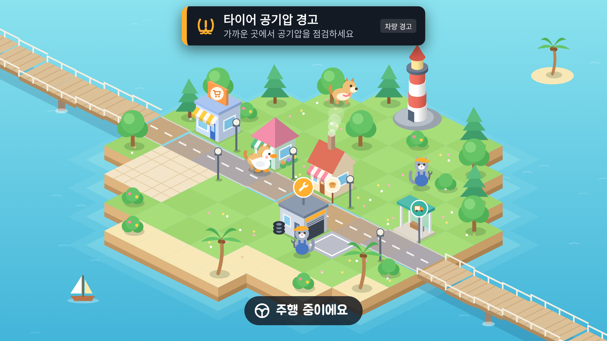
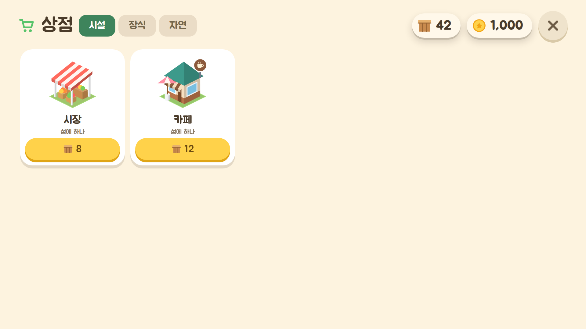
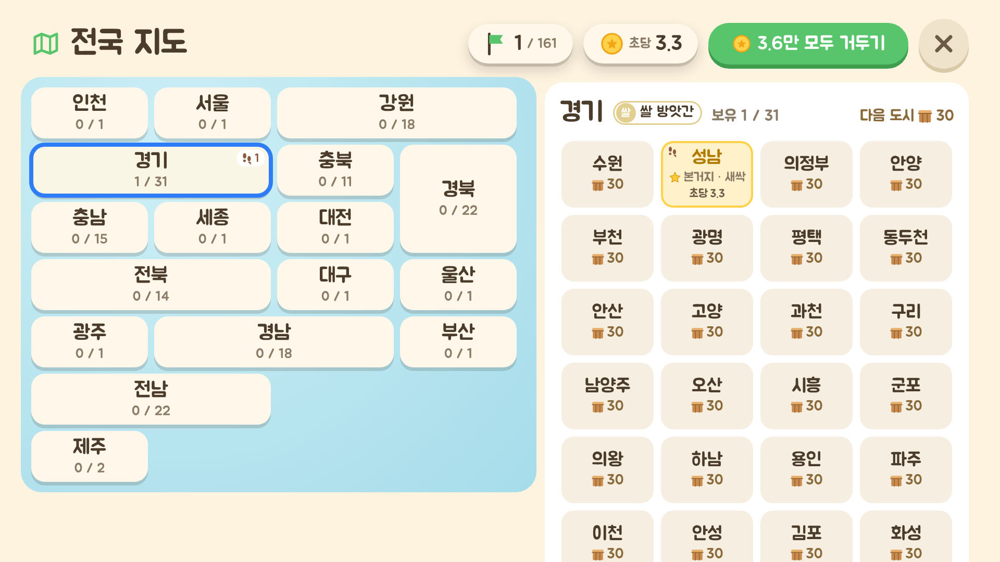
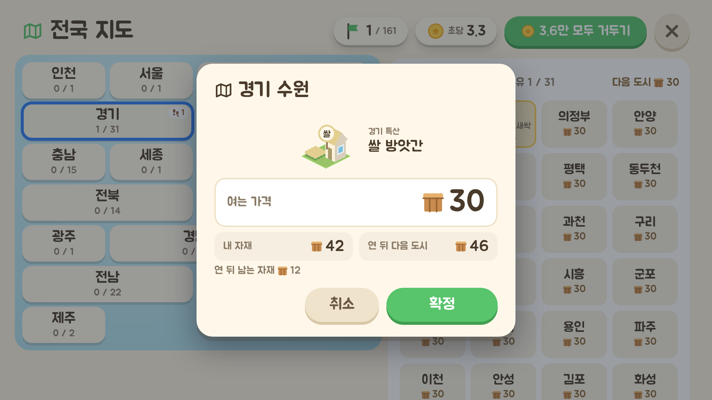

# SCENARIO: 내 차로 짓는 도시 (`GAM`)

코어 시나리오 가이드입니다. 대표 시나리오 "토요일 장보기"를 장면 단위로 처음부터 끝까지 설명하며, [PROPOSAL.md](PROPOSAL.md) 4번 원고와 같은 흐름을 따릅니다.

- 기준: [GOAL.md](GOAL.md), [USE_CASES.md](USE_CASES.md), [REQUIREMENTS.md](REQUIREMENTS.md), [SCREENS.md](SCREENS.md)
- 형식: [submission-package.md](../../docs/process/submission-package.md)

## 1. 시나리오 개요

**"토요일 장보기"**

출퇴근, 장보기, 주말 외출에 차를 쓰는 차주가 토요일에 장을 보러 11km를 다녀오는 이야기입니다. 달리는 중에는 실제 차량 경고를 알아차리고, 주차한 자리에서는 방금 달린 결과를 섬을 키울 재료로 받으며 다음 정비 시기도 챙깁니다.

### 1. 낮의 섬

출발 전에 앱을 열면 주민이 돌아다니는 낮의 섬과 자재와 골드 잔액이 보입니다.

### 2. 출발하면 주행 모드

출발하면 창을 닫고 버튼을 숨겨, 저절로 움직이는 섬과 "주행 중이에요" 한 줄만 남깁니다. 운전자는 아무것도 누르지 않습니다.

### 3. 공기압 경고와 일렁이는 길

주행 중에도 실제 공기압 경고 카드가 맨 위에 뜨고 섬의 길이 일렁입니다. 경고가 풀리면 카드와 일렁임이 함께 사라집니다.

### 4. 주차하면 택배가 온다

주차하면 내 차가 섬으로 돌아오고 정류장에 택배 트럭이 도착합니다. 택배를 열면 달린 거리만큼의 자재("11km, 자재 11개")와 안전운전 항목별 결과가 나옵니다.

### 5. 시설 짓기

상점의 시설 탭에서 시설을 고르면 섬 위에 반투명으로 미리 보이고, 확정하면 자재가 줄고 완공됩니다.

### 6. 거두고, 사고, 쓰다듬기

빵집 위에 쌓인 완성품을 거둬 골드를 받고, 상점에서 장식을 사서 광장에 놓고, 머리 위에 하트가 뜬 주민을 쓰다듬습니다.

### 7. 정비소 주민의 정비 알림

정비소 주민이 엔진오일 점검 시기를 알립니다. 남은 거리와 기간 중 먼저 오는 쪽을 "점검 권장"으로 보여 주고, 교체를 기록하면 자재를 받고 다음 주기가 시작됩니다.

### 8. 전국 지도에서 내 도시 보기

지도를 열면 전국에서 내가 연 도시와 초당 수익 합계가 보이고, 이 차가 지나간 도시에는 발자국이 남습니다.

### 9. 차로 모은 자재로 새 도시 열기

아직 열지 않은 도시를 눌러 여는 가격과 내 자재를 확인하고 엽니다. 도시를 여는 자재는 차에서만 얻습니다.

화면은 HTML 목업의 차량 화면 캡처입니다. 차량 신호와 거리, 자재, 골드, 정비 주기 수치는 설명용 가상 데이터입니다.

## 2. 장면 표

목업 틀과 시연 영상이 이 표를 따릅니다. 표를 고친 뒤 `node spikes/mockup-frame/build.mjs`를 실행합니다.

- 화면 규격: 1920×1080
- 전체 길이: 약 155초 (6절 영상 콘티)

| ID | 장면 | 차량 상태 | 화면 | 틀 | 한 줄 설명 | 요구사항 | 심사 | SDK |
|---|---|---|---|---|---|---|---|---|
| SC-01 | 낮의 섬 | 주차 | S01 | [캡처](assets/scenes/SC-01.png) | 출발 전에 앱을 열면 주민이 돌아다니는 낮의 섬과 자재와 골드 잔액이 보입니다 | GAM-031, GAM-032, GAM-N04 | `[창의]` | 주차 판단: AAOS 기어, 주차 브레이크 |
| SC-02 | 출발하면 주행 모드 | 주행 | S02 | [캡처](assets/scenes/SC-02.png) | 출발하면 창을 닫고 버튼을 숨겨, 저절로 움직이는 섬과 "주행 중이에요" 한 줄만 남깁니다 | GAM-N01 | `[차량특화]` | 주행 판단: AAOS, Vehicle Odometer |
| SC-03 | 공기압 경고와 일렁이는 길 | 주행 (경고: 공기압) | S02, S10 | [캡처](assets/scenes/SC-03.png) | 주행 중에도 실제 경고 카드가 맨 위에 뜨고 섬의 길이 일렁이며, 경고가 풀리면 둘 다 사라집니다 | GAM-009, GAM-N02 | `[창의]` `[차량특화]` | Vehicle Safety 경고등 |
| SC-04 | 주차하면 택배가 온다 | 주차 | S03 | [캡처](assets/scenes/SC-04.png) | 내 차가 섬으로 돌아오고, 택배를 열면 달린 거리의 자재와 안전운전 자재가 나옵니다 | GAM-001, GAM-003, GAM-025 | `[차량특화]` `[기술]` | Vehicle Odometer, Brake, TurnSignal, AAOS 속도 |
| SC-05 | 시설 짓기 | 주차 | S11, S04, S05 | [캡처](assets/scenes/SC-05.png) | 시설 목록에서 시설을 고르면 섬 위에 반투명으로 미리 보이고, 확정하면 자재가 줄고 완공됩니다 | GAM-004, GAM-019 | `[창의]` | — (로컬 저장, 주차 판단만) |
| SC-06 | 거두고, 사고, 쓰다듬기 | 주차 | S06, S11 | [캡처](assets/scenes/SC-06.png) | 완성품을 거둬 골드를 받고, 상점에서 장식을 사서 놓고, 주민을 쓰다듬습니다 | GAM-031, GAM-032, GAM-033 | `[사업]` | — (로컬 저장, 기기 시각) |
| SC-07 | 정비소 주민의 정비 알림 | 주차 | S08, S09 | [캡처](assets/scenes/SC-07.png) | 엔진오일 점검 시기를 거리와 기간 중 먼저 오는 쪽으로 알리고, 교체를 기록하면 다음 주기가 시작됩니다 | GAM-006, GAM-007 | `[차량특화]` `[사업]` | Vehicle Odometer, CarInfo |
| SC-08 | 전국 지도에서 내 도시 보기 | 주차 | S13 | [캡처](assets/scenes/SC-08.png) | 위 줄 지도를 열면 전국에서 내가 연 도시, 초당 수익 합계, 이 차가 지나간 도시의 발자국이 보입니다 | GAM-038, GAM-043, GAM-044 | `[창의]` `[차량특화]` `[사업]` | FusedLocation (발자국) |
| SC-09 | 차로 모은 자재로 새 도시 열기 | 주차 | S14 | [캡처](assets/scenes/SC-09.png) | 미보유 도시를 눌러 여는 가격과 내 자재, 연 뒤 다음 도시 가격을 확인하고 엽니다 | GAM-039, GAM-N08 | `[차량특화]` `[사업]` | — (자재는 SC-04의 Vehicle Odometer와 안전운전 보상) |

- 화면 ID(`S##`)는 [SCREENS.md](SCREENS.md) 7절의 표기입니다.
- "틀" 칸에는 목업 파일이나 캡처를 `[이름](상대 경로)`로 연결하고, 캡처는 `assets/scenes/SC-01.png`처럼 둡니다.
- 캡처는 [HTML 목업](../../spikes/game-isometric/README.md)의 차량 화면을 `node spikes/mockup-frame/capture/game.cjs`로 찍은 것이라 목업이 바뀌면 다시 실행합니다. 캡처의 숫자(자재, 골드, 기준, 주기)는 목업 가정값입니다([목업 README](../../spikes/game-isometric/README.md) 5절).

## 3. 장면별 상세

### SC-01 낮의 섬

- 상황: 출발 전, 주차 중인 차에서 앱을 엽니다. 시각은 낮입니다.
- 사용자 행동: 섬을 둘러보기만 하고 아직 아무것도 누르지 않습니다.
- 앱 응답: 위 줄에 섬 이름, 자재와 골드 잔액, `P` 주차 표시와 시각이 보입니다. 주민이 돌아다니고, 지난 시간만큼 쌓인 완성품과 쓰다듬을 수 있는 주민 위에 표시가 뜨며(GAM-UC-004 B1), 지난번 도시와 자원이 그대로 이어집니다(GAM-N04).
- 차량 신호와 SDK: 화면을 여는 데 쓰는 신호는 없고, 조작을 허용할 때 주차 판단(AAOS 기어, 주차 브레이크)을 씁니다.
- 오판 방지와 대체 동작: 생산과 쓰다듬기 충전은 실제 시간으로만 흐르고 운전량과 관계없습니다(GAM-N03).
- 시연 방법: 목업을 열고 시뮬레이터의 `처음 상태로`를 누릅니다(목업 README 4절 순서 1).
- 캡처: [SC-01.png](assets/scenes/SC-01.png)

### SC-02 출발하면 주행 모드

- 상황: 차주가 장을 보러 출발합니다.
- 사용자 행동: 운전자는 아무것도 누르지 않고, 화면을 눌러도 반응하지 않습니다.
- 앱 응답: 열려 있던 창을 닫고 확정하지 않은 짓기, 구매, 배치를 자원 차감 없이 취소합니다(SCREENS.md 8절, GAM-020). 위 줄과 버튼을 숨기고 저절로 움직이는 섬과 "주행 중이에요" 한 줄만 남기며, 운행 시작 시점의 누적 주행 거리와 안전운전 항목의 신호를 기록만 하고 주행 중에는 알리지 않습니다(GAM-UC-001 B2, GAM-N06).
- 차량 신호와 SDK: 주행과 주차 판단에는 AAOS `GEAR_SELECTION`, `PARKING_BRAKE_ON`, `CarUxRestrictionsManager`를 쓰고([dev-environment.md](../../docs/contest/dev-environment.md) 4.3절), 출발 거리는 Vehicle Odometer로 기록합니다.
- 오판 방지와 대체 동작: 신호 대기 같은 정차나 주행 여부를 판단할 수 없는 상태도 주행과 같이 다루어 조작을 막습니다(GAM-N01, SCREENS.md 8절).
- 시연 방법: 시뮬레이터에서 `D 주행`을 누르고 화면을 눌러 봅니다(목업 README 4절 순서 2).
- 캡처: [SC-02.png](assets/scenes/SC-02.png)

### SC-03 공기압 경고와 일렁이는 길

- 상황: 장을 보러 가는 길에 차량이 타이어 공기압 경고를 보냅니다.
- 사용자 행동: 운전자는 아무것도 누르지 않습니다. 경고는 차량 계기판과 함께 확인합니다.
- 앱 응답: 주행 화면 위에 실제 경고명과 안내 카드가 뜨고 섬의 길이 일렁입니다. 주차한 뒤에도 경고가 풀릴 때까지 어느 화면에 있든 카드가 맨 위에 남고, 경고가 풀리면 카드와 일렁임이 함께 사라집니다(GAM-009, SCREENS.md 8절 S10).
- 차량 신호와 SDK: Vehicle Safety 경고등 `registerTelltales`의 `TPMS`, `ENGINE_TEMPERATURE`를 쓰며, 퍼미션은 `PRIVATE_CAR_SAFETY`입니다([SDK.md](SDK.md) 2절).
- 오판 방지와 대체 동작: 도시 효과는 경고 안내를 가리거나 늦추지 않고(GAM-N02), 차량 신호로 받은 경고만 표시하며 경고를 추측하지 않습니다(GAM-009). 경고 카드가 떠도 주행 중에는 게임 조작을 열지 않습니다(GAM-N01).
- 시연 방법: `D 주행` 상태에서 시뮬레이터 `타이어 공기압`을 켰다 끕니다. `엔진 과열`도 같은 방식입니다(목업 README 4절 순서 7의 버튼을 주행 중에 누릅니다).
- 캡처: [SC-03.png](assets/scenes/SC-03.png)

### SC-04 주차하면 택배가 온다

- 상황: 11km를 달린 뒤 주차합니다(설명용 수치).
- 사용자 행동: 정류장의 택배 트럭을 누르고, 필요하면 `근거`를 연 뒤 `받기`를 누릅니다.
- 앱 응답: 내 차가 섬으로 돌아오고 정류장에 택배 트럭이 섭니다(GAM-UC-001 B3). 택배 카드에는 "11km, 자재 11개"(예시)와 안전운전 네 항목(운전 시간, 급가속과 급감속, 급제동, 방향 지시등)의 달성, 미달성, 판정 불가와 받은 자재가 나옵니다(B4, GAM-003, GAM-025). `근거`에는 운행 전후 누적 주행 거리와 변환 기준이 나오고(A3, GAM-018), `받기`를 누르면 잔액에 더해집니다(B5).
- 차량 신호와 SDK: 거리와 운전 시간은 Vehicle Odometer(`CAR_DRIVE`), 급가속과 급감속은 AAOS `PERF_VEHICLE_SPEED`, 급제동은 Vehicle Brake 페달과 속도 변화, 방향 지시등은 Vehicle TurnSignal로 판정합니다.
- 오판 방지와 대체 동작: 같은 운행은 두 번 적립하지 않고(GAM-001), 이미 달성한 항목도 다시 보상하지 않습니다(A2). 신호를 읽지 못한 항목은 "판정 불가"로 두고 미달성으로 치지 않으며(E1~E3), 누적 거리를 읽지 못하면 자재를 적립하지 않습니다(E8).
- 시연 방법: 시뮬레이터에서 이동 거리 11km와 운전 시간, 횟수를 정한 뒤 `P 주차`를 누르고 택배 트럭을 누릅니다(목업 README 4절 순서 3).
- 캡처: [SC-04.png](assets/scenes/SC-04.png)

### SC-05 시설 짓기

- 상황: 택배로 받은 자재로 시설을 지을 수 있습니다.
- 사용자 행동: 시설 목록에서 시설을 고르고, 섬 위에서 자리를 맞춘 뒤 `확정`을 누릅니다.
- 앱 응답: 시설 목록과 자재 비용이 나오고(GAM-UC-003 B1), 시설을 고르면 섬 위에 반투명으로 미리 보입니다(B2). 확정하면 자재가 줄고 완공 연출이 나옵니다(B4~B5, GAM-019).
- 차량 신호와 SDK: 로컬 저장만 쓰며, 조작은 주차 판단 뒤에만 허용합니다.
- 오판 방지와 대체 동작: 자재가 모자라면 짓지 않고 모자란 양을 보여 주고(E1), 취소하면 자재와 배치가 바뀌지 않습니다(E3, GAM-020). 주행이 시작되면 확정하지 않은 짓기를 취소합니다(SCREENS.md 8절).
- 시연 방법: 위 줄 상점 → `시설` 탭 → 시장 → 정류장 옆 빈 땅 → ✓ 확정(목업 README 4절 순서 4).
- 캡처: [SC-05.png](assets/scenes/SC-05.png)

### SC-06 거두고, 사고, 쓰다듬기

- 상황: 주차한 김에 섬을 돌봅니다.
- 사용자 행동: 빵집 위에 쌓인 완성품을 누르고, 상점에서 골드로 장식을 사서 광장에 놓고, 머리 위에 하트가 뜬 주민을 쓰다듬습니다.
- 앱 응답: 쌓인 완성품만큼 골드가 더해지고 생산이 이어집니다(GAM-UC-004 B2, GAM-031). 장식을 사면 골드가 줄고 섬 위에 놓을 수 있으며(GAM-033), 쓰다듬은 주민은 반응하고 남은 횟수가 1 줄어듭니다(B3, GAM-032).
- 차량 신호와 SDK: 로컬 저장과 기기 시각을 쓰고, 조작은 주차 판단 뒤에만 허용합니다.
- 오판 방지와 대체 동작: 완성품은 상한까지만 쌓이고(A2), 쓰다듬기 횟수가 없으면 다음 충전까지 남은 시간을 보여 줍니다(E1). 생산과 충전은 운전량과 관계없습니다(GAM-N03).
- 시연 방법: 빵집 위 완성품 → 위 줄 상점 → 벤치 → `놓기` → ✓ → 광장 주민(목업 README 4절 순서 5). 목업은 보관함(S12)을 상점 카드의 `놓기`로 줄였습니다.
- 캡처: [SC-06.png](assets/scenes/SC-06.png)

### SC-07 정비소 주민의 정비 알림

- 상황: 엔진오일 교체 기준(거리 또는 기간)에 닿았습니다.
- 사용자 행동: 정비소 주민 말풍선이나 `엔진오일 점검 권장` 배너를 누르고, 정비를 마친 뒤 `교체 기록`에 교체 날짜와 당시 주행거리를 넣어 저장합니다.
- 앱 응답: 정비 돌발 퀘스트가 생기고 주차 중 섬에서 정비소 주민 말풍선과 배너로 알립니다(GAM-UC-002 A4, GAM-007). 차량 관리 화면에 남은 거리와 기간(예시: 1,000km 또는 18일), 먼저 오는 쪽, 주기의 출처, `점검 권장`이 나오고, 입력값과 차량 신호를 구분해 보여 줍니다(A5, GAM-006, GAM-N05). 기록을 저장하면 퀘스트가 완료되어 자재를 받고 다음 주기가 시작됩니다(A6, GAM-007).
- 차량 신호와 SDK: 누적 주행 거리는 Vehicle Odometer(`CAR_DRIVE`), 차종별 주기 선택은 Vehicle CarInfo(`CAR_INFO`)를 쓰고, 마지막 교체 시점은 사용자 기록으로 받습니다.
- 오판 방지와 대체 동작: 주행 중에는 화면으로 알리지 않습니다(GAM-007). 정비 시점은 "점검 권장"까지만 말하고 진단으로 단정하지 않으며(GAM-N05), 기록하지 않고 닫아도 불이익 없이 퀘스트 현황에 남습니다(A5).
- 시연 방법: 시뮬레이터 정비 상태 `기준 도달` → 정비소 주민 또는 `엔진오일 점검 권장` → `교체 기록` → `저장`(목업 README 4절 순서 6).
- 캡처: [SC-07.png](assets/scenes/SC-07.png)

### SC-08 전국 지도에서 내 도시 보기

- 상황: 주차 중에 본거지 섬을 돌본 뒤 위 줄 지도 아이콘을 누릅니다.
- 사용자 행동: 전국 지도(S13)를 열고 권역을 눌러 그 안의 도시를 보며, 쌓인 골드는 `모두 거두기`로 한 번에 받습니다(GAM-UC-007).
- 앱 응답: 전국에서 내가 연 도시와 초당 수익 합계, 권역별 보유 수를 보여 줍니다. 이 차가 지나간 도시에는 발자국과 첫 관측 날짜가 남고, 자리를 비운 동안 쌓인 수익은 요약으로 알립니다(GAM-038, GAM-043, GAM-044).
- 차량 신호와 SDK: FusedLocation `isSupported()`, `registerFusedLocationCallback()`, `getLastKnownLocation()`, `addProximityAlert()`(`FUSED_LOCATION`)로 발자국을 남깁니다(GAM-043).
- 오판 방지와 대체 동작: 발자국은 "이 차가 그 도시를 지나갔다"는 관측이고 방문이 아닙니다. 저장은 도시와 날짜만 하고, 위치 권한이 없으면 발자국 없이 동작하며 지도 아래에 "발자국 기록 꺼짐"을 보여 줍니다(GAM-N09).
- 시연 방법: 위 줄 지도 아이콘 → 경기 권역. 시뮬레이터로 주행 중 위치를 부산으로 바꾸고 주차하면 "새로 지나간 곳 1곳"과 부산 발자국이 생깁니다([목업 README](../../spikes/game-isometric/README.md) 4절 8번, 11번).
- 캡처: [SC-08.png](assets/scenes/SC-08.png)

### SC-09 차로 모은 자재로 새 도시 열기

- 상황: 주차 중에 전국 지도에서 아직 열지 않은 도시를 고릅니다.
- 사용자 행동: 도시 카드(S14)에서 여는 가격과 내 자재를 확인하고 `열기` → `확정`을 누릅니다(GAM-UC-008).
- 앱 응답: 자재를 차감하고 도시를 켜며, 연 뒤에는 다음 도시의 가격이 오릅니다. 자재가 모자라면 모자란 양만 보여 줍니다(GAM-039).
- 차량 신호와 SDK: 직접 쓰는 신호는 없고, 여는 데 드는 자재는 차에서만 얻습니다(SC-04의 Vehicle Odometer와 안전운전 일일 항목, GAM-N08).
- 오판 방지와 대체 동작: 자재는 골드로 대신 살 수 없고 폰에서는 도시를 열 수 없으며("차에서 할 수 있어요", GAM-N08), 확정 전에는 자재를 차감하지 않습니다.
- 시연 방법: 지도 → 경기 → 미보유 도시 → `열기` → `확정`. 캡처는 시연을 위해 자재를 늘린 상태입니다.
- 캡처: [SC-09.png](assets/scenes/SC-09.png)

### 스마트폰에서 도시 이어 돌보기 (향후 확대)

대표 시나리오 밖에서, 차에 타지 않은 시간에도 도시를 둘러보고 시설을 돌보는 흐름입니다. 차량에서 보상을 얻고 도시를 넓히는 경험을 지키기 위해 스마트폰의 기능을 제한합니다(GAM-UC-010).

| 단계 | 사용자가 하는 것과 앱이 하는 것 |
|---|---|
| 1. 차량에서 연동 | 주차 중 차량 화면에서 전송 범위를 확인하고 동의한 뒤 스마트폰을 연동합니다(GAM-045). |
| 2. 차 밖에서 돌보기 | 스마트폰에서 쌓인 골드를 거두고, 골드로 시설을 업그레이드합니다(GAM-046). |
| 3. 차량 전용 기능 확인 | 스마트폰에서는 퀘스트 현황만 볼 수 있습니다. 자재 획득과 사용, 택배 받기, 퀘스트 진행과 완료, 정비 기록은 차량에서만 할 수 있다고 안내합니다. |
| 4. 다음 주차 때 이어 하기 | 차량 화면을 열면 스마트폰에서 돌본 상태가 이어지고, 연동된 차가 주행 중으로 확인되면 스마트폰에서도 게임 조작을 막습니다(GAM-047). |

HTML 목업의 폰 화면은 이 흐름을 보여 주는 예시이며 실제 기기 간 연동은 구현하지 않았습니다(목업 README 4절 순서 12).

## 4. 시연 준비

| 항목 | 내용 |
|---|---|
| 실행 방법 | [spikes/game-isometric/index.html](../../spikes/game-isometric/index.html)을 Chrome이나 Edge로 엽니다. 빌드와 서버가 필요 없고, 장면 순서만 볼 때는 [목업 틀](../../spikes/mockup-frame/README.md)을 엽니다 |
| 처음 상태 (초기 데이터) | 녹화 전에 시뮬레이터의 `처음 상태로`를 누릅니다. 진행 상태는 브라우저 localStorage에 남습니다 |
| 차량 신호를 바꾸는 방법과 순서 | 목업 오른쪽 차량 시뮬레이터로 `D 주행`(SC-02) → 주행 중 `타이어 공기압` 켜고 끄기(SC-03) → 이동 거리, 운전 시간, 횟수 → `P 주차`(SC-04) → 정비 상태 `기준 도달`(SC-07) 순서로 넣고, 이어서 위 줄 지도 아이콘(SC-08) → 경기 → 미보유 도시 → `열기` → `확정`(SC-09)을 누릅니다. 발자국은 주행 중 시뮬레이터 위치를 바꾼 뒤 주차하면 생깁니다 |
| 가상 데이터 표시 | 차량 신호는 모두 시뮬레이터 값이고 Pleos SDK와 에뮬레이터에 연결하지 않았습니다. 정비 주기는 화면에 `예시 데이터`로 표시하고, 그 밖의 숫자(1km당 자재, 일일 기준과 보상, 시설 비용)도 목업 가정값이라 영상 첫 장면에 밝힙니다 |

## 5. 심사 기준 대응

점검 질문은 [judging.md](../../docs/contest/judging.md) 2절에 있고, 여기에는 근거가 되는 장면을 적습니다.

| 심사 항목 | 근거 장면 | 한 문장 |
|---|---|---|
| 차량특화성 | SC-02, SC-03, SC-04 | 보상의 근거가 차량이 잰 누적 거리와 운전 신호이고, 운행이 끝난 자리의 차량 화면에서 결과가 열리며, 실제 차량 경고와 섬의 변화가 한 화면에 함께 나타납니다. 주행 중에는 조작을 막되 실제 경고만은 바로 띄웁니다 |
| 창의성 | SC-03, SC-04, SC-05, SC-08 | 반복되는 일상 운전과 잊기 쉬운 정비를 섬을 키우는 놀이로 묶고, 위험 운전 대신 급제동 없이 운전한 날을 보상합니다 |
| 기술 활용성 | SC-03, SC-04, SC-07 | Vehicle Odometer(자재, 정비 남은 거리), TurnSignal과 Brake(일일 항목), Safety 경고등(경고), CarInfo(차종별 주기)를 쓰고, 장면 밖에서 Seat(동승 안전벨트), NaviHelper(도로 주의 구간), Safety 레벨 신호(관리 퀘스트), TextToSpeech(쉬어 가기)도 씁니다. 전체 목록은 [SDK.md](SDK.md)에 있습니다 |
| 사업성 | SC-01, SC-06, SC-07, SC-08, SC-09 | 주차할 때마다 택배가 오고, 완성품과 쓰다듬기가 시간에 따라 다시 쌓여 들를 이유가 생기며, 정비 시기도 함께 챙깁니다 |

## 6. 영상 콘티

화면은 [HTML 목업](../../spikes/game-isometric/README.md)을 4절 순서대로 조작해 녹화하고, 목업 틀에서 `S` 키를 누르면 2절 "SDK" 칸이 장면 아래에 나옵니다. 자막은 차량 신호가 게임의 어떤 순간이 되는지를 한 줄로 보여 주며(심사 기준 "기술 활용성"), SDK 이름은 [SDK.md](SDK.md) 2절과 같게 씁니다.

| 장면 | 길이 | 화면에서 하는 것 | 자막 | 쓰는 SDK |
|---|---|---|---|---|
| 시작 | 5초 | 제목 카드: 앱 이름, 한 줄 소개, "차량 신호는 시연용 시뮬레이터 값" | — | — |
| SC-01 | 10초 | 낮의 섬, 주민이 돌아다님 | 주차가 확인되면 섬이 열립니다 | 주차 판단(AAOS 기어, 주차 브레이크) |
| SC-02 | 10초 | 시뮬레이터 `D 주행` → 위 줄이 사라지고 "주행 중이에요" | 주행 중에는 조작이 없습니다 | Vehicle Odometer(출발 거리 기록) |
| SC-03 | 15초 | 주행 중 `타이어 공기압` → 주행 화면 위 경고 카드와 일렁이는 길 → 해제 | 주행 중에도 실제 경고는 먼저 보여 줍니다 | Vehicle Safety 경고등 |
| SC-04 | 25초 | `P 주차` → 택배 트럭 → 카드 열기 → `근거` → `받기` | 달린 거리가 자재가 되고, 급제동과 방향 지시등도 기록됩니다 | Vehicle Odometer, Brake, TurnSignal |
| SC-05 | 15초 | 상점 `시설` 탭 → 시장 → 빈 땅에 미리보기 → 확정 → 완공 | 차로 모은 자재로 도시를 짓습니다 | — |
| SC-06 | 15초 | 완성품 거두기 → 상점에서 장식 → 쓰다듬기 | 주차할 때마다 들를 이유가 쌓입니다 | — |
| SC-07 | 20초 | `기준 도달` → 정비소 주민 → 차량 관리 → 교체 기록 | 정비 시기는 차가 알려 주고, "점검 권장"까지만 말합니다 | Vehicle Odometer, CarInfo |
| SC-08 | 15초 | 위 줄 지도 → 전국 지도, 보유 도시와 초당 수익 합계, 발자국 | 이 차가 지나간 도시에 발자국이 남습니다 | FusedLocation |
| SC-09 | 15초 | 미보유 도시 → 도시 카드 → `열기` → `확정` → 다음 도시 가격이 오름 | 새 도시는 차로 모은 자재로만 엽니다 | Vehicle Odometer(자재) |
| 끝 | 10초 | SDK 요약 카드: 쓰는 SDK와 장면 (SDK.md 1절) | — | Vehicle, NaviHelper, TextToSpeech, FusedLocation, SpeechToText |

- 합계는 약 155초이며, 공모전에는 영상 길이 기준이 공지되지 않았습니다([submission.md](../../docs/contest/submission.md) 2절).
- 동승 안전벨트와 도로 주의 구간 퀘스트는 목업에 화면이 없어 콘티에 넣지 않았습니다.
