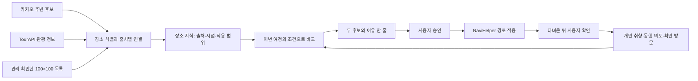

# 다녀왔습니다: 100×100과 외부 장소 정보 연계안

상태: **Draft**. [시나리오](SCENARIOS.md)와 [지식 모델 제안](../../spikes/grandma-journey-context/docs/PRODUCT-AND-KNOWLEDGE.md)의 외부 장소 연계안이다. 외부 API 호출·데이터 수입·제휴는 하지 않았다.

## 1. 서비스가 소유해야 할 전문성

**‘유명한 곳’을 전달하는 데서 끝나지 않고, ‘이번 동행과 여정에서 왜 들를 만한가’를 설명한다.**

| 정보 층 | 제공하는 가치 | 이것만으로 말할 수 없는 것 |
|---|---|---|
| 100×100 등의 큐레이션 | 주제와 장소의 연결, 새로운 방문 동기 | 실시간 영업·한산함·접근성·개인별 적합성 |
| 장소 검색·관광 정보 | 장소 식별, 주소·좌표·분류, 제공되는 설명과 사진 | 사용자의 실제 방문, 동행자의 취향, 정확한 우회 시간 |
| 자체 검수한 여정 정보 | 주차 후 입구까지 이동, 계단·경사, 체류 방식 등 확인한 조건 | 한 번의 관찰을 모든 시간대의 사실로 일반화 |
| 개인 기억과 명시한 선호 | 누구와 언제 방문했는지, 다음에 하고 싶은 일 | 방문만으로 호감·만족도·이번 실제 동행 추정 |

초기에는 한 권역의 장소를 깊게 연결한다. 모든 카페의 감성 태그를 생성하는 것보다, 확인할 수 있는 조건과 모르는 조건을 분리하는 데 집중한다.

## 2. 데이터 제공처별 채용안

| 제공처 | 확인된 기능 | 우선 채용 범위 | 확인할 제한 |
|---|---|---|---|
| 카카오 Local | 좌표·반경·분류·키워드 검색, ID·주소·좌표·상세 링크 | 목적지 주변 음식점(FD6)·카페(CE7) 후보 확보 | REST API 키·쿼터·이용 조건. 기본 검색 응답에 조용함·주차 편의·전체 리뷰·실시간 영업을 기대하지 않음 |
| TourAPI 국문 관광정보 | 위치·키워드 검색, 관광지·음식점, 소개·이미지·변경 정보 | 여행지 설명과 관광 콘텐츠 보강, 관광 명소 후보 | 서비스키·제공 필드의 누락·사진별 공공누리 조건. 100×100 선정 정보 제공 여부는 별도 미확인 |
| 100×100 | 공식 소개에서 주제별 선정 결과와 지도 공개를 확인 | 주제별 발견 목록과 추천의 출처. 제공 경로 확보 후 연결 | 공개 개발자 API·공식 파일·선정 판본·TourAPI ID 매핑·재사용 범위를 확인하지 못함(GRD-Q23) |
| 네이버 지역 검색 | 검색어 기반 업체 조회, 요청당 최대 5개 결과 | 특정 상호·지역을 찾는 보조 후보 | 광범위한 주변 전체 목록이나 리뷰 원문 API로 취급하지 않음. 첫 실험의 필수 의존에서는 제외 제안 |

먼저 **카카오 Local + TourAPI**를 붙이고, 100×100은 별도 입력 어댑터로 둔다. 데이터 공급이 지연돼도 개인 기억 기반 기본 추천이 막히지 않게 한다. 외부 API 사용 가능성과 개별 서비스의 데이터 재사용 조건은 서로 다른 확인 사항이다.

## 3. 100×100을 받아오는 순서

1. 공식 운영 주체에 API 또는 내려받기 파일 제공 여부와 이용 조건을 확인한다. 장소명·주소·좌표·주제·선정 연도/판본·출처 URL·식별자·갱신 방식이 필요한 항목이다.
2. TourAPI의 `contentId`와 연결되는 목록인지 확인한다. 같은 기관이 운영한다는 이유로 데이터셋·식별자가 같다고 가정하지 않는다.
3. 공식 파일 제공이 가능하면 판본을 가진 입력 데이터로 수입하고, 변경·누락·중복을 검수한다. 전용 API가 없어도 이 경로로 연계할 수 있다.
4. 제공 경로·재사용 범위가 불명확하면 목록·이미지를 복제하지 않는다. 원문 링크를 안내하는 수준으로 두고, 목업은 명확히 표시한 독립 예시 데이터로 진행한다. 내부 웹 API를 발견하더라도 공개 개발 API나 재사용 허가로 간주하지 않는다.

‘100×100 추천’보다 정확한 주제와 판본을 밝히는 ‘100×100의 ○○ 주제에 선정된 곳’ 표현을 검토한다. 전국 종합 순위·맛 보증·우리 앱의 인증으로 바꾸지 않는다. 주제 간 순위는 서로 비교 가능한 점수라고 가정하지 않는다.

## 4. 수집부터 추천까지

- 외부 요청에는 검색에 필요한 중심 좌표·분류·검색어만 전달하는 설계다. 가족 이름·과거 동행·방문 메모를 장소 검색 사업자에게 보내지 않는다. 개인화는 앱의 허용된 개인 데이터 영역에서 수행한다.
- 키가 필요한 공급자 호출과 사용량 관리는 서버 어댑터에서 맡긴다. 단일 HTML에 비밀키를 넣지 않는다. 사용자 식별·동기화 서버 도입까지 자동으로 확정하는 것은 아니다.
- GRD-005의 승인 전 외부 전송 금지와 정합성을 위해, ‘주변 검색 요청에 필요한 외부 조회 동의’와 내비·공유 승인을 구분하는 안을 GRD-Q10·Q5에서 검토한다. 검색 동의를 가족에게 기록 공유하는 승인으로 확장하지 않는다.
- 출처별 허용 캐시 기간·표시/지도 결합 조건·삭제 요청을 어댑터 정책으로 둔다. 허용이 불명확한 응답은 장기 지식 저장소에 축적하지 않는다.
- 한 공급자의 실패가 전체 결과·개인 기록을 지우지 않도록 한다. 기존 자료를 쓸 수 있으면 조회 시각과 오래된 정보임을 표시하고, 사용할 수 없으면 원문 확인 또는 장소 직접 선택으로 전환한다.

## 5. 같은 장소를 연결하는 기준

내부 `placeId`에 외부 식별자를 출처별로 연결한다. 상호 이름 하나로 합치지 않는다.

| 단계 | 처리 |
|---|---|
| 1 | 제공자가 동일한 식별자·공식 매핑을 주면 우선 활용하되 폐업·이전·지점 변경을 확인 |
| 2 | 공식 매핑이 없으면 정규화한 상호·지점명·주소·좌표·전화번호 중 제공되는 항목으로 일치 후보 생성 |
| 3 | 같은 건물의 여러 가게, 체인점, 관광지와 내부 카페, 공원과 입구처럼 경계가 다르면 자동 병합하지 않음 |
| 4 | 불확실한 후보는 검수 또는 사용자 선택을 거쳐 연결. 매칭 근거와 수정 이력 보존 |
| 5 | 오매칭을 분리해도 원래 개인 방문은 삭제하지 않음. 어느 장소의 방문인지 재확인하고 스탬프·질문 재계산 |

거리 임계값 하나로 동일성을 정하지 않는다. 실제 권역 데이터로 오매칭을 살펴본 뒤 기준을 정한다(GRD-Q24). 원문 연결이 끊겼다고 동일 장소의 개인 기억을 잃지 않도록 하되, 보관 가능한 외부 필드 범위는 제공 조건에 따른다.

HTML 목업은 가상 장소 ID만 쓴다. 이 절의 기준은 구현하지 않은 제안이다.

## 6. 그래프에 넣을 것과 구분할 것

아래는 제안 스키마다. 초기에는 관계형 DB나 JSON으로 구현해도 된다.

| 개체 | 최소 필드 | 규칙 |
|---|---|---|
| Place | internalId, name, branch, location | 좌표계·위경도 순서와 장소 범위 명시 |
| ExternalPlaceRef | placeId, provider, externalId, url, matchState, matchedAt | 출처별 ID 구분, 미확정 매칭으로 개인 기억 노출 금지 |
| CurationMembership | placeId, collection, topic, edition, sourceUrl, verifiedAt | 주제별 선정 사실. 장소의 영구 속성·평점으로 변환하지 않음 |
| PlaceAssertion | placeId, predicate, value, source, observedAt, retrievedAt, validUntil, verificationState, scope | 실제 확인 시점과 API 조회 시점 구분. 유효기간은 출처와 속성별 정책으로 설정 |
| Visit | visitId, owner, placeId, visitedAt, actualCompanions, note, useForRecommendation | 사용자 확인 경험. 여러 방문과 실제 동행을 유지 |
| TripIntent | tripId, destination, plannedCompanions, constraints | 이번 여정 의도. 실제 동행·방문과 별개 |
| SourcePolicy | provider, attribution, allowedFields, cacheRule, termsCheckedAt | 저장·표시·삭제에 적용. 정책 미확정 데이터의 영구 복제 금지 |

관계 예: `Place → SELECTED_IN → Topic/Edition`, `Person → PREFERS → Topic`, `Visit → AT_PLACE → Place`, `Visit → WITH_PERSON → Person`.

100×100 선정과 ‘바다 전망’, ‘주차 편함’은 서로 다른 주장이다. 방문 한 번에서 ‘조용했다’고 남긴 메모도 모든 사람에게 적용되는 장소 사실로 승격하지 않는다. 개인 경험은 본인의 추천 근거로만 우선 사용한다.

## 7. 추천 규칙 제안

1. **탐색 범위:** 목적지 주변인지 먼저 확인한다. 현재 위치 주변과 구별한다. 반경 거리와 도로 이동 시간은 다르다.
2. **필수 조건:** 사용자가 반드시 필요하다고 한 조건은 확인 가능한 자료로 평가한다. 미확인을 만족으로 처리하지 않고 별도 대안·확인 필요 후보로 둔다.
3. **선호 조건:** 직접 선택한 취향·이번 동행자의 확인된 선호·여행 주제의 관련성을 반영한다. ‘어머니’라는 관계명만으로 걷기 제약을 생성하지 않는다.
4. **기억과 발견:** 과거 방문은 기록과 이유로 보여준다. 재방문과 새 장소 중 어느 쪽을 우선할지는 사용자 선택에 따른다. 방문을 호감으로 간주하지 않는다.
5. **중복과 다양성:** 같은 장소의 여러 출처를 하나로 묶고, 목적에 맞으면 서로 다른 두 후보를 보여준다. 동일 체인·같은 유형만 반복하는지 검토한다.
6. **설명:** 정렬에 실제로 사용한 근거만 한 줄로 고른다. 100×100 선정, 직접 고른 취향, 내 방문 기록의 출처를 상세에서 구분한다.

NaviHelper 경로 변경 API를 후보별 이동 시간 조회 용도로 사용하지 않는다. 별도 경로 조회 서비스가 확보되지 않으면 거리 또는 ‘이동 시간 미확인’까지만 표시한다. 목업의 ‘약 몇 분’은 가상 예시다. 영업시간 자료가 있어도 최신 임시 휴무까지 확인한 것은 아니다.

## 8. 한 권역 실험과 평가

| 단계 | 산출물 | 통과 기준 |
|---|---|---|
| 외부 후보 | 카카오·TourAPI의 허용된 응답 표본과 출처 정책 | 실제 키는 저장소 밖에서 관리. 목적지 좌표·카테고리·오류·빈 결과 처리 확인 |
| 장소 연결 | 서로 다른 출처 간 일치/불일치 사례 | 같은 이름의 다른 지점·관광지 내부 업소가 무작정 합쳐지지 않음 |
| 큐레이션 결합 | 이용 조건이 확인된 주제 목록 또는 명시한 시연 목록 | 실제 선정과 예시를 섞지 않음. 판본·출처 없는 선정 배지 없음 |
| 개인화 비교 | 같은 목적지에서 함께/혼자/미정/새로운 곳 우선 결과 | 바뀐 순서와 이유를 사용한 근거까지 추적 가능 |
| 운영 실패 | 만료·출처 충돌·API 장애·오매칭 정정 | 미확인을 사실로 표시하지 않음. 계획·개인 방문을 보존 |

장소 연결 정확도, 필수 조건의 확인 가능 비율, 근거 있는 추천 비율, 사용자가 선택한 이유를 관찰한다. 만족도나 MAU 향상을 측정한 것처럼 수치를 제시하지 않는다. 공식 선정 여부·출처 정확성은 장소 추천의 품질과 별도로 확인한다.

## 9. 근거와 미결정

공식 문서 확인일: 2026-11-14. 서비스 호출·키 발급·제휴·필드 수집은 검증하지 않았다.

- [100×100 공식 소개](https://www.korean-culture.org/koreanet/view.do?seq=1055494): 주제별 선정·지도 공개의 근거. API·재사용 허가의 근거는 아님.
- [100×100 사이트](https://spot100x100.kr/): 공개 API를 확인하지 못함. ‘API가 없다’고 단정하지 않음.
- [카카오 Local 개발 가이드](https://developers.kakao.com/docs/ko/local/dev-guide).
- [TourAPI 국문 관광정보](https://www.data.go.kr/data/15101578/openapi.do): 제공 데이터에 사진별 공공누리 유형 등 조건이 있음.
- [네이버 지역 검색](https://developers.naver.com/docs/serviceapi/search/local/local.md).
- [미결정 질문](OPEN_QUESTIONS.md): GRD-Q5·Q10·Q18·Q19·Q23~Q26.
