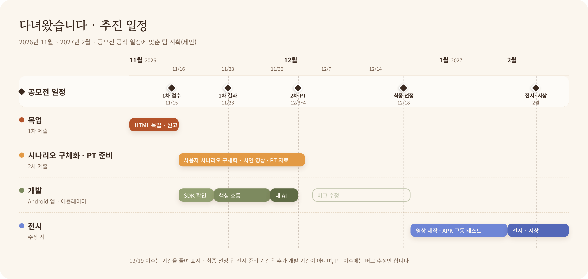

# PROPOSAL: 다녀왔습니다

앱명 / 프로젝트명: 다녀왔습니다

## 1. 앱 한 줄 소개

**"다음에 같이 가자, 그 말이 잊히지 않도록"**

가족과 나눈 "다음에"를 한 올씩 이어, "다녀왔습니다"로 매듭짓는 차 안의 동행 앱입니다. 정차한 자리에서 한마디로 약속을 남기면, 출발 준비와 함께 탈 사람 확인, 다녀온 기록까지 차가 곁에서 이어 줍니다.

## 2. 기획 배경 `[창의]`

가족과 차로 다니다 보면 "다음에 저기 같이 가자"는 말이 자주 나옵니다. 하지만 운전 중에는 적어 둘 수 없고, 차에서 내리면 금방 잊힙니다.

적어 두더라도 흩어집니다. 가 보고 싶다던 곳은 채팅방에, 가능한 날짜는 캘린더에, 함께 찍은 사진은 사진첩에 남습니다. 내비게이션에는 주소만 남고, 누구와 왜 가려 했는지는 남지 않습니다. 그러다 보니 약속은 미뤄지고, 함께 다녀온 기억도 다음 만남으로 이어지지 않습니다.

그래서 주소 대신 누구와, 왜 가려 했는지를 기억하고, 그 약속을 출발부터 귀가까지 이어 주는 앱을 차 안에 두기로 했습니다. 지도와 내비게이션이 "어디로"를 기억한다면, "다녀왔습니다"는 "누구와, 왜"를 기억하고 그 약속이 실제 하루가 될 때까지 함께 갑니다.

더 나아가 "다녀왔습니다"는 운전자와 그 가족을 알아 갑니다. 누구와 어디에 다녀왔는지, 그날 남긴 한마디와 운전자가 허락한 취향이 쌓일수록 "이번에는 어디가 좋을까"에 더 잘 답할 수 있습니다. 같은 바닷가라도 할머니와 갈 때와 아이와 갈 때 들를 곳이 달라지듯, 이번에 함께 가는 사람과 그날의 마음에 맞춘 곳을 이유와 함께 먼저 건넵니다.

## 3. 앱 주요 기능 및 차량 특화 요소 `[차량특화]` `[창의]`

약속이 생기는 순간부터 다녀온 뒤의 기록까지를 한 흐름으로 잇고, 각 순간에 차량이 알고 있는 것을 씁니다.

| 기능 | 설명 |
|---|---|
| 다음 약속 남기기 | 정차한 자리에서 마이크를 누르고 "할머니랑 다음에 여기 오자"고 말하면, 지금 위치 근처의 장소를 보여 주고 고른 곳을 '할머니와 다음에 갈 곳'으로 저장합니다. 마이크는 운전자가 직접 눌렀을 때만 켜집니다. |
| 여정 계획과 승인 | 날짜를 정하면 누구와, 어디를, 어떤 순서로 갈지 초안을 만들고, 날씨와 장소 정보도 함께 챙깁니다. 모르는 정보는 "미확인"으로 두고, 경로 적용이나 외부 전송은 하나씩 따로 물어 승인한 것만 실행합니다. |
| 출발 준비 | 출발 전에 차의 연료·배터리 잔량과 날씨를 다시 확인하고, 필요하면 주유소 같은 경유지를 제안합니다. 잔량만 보고 도착할 수 있다고 단정하지는 않습니다. |
| 내비게이션 연결 | 승인한 목적지와 경유지를 다시 입력하지 않고 차량 내비게이션에 바로 넣습니다. 제대로 들어갔는지 확인하고, 실패하면 알려 줍니다. |
| 동행 확인 | 할머니 댁 앞에서 문이 열렸다 닫히면 "할머니와 함께 출발하시나요?"라고 묻습니다. 문을 여닫았다고 해서 바로 함께 탄 것으로 치지 않고, 운전자가 "네"라고 답해야 할머니와 함께 출발한 것으로 남깁니다. |
| 다녀옴 기록 | 주차한 뒤 다녀온 곳을 확인하고 한마디를 말로 남기면 약속이 완료됩니다. 장소와 날짜는 차량 기록으로, 함께한 사람은 출발 때 운전자가 답한 동행으로 미리 채워 두어 틀린 것만 고치면 됩니다. 운전자가 확인한 방문만 저장하고, 기록에 없는 대화나 감정은 지어 넣지 않습니다. |
| 다시 가는 곳의 동행 확인 | 다녀온 곳을 다시 고르면 지난번 함께한 사람을 근거로 "이번에도 함께 가시나요?"라고 묻고, 답에 따라 들를 곳과 추천 이유가 달라집니다. "혼자"라고 답하면 지난 동행자의 취향은 빼고 추천합니다. |
| 내 AI와 함께 고르는 들를 곳 | 평소 쓰는 Claude, ChatGPT, Gemini를 휴대폰에서 연결하면, 관광 정보와 대한민국 명소발굴 (100×100) 추천지, 우리 가족 기록 가운데에서 이번 동행에 맞는 두 곳을 골라 줍니다. "어머니가 따뜻한 차를 좋아하셔"처럼 정차 중에 한마디로 다시 물을 수 있고, 달리는 동안에는 출발 전에 정리한 결과만 음성 한 줄로 알려 줍니다. |

가족이 앱을 설치하지 않고 공유 페이지에서 날짜와 장소 후보를 고르는 기능은 다음 단계에서 만듭니다.

**차량에서 만나는 새로운 경험**

- **멈춘 자리에서 약속이 생깁니다.** 잠시 선 그 자리에서 한마디만 하면, 지금 있는 곳이 '다음에 같이 갈 곳'이 됩니다.
- **약속한 날에는 차가 먼저 준비합니다.** 오늘 갈 곳과 필요한 경유지를 챙기고, 승인한 길은 다시 입력하지 않아도 내비게이션으로 이어집니다.
- **문 앞에서 차가 "함께 가시나요?"라고 묻습니다.** 운전자가 답하면 함께 가는 사람이 화면에 함께 표시되고, 같은 곳에 다시 갈 때는 지난번 동행을 기억해 묻습니다.
- **달리는 동안에는 목소리로 함께합니다.** 화면에는 남은 시간만 남고, 약속을 떠올리게 하는 안내 한 줄이 들립니다.
- **집에 돌아오면 하루가 기록으로 남습니다.** 미리 채워진 기록에 한마디만 더하면 약속이 완료되고, 다음 약속으로 이어집니다.

화면 위쪽의 실 한 줄에는 다녀온 곳, 오늘의 동행, 아직 가지 않은 약속이 함께 걸려, 기억이 다음 약속으로 이어지는 모습을 한눈에 보여 줍니다. 입력은 대부분 말로 하고, 운전자는 앱이 알아들은 내용 가운데 틀린 것만 고칩니다. 지금의 화면 목업은 실제 SDK에 연결하기 전이라 차량 상태를 시연 도구로 바꿔 보여 줍니다.

## 4. 주요 사용 시나리오 `[차량특화]`

**"이번 일요일, 할머니와 바다 카페"**

할머니를 모시고 바다 카페에 다녀오는 손주의 하루를 따라가며 앱을 쓰는 흐름을 소개합니다. 지난 외출 때 카페 앞에 잠시 섰을 때 할머니가 "저기 한번 가 보고 싶다"고 하셨고, 이번 일요일에 그 약속을 지키러 갑니다. 집에서 출발해 할머니 댁에 들렀다가 바다 카페를 거쳐 다시 집으로 돌아오는 길입니다.

| 장면 | 차량 상태 | 사용자가 하는 것과 앱이 하는 것 |
|---|---|---|
| 1. 기억 | 정차 | 지난 외출 때 카페 앞에 선 운전자가 마이크를 누르고 "할머니가 저 카페 가 보고 싶대"라고 말합니다. 앱이 근처 장소를 보여 주고, 운전자가 바다 카페와 할머니를 고르면 약속으로 저장됩니다. |
| 2. 계획과 승인 | 정차 | 약속에서 여정을 만들고 일요일 10:30을 고릅니다. 앱은 동선 초안과 날씨·장소 정보를 함께 보여 줍니다. 운전자는 실행될 일을 하나씩 확인하고 계획을 확정합니다. |
| 3. 출발 | 정차 | 일요일에 집에서 앱을 열면 홈에 오늘 여정이 보입니다. 연료나 배터리와 날씨를 다시 확인하고, 필요하면 경유지를 넣습니다. 운전자가 승인하면 집 → 할머니 댁 경로가 내비게이션에 들어가고, 결과를 알려 줍니다. |
| 4. 할머니 댁으로 | 주행 | 화면에는 다음 목적지와 안내 한 줄만 남고, "할머니 댁까지 20분"처럼 음성으로 알려 줍니다. 운전자는 화면을 누르지 않습니다. |
| 5. 함께 출발 | 정차 | 할머니 댁 앞에서 문이 열렸다 닫히면 "할머니와 함께 출발하시나요?"라고 묻습니다. [네]를 누르면 할머니의 빛이 켜지고 할머니 댁 → 바다 카페 경로가 들어갑니다. 문만 열고 닫았거나 답이 없으면 탑승으로 보지 않습니다. |
| 6. 바다 카페로 | 주행 | "바다 카페까지 25분. 할머니가 가 보고 싶다고 하신 곳이에요."처럼 남은 시간과 약속을 음성으로 알려 줍니다. |
| 7. 다녀옴 | 주차 | 집에 돌아와 주차하면 홈에서 "바다 카페에 다녀오셨나요?"라고 묻습니다. 운전자가 확인하고 한마디를 남기면 약속이 완료되고, 꼬리표가 사진으로 바뀌며 실에 매듭이 지어집니다. 다음 약속도 이어서 남길 수 있습니다. |

**같은 곳에 다시 가는 날**

다녀온 기록은 다음 외출로 이어집니다. 이번에는 지난달 어머니와 다녀온, 바다가 보이는 북카페 "파도 서가"에 다시 가는 날입니다.

| 단계 | 사용자가 하는 것과 앱이 하는 것 |
|---|---|
| 1. 같은 곳 다시 고르기 | 파도 서가를 다시 목적지로 고르면, 지난 방문 기록을 근거로 "이번에도 어머니와 함께 가시나요?"라고 묻습니다. |
| 2. 이번 동행 답하기 | 운전자가 이번에 함께 가는 사람을 고릅니다. "혼자"라고 답하면 지난 동행자의 취향은 빼고 추천합니다. |
| 3. 들를 곳 고르기 | 답에 맞춰 목적지 근처에 들를 곳 두 곳을 보여 줍니다. 내 AI가 연결되어 있으면 AI가 우리 가족에게 맞는 곳을 골라 제안합니다. 고른 곳은 승인한 뒤에만 경로에 들어갑니다. |
| 4. 한마디로 이어 묻기 | "어머니가 따뜻한 차를 좋아하셔"라고 말하면 AI가 그 취향에 맞는 곳을 먼저 다시 고릅니다. 이어서 "이 취향을 어머니 기억에 남길까요?"라고 묻고, 운전자가 허락할 때만 남깁니다. |
| 5. 다녀온 뒤 | 운전자가 방문을 확인하면 실에 새 사진이 걸리고, 다음 약속을 남길 빈 꼬리표가 생깁니다. |

잘못 판단하지 않는 장면도 함께 보여 줍니다. 문만 열고 닫거나, 좌석에 짐을 올리거나, 경로만 찾아본 경우는 탑승, 동행, 출발로 보지 않습니다. 근처에 잠깐 선 것만으로 다녀왔다고 기록하지도 않습니다. 네트워크가 끊겨도 확정한 계획과 기록은 그대로 남습니다.

## 5. 개발 계획 `[기술]`

**목업**

대표 시나리오(기억 → 계획과 승인 → 출발 → 할머니 댁으로 → 함께 출발 → 바다 카페로 → 다녀옴)와 같은 곳에 다시 가는 날까지, 차량 화면 비율의 HTML 목업으로 직접 눌러 볼 수 있게 만들었습니다. 차량 상태는 화면 밖 시연 도구로 바꾸고, 장소·차량 신호·내 AI의 답은 미리 준비한 시연 데이터입니다.

**개발**

Pleos Connect에서 동작하는 Android 앱으로 만들고, 공모전 요건(minSdk 28 이상, Gradle 8.0 이상, Java 또는 Kotlin)에 맞춰 Pleos Connect Emulator v2.1.0에서 시연합니다. 기억, 약속, 방문 기록은 차량 기기에 저장하고, 밖으로는 장소·날씨 조회에 필요한 위치와 검색어, 운전자가 승인한 공유, 연결한 AI에 보내는 최소 조건만 나갑니다. 날씨와 장소 검색이 실패하면 "미확인"으로 표시하고 운전자가 직접 계획을 이어 갑니다.

**Pleos SDK 활용 계획**

아래 표는 공식 문서에서 제공 여부를 확인한 API의 활용 계획입니다. 실제 신호 수신과 권한 동작은 개발 초반에 에뮬레이터로 확인합니다.

| SDK와 제공 정보 | 서비스에서 활용하는 방법 | 적용 시 고려 사항 |
|---|---|---|
| SpeechToText (음성 인식) | 정차 중 한마디로 약속을 남기고, 다녀온 뒤의 한마디를 기록합니다. | 마이크는 운전자가 누를 때만 켭니다. 인식이 어려우면 글이나 선택지로 입력합니다. |
| FusedLocation (차량 위치) | 멈춘 자리 근처의 장소 후보를 찾고, 다녀온 곳의 기록을 돕습니다. | 위치 권한은 실행 중 동의가 필요합니다. 거부하면 장소를 직접 고르고 기록은 선택 입력으로 남깁니다. |
| Vehicle Fuel / EvBattery (연료·배터리 상태) | 출발 전 잔량을 확인해 주유소 같은 경유지를 제안합니다. | 잔량만으로 도착할 수 있는지 단정하지 않습니다. |
| NaviHelper (목적지와 경유지) | 승인한 목적지와 경유지를 내비게이션에 넣고, 다시 가는 날에는 고른 목적지를 읽습니다. | 승인한 뒤에만 적용하고 결과를 확인합니다. 후보를 찾으려고 경로 요청을 반복하지 않습니다. |
| Vehicle Door (도어 열림·닫힘) | 할머니 댁 앞에서 동행을 물을 때를 정합니다. | 문이 열린 것만으로 탑승을 판단하지 않습니다. |
| Vehicle Seat (좌석 점유) | 동행 확인을 돕는 보조 신호로 씁니다. | 값의 의미를 확인한 뒤에 쓰며, 쓸 수 없으면 운전자가 동행자를 직접 고릅니다. |
| TextToSpeech (음성 합성) | 주행 중 다음 목적지까지 남은 시간과 약속을 한 줄로 알려 줍니다. | 주행 중에는 화면 대신 이 안내만 씁니다. |

장면별 API 흐름, 신호가 없을 때의 동작, 선언할 퍼미션 전체는 7번 참고자료의 "Pleos SDK 활용 맵"에 있습니다.

**AAOS 표준 API 보완 활용 계획**

Pleos Connect의 기반인 Android Automotive OS의 표준 API는 주행 중 화면 제한과 정차·주차 확인에 보조로 쓸 계획입니다. 공모전에서의 사용 가능 여부를 확인한 뒤 적용합니다.

| API와 제공 정보 | 서비스에서 활용하는 방법 | 적용 시 고려 사항 |
|---|---|---|
| CarUxRestrictionsManager (주행 중 화면 사용 제한) | 플랫폼의 주행 규제를 입력 허용 여부에 반영합니다. | 주행 중 화면과 조작 허용을 플랫폼 제한에 맞춥니다. |
| CarPropertyManager: 기어와 주차 브레이크 (`GEAR_SELECTION`, `PARKING_BRAKE_ON`) | 정차·주차를 확인해 기억 남기기, 여정 계획, 다녀옴 기록 같은 조작을 여는 기준으로 씁니다. | 판단할 수 없으면 입력을 막고, 주행 거리 변화만으로 주차를 판단하지 않습니다. |

**내 AI 연동**

Pleos LLM SDK는 공모전 기간에 제공되지 않으므로, 운전자가 연결한 Claude, ChatGPT, Gemini 같은 외부 AI의 API를 씁니다. 앱이 목적지 근처의 관광 정보, 이용 조건이 확인된 대한민국 명소발굴 (100×100) 선정지, 활용을 허락한 가족 기록을 모아 후보를 만들고, 운전자가 고른 조건을 "조용한 분위기 · 오래 걷지 않기" 같은 태그로 정리해 함께 보냅니다. AI는 그 후보 안에서 두 곳과 이유, 근거, 확인하지 못한 조건을 돌려주고, 앱은 후보 밖 장소나 근거 없는 문장을 걸러 낸 뒤 보여 줍니다. 가족 이름, 남긴 한마디 원문, 집 주소, 실제 경로, 음성 오디오는 보내지 않습니다. 연결은 사용자가 발급한 API 키를 휴대폰에서 등록하는 방식이고, 키는 차량 기기의 암호화 저장소에 둡니다. AI는 차가 멈춰 있을 때만 부르며, 연결되지 않았거나 응답이 실패하면 기본 추천으로 동작합니다.

## 6. 기대효과 및 발전 가능성 `[사업]`

**기대 효과**

"다녀왔습니다"를 쓰는 가족에게 가장 큰 변화는 흘려보내던 "다음에"가 실제로 함께 다녀온 하루가 된다는 것입니다. 운전자는 약속을 따로 기억하거나 목적지를 다시 입력하지 않아도 되고, 출발 준비와 길 안내, 함께 탈 사람 확인까지 차가 이어 주니 약속을 지키는 데 드는 수고가 줄어듭니다. 함께 다녀온 곳은 그날 남긴 한마디와 함께 차곡차곡 쌓여 가족이 다시 꺼내 볼 이야기가 되고, 그 기록은 곧 다음 약속의 시작이 됩니다. 쌓인 기억은 같은 곳을 다시 찾을 때 "이번에도 함께 가시나요?"라는 질문과 우리 가족에게 맞는 추천으로 돌아오므로, 쓸수록 우리 가족을 더 잘 아는 차가 됩니다.

**발전 가능성**

"다녀왔습니다"는 장소를 많이 아는 앱보다 우리 가족을 잘 아는 앱으로 자라려 합니다. 지금은 연결한 AI가 들를 곳 두 곳을 고르는 데서 멈추지만, 가족의 기억이 쌓일수록 하루 전체를 함께 설계할 수 있습니다. 운전자가 "오래 걷기 힘들다"고 말한 날에는 쉬어 갈 곳을 끼워 넣고, 비 소식이 있으면 실내에서 머물 곳으로 동선을 다시 짜며, 허락받아 남긴 취향을 바탕으로 다음에 가 볼 만한 곳을 먼저 건넵니다.

같은 흐름은 명절 귀성, 공항 배웅, 가족 여행처럼 더 큰 여정으로 이어집니다. 가족이 앱을 설치하지 않고도 공유 페이지에서 날짜와 후보를 고르고 다녀온 기록을 함께 나누면, 운전자 한 사람의 약속이 온 가족이 함께 만드는 여정이 됩니다.

가족이 함께 갈 곳을 잇는 서비스인 만큼 지역과의 협력도 자연스럽습니다. 대한민국 명소발굴 (100×100)을 운영하는 기관이나 지자체와 가족 방문 캠페인을 만들고, 제휴를 통해 추천 선택지를 더하는 방식으로 수익을 낼 수 있습니다.

## 7. 참고자료 (선택 · 가산점 부여)

- GitHub 저장소: [다녀왔습니다 프로젝트](https://github.com/CyberFlower/htf-jaemin-I/tree/main/projects/grandma)
- HTML 목업: [HTML 파일](https://github.com/CyberFlower/htf-jaemin-I/blob/main/spikes/grandma-journey-context/journey-demo.html). 저장소를 내려받아 `spikes/grandma-journey-context/journey-demo.html`을 Chrome 또는 Edge에서 열면 조작할 수 있습니다. 주소 끝에 `#SC-01`~`#SC-08`을 붙이면 장면을 바로 엽니다. 차량 상태는 화면 오른쪽 시연 도구로 바꾸며, 장소와 차량 신호는 설명용 가상 데이터입니다.
- 앱 화면 시안: [장면 캡처 8장](https://github.com/CyberFlower/htf-jaemin-I/tree/main/projects/grandma/assets/scenes)
- 코어 시나리오 가이드: [SCENARIO.md](https://github.com/CyberFlower/htf-jaemin-I/blob/main/projects/grandma/SCENARIO.md)
- Pleos SDK 활용 맵: [SDK.md](https://github.com/CyberFlower/htf-jaemin-I/blob/main/projects/grandma/SDK.md)

같은 저장소에 다른 출품작 "내 차로 짓는 도시"도 함께 있으며, 이 앱의 목업은 `spikes/grandma-journey-context/`에 있습니다.

## 8. 숏폼 링크 (선택 · 가산점 없음)

제출하지 않음.
