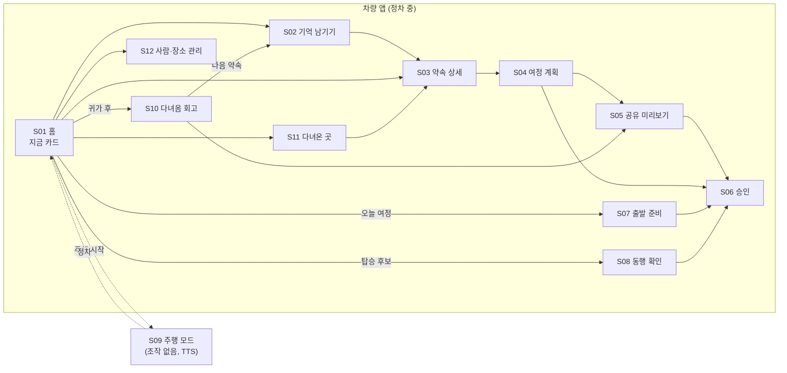

# USE CASES: 다녀왔습니다 (`GRD`)

> 상태: **Draft — 자료 추출 및 사용자 목적 설명을 반영한 보강안**. UC 분할과 단계 번호는 검토를 위한 정리이며 범위 확정이 아닙니다.
> 기준: [GOAL.md](GOAL.md), [REQUIREMENTS.md](REQUIREMENTS.md), [PROPOSAL.md](PROPOSAL.md), [원본 기획안 v0.1](../../draft/proposal-grandma.html).
> 보강 근거: 2026-11-13 사용자의 설명 — 사용자 context를 증강하고, 이를 바탕으로 여정에 가치 있는 정보를 전달하는 앱. 아래 맥락 활용·피드백의 상세 동작은 이 목적을 구체화한 제안이며 기존 FR의 확정 기능이 아닙니다.
> 형식: [공통 UC·FR 템플릿](../../docs/process/templates/README.md). 원본보다 Goal·현재 FR을 우선하며, 문서에 없는 실패·취소 정책은 질문으로 남깁니다.

> 설명 자료: [대표 시나리오와 시연 순서](SCENARIOS.md), [API 채용안](API-ADOPTION.md), [외부 장소 연계안](PLACE-INTEGRATION.md). 현재 HTML은 S04 주변 추천·S10 기록의 일부를 실험하며, 아래 홈 전체 흐름을 구현한 것은 아닙니다.

## 앱의 중심 경험: 맥락이 다음 안내를 바꾼다

**사용자가 남긴 기억·의도와 현재 상황을 연결해 맥락을 풍부하게 하고, 그 맥락을 사용자가 여정에서 판단하고 행동하는 데 도움이 되는 정보로 돌려준다.**

가족 동행은 이 가치를 설명하는 현재 대표 시나리오입니다. 사용자가 말한 제품 목적을 더 넓은 여정에 적용할 범위는 GRD-Q16에서 검토합니다.

| 단계 | 사용자가 얻는 가치 | 연결 UC |
|---|---|---|
| 맥락 축적 | 단순 장소에 누구와 왜 가려 했는지, 어떤 기억·약속이 있는지 연결한다 | 001·002·008 |
| 현재 여정 이해 | 과거 약속에 오늘의 일정·가족 응답·실제 동행자·차량 상태를 결합한다 | 003·004·005·006 |
| 가치 있는 정보 전달 | 지금 이 여정에 필요한 기억·준비 정보·선택지를 이유와 함께 받는다 | **011 (중심 경험 보강 제안)** |
| 사용자 판단과 실행 | 받은 정보를 바탕으로 계획·경로·설정을 선택하고 승인한다 | 003·005·007 |
| 결과로 맥락 갱신 | 확인한 방문·회고·다음 약속이 이후 안내에 다시 쓰인다 | 008 → 002·011 |
| 필요한 사람과 공유 | 사용자 승인 범위에서 가족에게 계획·기억·출발 소식을 전달한다 | 004·009·010 |

맥락은 정보를 많이 모았다는 뜻이 아닙니다. **어떤 사용자 정보가 어떤 현재 상황과 연결되어, 전달할 정보가 어떻게 달라지는지**를 각 UC에서 확인합니다. 아래 `맥락과 사용자 가치`는 이 관점의 설계 제안입니다. 기존 FR만으로 지원되는 부분과 새로 정의할 부분을 구분합니다.

예: 사용자가 “할머니와 이 카페에 가고 싶다”고 확인해 저장한 약속에 오늘의 동행자·날씨·장소 정보를 결합합니다. 앱은 그 장소가 이번 여정에 관련된 이유와 확인된 준비 정보를 함께 제시하고 사용자가 계획을 판단하도록 돕습니다. 다음 방문에서는 사용자가 확인한 실제 방문·완료 상태를 반영하는 흐름을 제안합니다. 장소 평가·취향을 임의로 추정하지 않습니다.

## 독립 개발사 앱의 차별화 가설

**사람·장소·약속의 기억을 차량에 종속시키지 않고 이어 가며, 현재 여정에 맞는 질문과 정보로 돌려준다.** 이 차별화는 제품 설계 가설이며, 제조사가 구현할 수 없다는 주장이나 경쟁 제품 조사 결과가 아닙니다.

| 사용자가 체감할 차이 | UC에서 보여줄 장면 | 범위 |
|---|---|---|
| 나의 과거 경험이 이번 여정을 이해하는 질문이 됨 | 같은 장소의 방문 기억을 근거로 동행 의도를 묻고 답에 따라 안내가 달라짐 | UC-012 → 011: 중심 시나리오 보강 제안 |
| 차를 바꿔도 사람·장소의 기억을 다시 입력할 필요가 줄어듦 | 지원되는 다른 차량에서 본인의 기억을 이어 쓰되 현재 차량 상태는 새로 확인 | UC-013: 계정·저장·지원 환경 검토가 필요한 확장 |
| 내가 고친 기억이 다음 안내를 바로잡음 | 잘못 연결된 동행·방문 기억을 수정하거나 활용에서 제외 | UC-014 → 012·011: 맥락 품질 보강 제안 |

별도 설치 앱이므로 사용자가 앱을 열고 본인의 기억을 사용할 수 있는 환경을 기본으로 합니다. 차량의 전체 운행 이력, 제조사 계정, 다른 차량의 데이터, 내비 목적지 변경을 자동으로 읽을 수 있다고 가정하지 않습니다. 현재 앱에서 선택한 목적지·사용자 확인으로 시나리오를 시작할 수 있어야 합니다. 차량 신호가 없을 때도 기억과 질문의 가치를 보여주되 차량 제어·내비 실행은 실제 지원 범위에 한정합니다.

### 차별화를 검토할 대표 시나리오 (제안)

1. 이전 여정에서 사용자가 장소 P, 방문 시점, 당시 동행자와 실제로 남긴 다음 약속을 확인해 저장한다(UC-008 보강).
2. 이후 사용자가 앱에서 같은 장소 P를 다시 선택한다. 다른 지원 차량에서도 기억을 이어 쓰는 것은 UC-013의 확장 장면이다.
3. 앱이 “지난번에는 어머니와 함께 방문했던 곳이에요. 이번에도 함께하는 여정인가요?”라고 묻는다(UC-012). 질문할 과거 기록과 시점은 사용자가 확인할 수 있다.
4. “함께 갈 예정”이면 실제 저장된 동행 관련 약속과 현재 정보를 연결한다. “이번에는 혼자”라면 과거 동행자를 이번 여정에 적용하지 않는다. 무응답이면 미확인으로 둔다.
5. UC-011이 확인된 답을 바탕으로 관련 정보와 이유를 제공한다. 실제 탑승 확인은 UC-006, 실행은 별도 승인 흐름으로 이어진다.
6. 여정 후 확인한 실제 방문·동행 결과가 새 경험으로 남는다. 이번 답으로 과거 방문 기록을 덮어쓰지 않는다.

검토 증거: 같은 장소·다른 동행 답변에서 안내가 실제로 달라지는지, 잘못된 기억을 수정했을 때 후속 질문이 바로잡히는지, 차량 신호 없이도 기억 기반 정보가 도움이 되는지 확인합니다. 다른 차량에서의 연속성은 구현 지원이 확인된 환경 또는 명시한 목업으로 구분해 시연합니다.

## 화면 흐름 (제안)

> 상태: Draft. 아래 전제를 따릅니다.
> - 홈은 **앱이 열려 있을 때만** 여정 상태와 차량 신호에 반응합니다. 앱이 닫혀 있을 때 먼저 띄우는 알림은 GRD-Q17 이후로 미룹니다.
>
> 화면 ID(`S##`)는 이 문서 안에서만 쓰는 표기입니다.

### 접점

| 접점 | 누가 | 언제 | 할 수 있는 것 |
|---|---|---|---|
| 차량 앱 | 운전자 | 정차·주차 중 | 입력, 확인, 승인 |
| 주행 모드 (차량 앱) | 운전자, 동승자 | 주행 중 | 보기와 듣기(TTS)만. 조작하지 않음 |

차량 실행(경로, 공조)과 외부 전송의 승인은 차량 앱에서 합니다(GRD-005).

### 홈 (S01)

```text
┌ 다녀왔습니다 ──────────── 🅿 정차 중  ⚙ ┐
│ [지금 카드]                             │
│  오늘 10:30 할머니와 바다 카페          │
│  연료 40% · 맑음 (10:02 조회)           │
│  [준비 점검]   [경로 적용]              │
├─────────────────────────────────────────┤
│ 약속  ┌────────┐ ┌────────┐             │
│       │할머니  │ │엄마    │             │
│       │바다카페│ │꽃 시장 │  ...        │
│       └────────┘ └────────┘             │
├─────────────────────────────────────────┤
│ 🎙 기억 남기기              📖 다녀온 곳 │
└─────────────────────────────────────────┘
주행 중: 홈 대신 주행 모드(S09). 다음 목적지와 안내 한 줄만 크게 보여 주고, 버튼 없이 TTS로 안내
```

- **지금 카드:** 지금 할 일 한 장. 아래 규칙으로 고릅니다(GRD-UC-015).
- **약속 카드:** 사람 + 장소로 저장한 다음 약속(S03).
- **🎙 기억 남기기:** S02. **📖 다녀온 곳:** S11. **⚙:** 사람·장소 관리(S12).

### 지금 카드 규칙

위에서부터 먼저 맞는 카드 한 장만 보여 줍니다. 여정 상태는 GOAL의 `제안 → 조율 → 확정 → 준비 → 이동 → 회고`를 따릅니다.

| 순위 | 조건 (여정 상태 + 관측) | 카드 문구 예 | 버튼 | 이동 |
|---|---|---|---|---|
| 1 | 주행 중으로 판단했거나, 주행/정차를 판단할 수 없음 | (홈 대신 주행 모드) | 없음 | S09 · UC-015 E1~E2 |
| 2 | 정차 중이고 오늘 여정에 동행 예정자가 있으며, 도어 열림→닫힘을 관측함(좌석 신호는 지원할 때만) | "할머니와 함께 출발하시나요?" | [네] [아니요] [나중에] | S08 · UC-006 |
| 3 | 오늘 `확정`·`준비` 상태의 여정이 있음 | "오늘 10:30 할머니와 바다 카페 · 연료 40% · 맑음(10:02 조회)" | [준비 점검] [경로 적용] | S07 · UC-005 |
| 4 | `이동` 상태의 여정이 있고, 사용자가 여정을 끝냈거나 출발지 근처에 정차함(위치를 지원할 때) | "바다 카페에 다녀오셨나요?" | [기록하기] [나중에] | S10 · UC-008 |
| 5 | 위에 해당하는 것이 없음 | "할머니와 다음에 갈 곳: 바다 카페" 또는 "남길 기억이 있나요?" | [여정 만들기] 또는 [🎙] | S03 또는 S02 |

- 순위가 더 높은 카드가 생기면 바꿉니다. 사용자가 입력 중인 화면은 덮어쓰지 않습니다(UC-015 A2).
- 신호로 띄운 카드(2, 4)는 관측 근거를 함께 보여 줍니다. 탑승, 신원, 방문은 사용자 확인으로 정합니다(GRD-N02).
- 카드에 필요한 신호를 지원하지 않으면 그 카드를 띄우지 않습니다. 같은 작업은 약속 카드나 메뉴로 직접 들어갈 수 있습니다.
- 순위와 교체 규칙, 판단할 수 없을 때의 기본값은 GRD-Q22와 공통 Q8에서 정합니다.

### 화면 목록

| ID | 화면 | 진입 | 주요 행동 | UC·흐름 |
|---|---|---|---|---|
| S01 | 홈 | 앱 실행, 정차 | 지금 카드, 약속 카드, 기억 남기기, 다녀온 곳 | UC-015 |
| S02 | 기억 남기기 | S01 🎙, S10 다음 약속 | 음성·텍스트 입력 → 장소 후보 확인 → 함께 갈 사람 선택 → 저장 | UC-002 B1~B3, A1, E1~E2 |
| S03 | 약속 상세 | S01 약속 카드, S02 저장 후 | 사람·장소·남긴 말, 지난 방문 근거와 동행 의도 질문, 여정 만들기 | UC-001 B2; UC-012 B2~B3, A1, E2 |
| S04 | 여정 계획 | S03 | 날짜·동행·목적지·경유지 초안, 날씨·장소 정보(출처·조회 시각), 맥락 안내 | UC-003 B1~B2, A1; UC-011 B1~B4 |
| S05 | 공유 미리보기 | S04, S10 | 가족에게 보일 내용 확인 | UC-004 B1; UC-009 B1 |
| S06 | 승인 | S04, S05, S07, S08 | 경로·공조·전송을 각각 체크하고 승인하거나 거절 | GRD-005; UC-003 B3, E1; UC-004 B2; UC-005 B2; UC-007 B2, E1; UC-009 B2, E1 |
| S07 | 출발 준비 | S01 오늘 여정 카드 | 연료·배터리·날씨 갱신, 경유 제안, 경로 적용 결과 확인 | UC-005 B1~B3, A1, E1 |
| S08 | 동행 확인 | S01 탑승 후보 카드, S07(수동 선택) | 동행자 확인 또는 수동 선택 → 다음 구간 경로와 공조 적용으로 연결 | UC-006 B1~B2, A1, E1; UC-007 B1 |
| S09 | 주행 모드 | 주행 판단 시 자동 전환 | 다음 목적지, 남은 시간, 맥락 안내 한 줄. 조작 없음, TTS | UC-011 E3; UC-015 E1~E2; GRD-N01 |
| S10 | 다녀옴 회고 | S01 귀가 카드 | 방문 확인 → 기록 초안 → 사진과 한마디 → 약속 완료 → 다음 약속 | UC-008 B1~B3, A1, E1~E2; UC-009 B1 |
| S11 | 다녀온 곳 | S01 📖 | 기록 목록·상세, 질문과 안내의 근거, 수정·활용 제외, 같은 장소 다시 가기 | UC-012 B1; UC-014 B1~B3, A1~A2 |
| S12 | 사람·장소 관리 | S01 ⚙ | 사람·장소 등록, 연결·해제 | UC-001 B1~B2, A1 |

### 화면 이동도



### 대표 시나리오를 화면으로 따라가기

**첫 방문:** 동선은 `집 → 할머니 댁(탑승) → 바다 카페 → 귀가`입니다. 경로 적용은 구간마다 따로 승인합니다.

| 단계 | 언제·어디서 | 화면 | 운전자가 보는 것과 하는 것 | UC |
|---|---|---|---|---|
| 1 기억 | 지난 외출, 카페 앞 정차 | S01 → S02 → S03 | 🎙 "할머니가 저 카페 가보고 싶대" → 근처 후보 중 바다 카페 → 할머니 선택 → 약속 카드 생성 | UC-002 |
| 2 조율·확정 | 정차 중 | S03 → S04 → S06 | [여정 만들기] → 일요일 10:30 → 날씨·장소 정보(출처·조회 시각) → 경로·공조·전송을 각각 체크해 계획 승인 | UC-003 |
| 3 출발 | 일요일, 집에서 시동 | S01(오늘 여정 카드) → S07 → S06 | 연료·날씨 갱신, 필요한 경유 제안 → **1구간(집 → 할머니 댁)** 경로 적용 → 결과 확인 | UC-005 |
| 주행 | 1구간 | S09 | 🔊 "할머니 댁까지 20분" (예시) | GRD-N01 |
| 4 동행 | 할머니 댁 앞 정차, 도어 열림→닫힘 | S01(탑승 후보 카드) → S08 → S06 | "할머니와 함께 출발하시나요?" [네] → **2구간(할머니 댁 → 바다 카페)** 경로 적용, 지원하면 공조도 적용 | UC-006, UC-005, UC-007 |
| 주행 | 2구간 | S09 | 🔊 "바다 카페까지 25분. 할머니가 가보고 싶다고 하신 곳이에요." (예시. 동승자 앞에서 공개할 범위는 GRD-Q19) | UC-011 |
| 5 다녀옴 | 귀가 후 주차 | S01(귀가 카드) → S10 | 방문 확인 → 기록 초안 → 사진과 한마디 → 약속 완료 → 다음 약속 남기기 | UC-008, UC-002 |

돌아오는 구간(바다 카페 → 할머니 댁 → 집)도 같은 방식(S07 또는 S08 → S06 → S09)으로 반복합니다. 할머니가 내리는 것을 확인하는 범위는 GRD-Q11·Q12와 함께 검토합니다.

**재방문:** 같은 장소를 다시 고르면 지난 기억으로 이번 여정의 동행을 묻습니다.

| 단계 | 화면 | 운전자가 보는 것과 하는 것 | UC |
|---|---|---|---|
| 1 | S01 → S11 또는 S03 | 다녀온 곳이나 약속 카드에서 바다 카페 선택 | UC-012 B1 |
| 2 | S03 | "지난번에는 할머니와 함께 방문했던 곳이에요. 이번에도 함께인가요?" [함께] [혼자] [나중에] | UC-012 B2~B3, A1, E2 |
| 3 | S04 | 답에 따라 달라진 정보와 그 이유 | UC-011 B3 |
| 4 | S11 | 질문의 근거가 틀렸으면 확인하고 수정 | UC-014 |

## UC 목록과 기존 요구사항

모든 UC는 Draft입니다. UC의 우선순위는 아래 표의 FR 우선순위와 별도로 정합니다.

| UC | 사용자 목표 | 관련 FR | 기존 FR 우선순위 |
|---|---|---|---|
| GRD-UC-001 | 다시 사용할 사람·장소 맥락 만들기 | GRD-001 | P0 |
| GRD-UC-002 | 장소에 함께 갈 사람과 의도를 남기기 | GRD-002 | P0 |
| GRD-UC-003 | 기억과 현재 조건으로 여정 구체화하기 | GRD-003, GRD-005 | P0 |
| GRD-UC-004 | 가족의 응답으로 여정 조건 보강하기 | GRD-004, GRD-005 | P1 (승인 P0) |
| GRD-UC-005 | 오늘의 차량·환경에 맞는 출발 정보 받기 | GRD-006, GRD-005, GRD-007 | P0 |
| GRD-UC-006 | 실제 동행자로 현재 여정 맥락 확인하기 | GRD-008 | P1 |
| GRD-UC-007 | 동행자의 저장된 선호로 공조 준비하기 | GRD-009, GRD-005 | P2 (승인 P0) |
| GRD-UC-008 | 실제 여정 경험을 다음 안내의 맥락으로 남기기 | GRD-010 | P0 |
| GRD-UC-009 | 가족에게 의미 있는 여정 기억 공유하기 | GRD-011, GRD-005 | P2 (승인 P0) |
| GRD-UC-010 | 실제 출발 맥락에 맞는 소식 준비하기 | GRD-012 | P2 |
| GRD-UC-011 | 현재 여정에 필요한 맥락 기반 정보 받기 | GRD-003·006·008·010 (부분 근거), 추가 FR 정의 필요 | 미정 |
| GRD-UC-012 | 재방문 기억으로 이번 동행 의도 확인하기 | GRD-001·008·010 (부분 근거), 추가 FR 정의 필요 | 미정 — 중심 시나리오 제안 |
| GRD-UC-013 | 다른 차량에서도 개인의 여정 기억 이어 쓰기 | GRD-001·010 (부분 근거), 추가 FR 정의 필요 | 미정 — 확장 제안 |
| GRD-UC-014 | 안내에 쓰이는 기억을 확인하고 바로잡기 | GRD-001·010 (부분 근거), 추가 FR 정의 필요 | 미정 — 맥락 품질 보강 제안 |
| GRD-UC-015 | 홈에서 지금 할 일을 확인하고 이어가기 | GRD-N01·N02·N03 (원칙 연결), 추가 FR 정의 필요 | 미정 |

공통 적용: 차량 화면에서의 입력·확인은 정차 중에만 진행합니다(GRD-N01). 신호를 신원·방문·출발로 단정하지 않습니다(GRD-N02). 관련 FR의 수용 기준·검증 태그가 상세 정책의 원천입니다. UC에는 SDK 검증 완료를 새로 주장하지 않습니다.

관련 결정: [DECISIONS.md](DECISIONS.md)에 아직 프로젝트 결정이 없습니다. 아래 미결정의 `GRD-Q#`는 [프로젝트 질문](OPEN_QUESTIONS.md), `공통 Q#`는 [저장소 질문](../../docs/open-questions.md)을 참조합니다. 새로운 합의는 기존 Decisions 형식으로 기록해야 합니다.

## GRD-UC-001 다시 사용할 사람·장소 맥락 만들기

- 상태: Draft
- 목표: GRD-G1
- 주 행위자: 운전자
- 보조 행위자: 없음
- 사용자 목표: 사람과 장소의 관계를 앱이 이해하도록 알려주어, 다음 여정에서 관련된 기억과 약속을 활용하기
- 범위: 사람·장소 등록 및 연결·해제
- 트리거: 여정에 사용할 사람이나 장소를 등록하려 한다
- 사전 조건: 차량 화면 입력은 정차 중 진행
- 성공 후 조건: 사람과 장소가 각각 저장되고 사용자가 지정한 연결을 갖는다
- 실패·취소 후 조건: 연락처로 위치를 추정하지 않는다. 입력 중 취소·저장 실패의 처리 정책은 GRD-Q14에서 확인한다
- 관련 결정: 없음 — [DECISIONS.md](DECISIONS.md)
- 미결정: GRD-Q14
- 출처: [원본 기획안](../../draft/proposal-grandma.html) §03 등록, §07 MVP-1; 아래 연결 FR 및 [GOAL.md](GOAL.md)

### 맥락과 사용자 가치

- 입력 맥락: 사용자가 등록·연결한 사람과 장소
- 맥락 증강: 사람과 장소를 연결하되 신원·관계는 사용자 입력에 근거한다
- 전달 가치: 이후 약속과 여정에서 누구와 어디의 정보인지 식별하는 근거가 된다
- 결과 반영: 연결·해제 결과를 반영한다. 과거 기록에 소급 적용할 범위는 GRD-Q18
- 보강 근거: 2026-11-13 사용자 목적 설명. 안내 선택·피드백 정책은 GRD-Q16~Q18에서 구체화하며 기존 FR 충족으로 간주하지 않는다.

### 기본 흐름

| 단계 | 사용자·외부 행위자의 행동 | 시스템 응답 |
|---|---|---|
| B1 | 사람과 장소를 각각 입력한다 | 각 정보를 별도로 등록한다 |
| B2 | 사람과 장소의 연결을 지정한다 | 지정한 관계로 연결한다 |

### 대안 흐름

| ID | 분기 단계·조건 | 행동과 시스템 응답 | 복귀·종료 |
|---|---|---|---|
| A1 | B2에서 연결을 해제한다 | 사용자 지정에 따라 연결을 해제한다 | 성공 종료 |

### 예외·취소 흐름

| ID | 분기 단계·조건 | 행동과 시스템 응답 | 복귀·종료 |
|---|---|---|---|
| E1 | B1~B2에서 저장 실패 또는 취소 | 원문에 세부 동작 없음 — GRD-Q14 | 복귀·종료 정책 미정 |

### 실행 환경·제약

로컬 저장. 전화번호로 위치를 알아내거나 가족관계를 자동 추정하지 않는다.

### 흐름과 요구사항 연결

| 흐름 | FR·비기능/원칙 ID | 연결 이유 |
|---|---|---|
| B1~B2, A1 | GRD-001 | 사람·장소의 독립 등록과 연결·해제 |

## GRD-UC-002 장소에 함께 갈 사람과 의도를 남기기

- 상태: Draft
- 목표: GRD-G1
- 주 행위자: 운전자
- 보조 행위자: 장소 검색 서비스
- 사용자 목표: 장소뿐 아니라 누구와 왜 가고 싶은지를 남겨 이후 여정에서 다시 떠올리기
- 범위: 사용자가 시작한 음성·텍스트 입력과 장소 확인
- 트리거: 지난 외출 중 다음에 함께 가고 싶은 곳을 발견한다
- 사전 조건: 정차 중이며 함께 갈 사람을 지정할 수 있다
- 성공 후 조건: 확인한 장소가 그 사람과 다음에 갈 약속으로 저장된다
- 실패·취소 후 조건: 장소 확인 전에는 저장하지 않는다. 주행 중 입력은 정차 후로 미룬다
- 관련 결정: 없음 — [DECISIONS.md](DECISIONS.md)
- 미결정: GRD-Q5, GRD-Q6, GRD-Q8, GRD-Q14; 공통 Q8
- 출처: [원본 기획안](../../draft/proposal-grandma.html) §02-1 기억, §05 STT/TTS; 아래 연결 FR 및 [GOAL.md](GOAL.md)

### 맥락과 사용자 가치

- 입력 맥락: 사용자 한마디, 함께 갈 사람, 확인한 장소 후보
- 맥락 증강: 사용자가 남긴 표현을 사람·장소와 연결해 다음 약속으로 만든다
- 전달 가치: 현재 또는 다음 여정에서 관련 약속을 떠올릴 근거가 된다(UC-011)
- 결과 반영: 확인된 장소·표현만 저장한다. 해석 수정·취소 정책은 GRD-Q18
- 보강 근거: 2026-11-13 사용자 목적 설명. 안내 선택·피드백 정책은 GRD-Q16~Q18에서 구체화하며 기존 FR 충족으로 간주하지 않는다.

### 기본 흐름

| 단계 | 사용자·외부 행위자의 행동 | 시스템 응답 |
|---|---|---|
| B1 | 정차 후 직접 음성 입력을 시작한다 | 사용자의 한마디를 입력받는다 |
| B2 | 주변 장소 후보를 확인한다 | 현재 위치 주변의 장소 후보를 제시한다 |
| B3 | 함께 갈 사람과 장소를 확인한다 | 다음에 함께 갈 약속으로 저장한다 |

### 대안 흐름

| ID | 분기 단계·조건 | 행동과 시스템 응답 | 복귀·종료 |
|---|---|---|---|
| A1 | B1에서 텍스트로 입력한다 | 음성 대신 텍스트 입력을 받는다 | B2로 진행 |

### 예외·취소 흐름

| ID | 분기 단계·조건 | 행동과 시스템 응답 | 복귀·종료 |
|---|---|---|---|
| E1 | B1에서 주행 중이다 | 입력을 정차 후로 미룬다 | 정차 후 B1 |
| E2 | B2에서 위치·장소 후보를 얻지 못한다 | 확인할 수 없는 장소를 확정하지 않는다. 대체 검색·수동 지정 정책은 GRD-Q14 | 후속 흐름 미정 |

### 실행 환경·제약

상시 녹음 없음. 위치·STT는 기존 FR의 문서 확인 수준이며 실제 동작 검증과 구분한다.

### 흐름과 요구사항 연결

| 흐름 | FR·비기능/원칙 ID | 연결 이유 |
|---|---|---|
| B1~B3, A1 | GRD-002 | 약속 입력과 장소 확인 |
| E1 | GRD-N01 | 주행 중 조작 제한 |

## GRD-UC-003 기억과 현재 조건으로 여정 구체화하기

- 상태: Draft
- 목표: GRD-G1, GRD-G3
- 주 행위자: 운전자
- 보조 행위자: 날씨·장소 서비스, 가족(UC-004)
- 사용자 목표: 저장된 약속에 오늘의 일정·환경 정보를 더해 실행할 여정을 판단하기
- 범위: 동행자·목적지·경유지·시간 초안 및 운전자 승인
- 트리거: 저장해 둔 약속으로 외출을 계획한다
- 사전 조건: 저장한 약속과 사용자가 선택한 날짜가 있다
- 성공 후 조건: 운전자가 확인한 계획이 확정된다. 개별 작업의 승인 범위는 GRD-Q10에서 구체화한다
- 실패·취소 후 조건: 승인 전 차량 실행·외부 전송을 하지 않는다. 계획 확정 전 가족 공유와의 관계는 GRD-Q10
- 관련 결정: 없음 — [DECISIONS.md](DECISIONS.md)
- 미결정: GRD-Q1, GRD-Q5, GRD-Q10, GRD-Q11, GRD-Q14
- 출처: [원본 기획안](../../draft/proposal-grandma.html) §02-2 조율, §03 실행, §06 PLANNING; 아래 연결 FR 및 [GOAL.md](GOAL.md)

### 맥락과 사용자 가치

- 입력 맥락: 저장한 약속, 선택 날짜, 날씨·장소 정보, 가족 응답
- 맥락 증강: 누구와 왜 가려 했는지에 현재 가능한 조건을 결합한다
- 전달 가치: 약속에 연결된 계획 초안과 출처·조회 시각을 보고 선택한다
- 결과 반영: 사용자가 승인한 계획이 이번 여정의 맥락이 된다
- 보강 근거: 2026-11-13 사용자 목적 설명. 안내 선택·피드백 정책은 GRD-Q16~Q18에서 구체화하며 기존 FR 충족으로 간주하지 않는다.

### 기본 흐름

| 단계 | 사용자·외부 행위자의 행동 | 시스템 응답 |
|---|---|---|
| B1 | 약속과 원하는 날짜를 선택·입력한다 | 선택한 약속의 사람·장소·의도를 바탕으로 동행자·목적지·경유지·시간 초안을 만든다 |
| B2 | 날씨·장소 정보와 필요한 가족 응답을 검토한다 | 이번 약속과 관련된 날씨·장소 정보의 출처·조회 시각과 UC-004의 응답을 제공한다. 관련 정보 선정 기준은 UC-011에서 보강한다 |
| B3 | 계획과 적용 작업을 확인하고 승인한다 | 경로·공조·전송 작업을 구분해 보여주고 계획을 확정한다 |

### 대안 흐름

| ID | 분기 단계·조건 | 행동과 시스템 응답 | 복귀·종료 |
|---|---|---|---|
| A1 | B2에서 외부 정보를 얻지 못한다 | 정보를 미확인으로 표시하고 수동 계획을 지원한다 | B3으로 진행 |

### 예외·취소 흐름

| ID | 분기 단계·조건 | 행동과 시스템 응답 | 복귀·종료 |
|---|---|---|---|
| E1 | B3에서 승인하지 않는다 | 차량 실행·외부 전송을 하지 않는다 | 초안 보존·편집 복귀 정책은 GRD-Q14 |

### 실행 환경·제약

일정은 수동 입력부터 지원한다. 캘린더 연동은 확장 후보이다. 확정 계획은 네트워크 단절에도 유지한다.

### 흐름과 요구사항 연결

| 흐름 | FR·비기능/원칙 ID | 연결 이유 |
|---|---|---|
| B1~B2, A1 | GRD-003 | 계획 초안과 정보 표시 |
| B3, E1 | GRD-005 | 운전자 승인 |
| A1 | GRD-N03 | 수동 계획과 확정 계획 유지 |

## GRD-UC-004 가족의 응답으로 여정 조건 보강하기

- 상태: Draft
- 목표: GRD-G1, GRD-G4
- 주 행위자: 가족 구성원
- 보조 행위자: 운전자, 공유 웹·서버
- 사용자 목표: 가족이 선택한 시간·장소를 알아 실제 함께할 수 있는 계획으로 좁히기
- 범위: 운전자의 공유 준비부터 가족 응답·운전자 확인까지
- 트리거: 운전자가 가족에게 여정 후보를 제안하려 한다
- 사전 조건: 조율할 후보가 있다. 전송 승인 범위는 GRD-Q10 해결 필요
- 성공 후 조건: 가족의 시간·장소 선택을 운전자가 모아 볼 수 있다
- 실패·취소 후 조건: 기본 공유에서 실제 경로·연락처·주거지 주소를 제외한다. 공유 실패·응답 취소 정책은 미정
- 관련 결정: 없음 — [DECISIONS.md](DECISIONS.md)
- 미결정: GRD-Q1, GRD-Q10, GRD-Q13, GRD-Q14, GRD-Q15
- 출처: [원본 기획안](../../draft/proposal-grandma.html) §02-2 조율, §06 COMMUNICATION; 아래 연결 FR 및 [GOAL.md](GOAL.md)

### 맥락과 사용자 가치

- 입력 맥락: 공유가 승인된 후보와 가족이 명시적으로 고른 응답
- 맥락 증강: 기존 여정 후보에 참여자의 선택을 더한다
- 전달 가치: 운전자는 응답을 모아 보고 계획을 판단한다
- 결과 반영: 한 번의 응답을 영구 선호로 일반화하지 않는다(보강 제안, GRD-Q18)
- 보강 근거: 2026-11-13 사용자 목적 설명. 안내 선택·피드백 정책은 GRD-Q16~Q18에서 구체화하며 기존 FR 충족으로 간주하지 않는다.

### 기본 흐름

| 단계 | 사용자·외부 행위자의 행동 | 시스템 응답 |
|---|---|---|
| B1 | 운전자가 공유할 후보와 내용을 확인한다 | 가족에게 보일 내용을 미리 보여준다 |
| B2 | 운전자가 승인한 공유 경로로 링크를 전달한다 | 공유 웹에서 시간·장소 후보를 제공한다(전달 경로 미정) |
| B3 | 가족이 후보를 고른다 | 가족 응답을 모아 운전자에게 보여준다 |

### 대안 흐름

자료에 별도 흐름이 명시되지 않았습니다. 필요 여부와 세부 정책은 GRD-Q14에서 검토합니다.

### 예외·취소 흐름

| ID | 분기 단계·조건 | 행동과 시스템 응답 | 복귀·종료 |
|---|---|---|---|
| E1 | B2~B3에서 공유 웹·전달 경로를 사용할 수 없다 | 시뮬레이션 대체 여부는 GRD-Q1. 전송 실패·재시도는 GRD-Q13 | 대체·종료 방식 미정 |

### 실행 환경·제약

공유 웹을 넣을지 아직 미정이다. 미응답·응답 변경·여러 응답의 충돌 정책은 GRD-Q14. 차량에서 직접 메신저 전송을 전제하지 않는다.

### 흐름과 요구사항 연결

| 흐름 | FR·비기능/원칙 ID | 연결 이유 |
|---|---|---|
| B1~B3 | GRD-004 | 공유 미리보기와 후보 응답 |
| B1 | GRD-N04 | 기본 공유 범위 |
| B2 | GRD-005 | 전송 승인 범위 확인 필요 |

## GRD-UC-005 오늘의 차량·환경에 맞는 출발 정보 받기

- 상태: Draft
- 목표: GRD-G2, GRD-G3
- 주 행위자: 운전자
- 보조 행위자: 차량 상태 제공 기능, 내비게이션, 날씨 서비스
- 사용자 목표: 계획 당시와 현재 상황을 함께 보고 필요한 출발 준비와 경유를 판단하기
- 범위: 상태 갱신·필요 경유 제안·승인된 목적지와 경유지 적용
- 트리거: 계획한 여정을 출발하려 한다
- 사전 조건: 여정 계획이 있고 경로 적용에 대한 운전자 승인을 받는다
- 성공 후 조건: 내비게이션 적용 결과를 확인한다. 경로 설정만으로 실제 출발을 확정하지 않는다
- 실패·취소 후 조건: 잔량만으로 도달 가능 여부를 단정하지 않고, 내비 적용 실패를 알린다
- 관련 결정: 없음 — [DECISIONS.md](DECISIONS.md)
- 미결정: GRD-Q3, GRD-Q5, GRD-Q10, GRD-Q14; 공통 Q8
- 출처: [원본 기획안](../../draft/proposal-grandma.html) §02-3 출발, §05, §07 MVP-3; 아래 연결 FR 및 [GOAL.md](GOAL.md)

### 맥락과 사용자 가치

- 입력 맥락: 승인 계획, 갱신된 날씨, 지원되는 연료·배터리 상태
- 맥락 증강: 이번 여정에 필요한 준비를 현재 상태에 비추어 확인한다
- 전달 가치: 준비 상태와 필요한 경유 제안을 받고 승인한 경로를 적용한다
- 결과 반영: 승인한 경로와 실제 적용 결과를 구분한다
- 보강 근거: 2026-11-13 사용자 목적 설명. 안내 선택·피드백 정책은 GRD-Q16~Q18에서 구체화하며 기존 FR 충족으로 간주하지 않는다.

### 기본 흐름

| 단계 | 사용자·외부 행위자의 행동 | 시스템 응답 |
|---|---|---|
| B1 | 출발 준비를 시작한다 | 이번 여정의 계획에 날씨·차량 연료 또는 배터리 상태를 갱신해 필요한 준비·경유를 제안한다. 제안 근거 설명은 UC-011 보강안에 연결한다 |
| B2 | 적용할 목적지와 경유지를 확인·승인한다 | 승인한 경로를 내비게이션에 요청한다 |
| B3 | 적용 결과를 확인한다 | 콜백으로 결과를 확인하고 사용자에게 알린다 |

### 대안 흐름

| ID | 분기 단계·조건 | 행동과 시스템 응답 | 복귀·종료 |
|---|---|---|---|
| A1 | B1에서 지원하지 않는 차량 상태가 있다 | 확인 불가로 표시한다. 소비량 근거가 없으면 잔량 상태 표시까지만 한다 | 경로 승인이 가능하면 B2로 진행 |

### 예외·취소 흐름

| ID | 분기 단계·조건 | 행동과 시스템 응답 | 복귀·종료 |
|---|---|---|---|
| E1 | B2~B3에서 경로 적용에 실패한다 | 실패를 알린다. 재시도·수동 대체 정책은 GRD-Q14 | 실패 후 경로 미정 |

### 실행 환경·제약

주행 중 확인·입력을 강요하지 않는다. 계획 표시를 실제 내비 연동으로 취급하지 않는다. 중복 실행을 방지한다.

### 흐름과 요구사항 연결

| 흐름 | FR·비기능/원칙 ID | 연결 이유 |
|---|---|---|
| B1, A1 | GRD-006 | 출발 준비 점검 |
| B2 | GRD-005 | 경로 적용 승인 |
| B2~B3, E1 | GRD-007 | 내비 적용 결과 확인 |
| B2~B3 | GRD-N05 | 중복 실행 방지 |

## GRD-UC-006 실제 동행자로 현재 여정 맥락 확인하기

- 상태: Draft
- 목표: GRD-G2, GRD-G3
- 주 행위자: 운전자
- 보조 행위자: 차량 도어·좌석 신호(지원 시)
- 사용자 목표: 실제로 함께하는 사람을 알려 이번 여정에 맞는 정보와 설정을 활용하기
- 범위: 탑승 후보 안내와 사용자 동행 확인
- 트리거: 정차 중 누군가 탔을 가능성이 관측된다
- 사전 조건: 정차 중이며 동행할 사람을 사용자가 확인할 수 있다
- 성공 후 조건: 사용자가 확인한 동행자가 설정된다
- 실패·취소 후 조건: 도어·좌석 신호만으로 탑승 또는 신원을 확정하지 않는다
- 관련 결정: 없음 — [DECISIONS.md](DECISIONS.md)
- 미결정: GRD-Q2, GRD-Q11, GRD-Q14, GRD-Q15; 공통 Q8
- 출처: [원본 기획안](../../draft/proposal-grandma.html) §02-4 동행, §03 확인, §05 좌석·벨트; 아래 연결 FR 및 [GOAL.md](GOAL.md)

### 맥락과 사용자 가치

- 입력 맥락: 예정 동행자, 지원되는 탑승 후보 신호, 사용자 확인
- 맥락 증강: 예정한 동행과 관측 신호를 사용자 확인으로 연결한다
- 전달 가치: 확인된 사람에 맞는 약속·경유 계획·승인된 선호 설정을 활용한다
- 결과 반영: 사용자 확인 결과를 현재 동행으로 반영한다. 동행 변경 후 재안내 기준은 GRD-Q17
- 보강 근거: 2026-11-13 사용자 목적 설명. 안내 선택·피드백 정책은 GRD-Q16~Q18에서 구체화하며 기존 FR 충족으로 간주하지 않는다.

### 기본 흐름

| 단계 | 사용자·외부 행위자의 행동 | 시스템 응답 |
|---|---|---|
| B1 | 정차 중 탑승 후보 안내를 받는다 | 지원되는 신호로 후보를 알리고 누구와 함께 출발하는지 묻는다 |
| B2 | 동행자를 확인한다 | 사용자 확인에 따라 현재 동행자를 설정한다. 이 맥락에 맞춘 안내 연결은 UC-011 보강안에서 다룬다 |

### 대안 흐름

| ID | 분기 단계·조건 | 행동과 시스템 응답 | 복귀·종료 |
|---|---|---|---|
| A1 | B1에서 좌석 신호를 사용할 수 없다 | 사용자가 수동으로 동행자를 고른다 | B2로 진행 |

### 예외·취소 흐름

| ID | 분기 단계·조건 | 행동과 시스템 응답 | 복귀·종료 |
|---|---|---|---|
| E1 | B1~B2에서 문만 열거나 좌석에 짐을 놓았다 | 신호만으로 탑승·신원을 확정하지 않는다 | 미확인 유지. 응답 거절·보류 방식은 GRD-Q14 |

### 실행 환경·제약

동행 예정과 실제 동행은 분리합니다. UC-012에서 “함께 갈 예정”이라고 답했어도 실제 탑승을 확인한 것은 아닙니다. UC-006의 확인은 현재의 실제 동행에 관한 것으로 표시합니다. 실제 확인 뒤 경유·설정을 바꿀 때에는 승인 범위를 다시 확인합니다(GRD-Q10·Q19).

동행 확인 뒤 경로 적용은 UC-005, 공조 적용은 UC-007로 연결한다. 실제 신호 지원은 확인 필요이다.

### 흐름과 요구사항 연결

| 흐름 | FR·비기능/원칙 ID | 연결 이유 |
|---|---|---|
| B1~B2, A1, E1 | GRD-008 | 동행 후보와 수동 확인 |
| E1 | GRD-N02 | 관측과 신원 해석 구분 |

## GRD-UC-007 동행자의 저장된 선호로 공조 준비하기

- 상태: Draft
- 목표: GRD-G2
- 주 행위자: 운전자
- 보조 행위자: 차량 공조 기능(지원 시)
- 사용자 목표: 확인된 동행자에 맞는 이전 설정을 떠올리고 이번에도 적용할지 판단하기
- 범위: 승인한 공조 설정의 적용 또는 준비 체크리스트
- 트리거: 동행자와 함께 출발하며 공조 설정을 사용하려 한다
- 사전 조건: 동행자가 확인되었고 이전에 승인해 둔 공조 설정이 있다
- 성공 후 조건: 지원되는 경우 재확인 후 설정을 적용한다. 실제 반영 판정은 기술 검증 필요
- 실패·취소 후 조건: 승인하지 않으면 적용하지 않는다. 미지원 상태를 실제 제어 성공처럼 표시하지 않는다
- 관련 결정: 없음 — [DECISIONS.md](DECISIONS.md)
- 미결정: GRD-Q4, GRD-Q10, GRD-Q14; 공통 Q6
- 출처: [원본 기획안](../../draft/proposal-grandma.html) §02-4 동행, §05 HVAC, §07 확장; 아래 연결 FR 및 [GOAL.md](GOAL.md)

### 맥락과 사용자 가치

- 입력 맥락: 확인된 동행자와 이전에 승인해 둔 공조 설정
- 맥락 증강: 이번 동행자와 저장된 설정을 연결한다
- 전달 가치: 적용 후보를 확인하고 승인하거나 미지원 시 준비 체크리스트를 받는다
- 결과 반영: 이번 적용 승인을 영구 선호 변경으로 간주할지는 GRD-Q18
- 보강 근거: 2026-11-13 사용자 목적 설명. 안내 선택·피드백 정책은 GRD-Q16~Q18에서 구체화하며 기존 FR 충족으로 간주하지 않는다.

### 기본 흐름

| 단계 | 사용자·외부 행위자의 행동 | 시스템 응답 |
|---|---|---|
| B1 | 저장된 공조 설정을 확인한다 | 적용할 설정을 보여준다 |
| B2 | 이번 적용을 승인한다 | 지원되는 공조 설정을 적용한다 |

### 대안 흐름

| ID | 분기 단계·조건 | 행동과 시스템 응답 | 복귀·종료 |
|---|---|---|---|
| A1 | B2에서 공조 제어를 지원하지 않는다 | 준비 체크리스트로 제공하고 실제 제어와 구분한다 | 체크리스트 제공으로 종료 |

### 예외·취소 흐름

| ID | 분기 단계·조건 | 행동과 시스템 응답 | 복귀·종료 |
|---|---|---|---|
| E1 | B2에서 승인하지 않는다 | 공조를 제어하지 않는다 | 미적용 종료 |
| E2 | B2에서 제어 결과를 확인할 수 없다 | 성공 판정·실패 안내·재시도 정책은 GRD-Q14 | 결과 처리 미정 |

### 실행 환경·제약

기존 FR에서 P2인 확장 후보이다. 공조 제어 권한과 실제 동작 검증을 전제하지 않는다.

### 흐름과 요구사항 연결

| 흐름 | FR·비기능/원칙 ID | 연결 이유 |
|---|---|---|
| B1~B2, A1, E1 | GRD-009 | 공조 적용과 미지원 대체 |
| B2, E1 | GRD-005 | 실행 승인 |

## GRD-UC-008 실제 여정 경험을 다음 안내의 맥락으로 남기기

- 상태: Draft
- 목표: GRD-G1, GRD-G4
- 주 행위자: 운전자
- 보조 행위자: 이동 기록 제공 기능
- 사용자 목표: 실제로 다녀온 경험과 다음 의도를 남겨 이후 여정 안내에 활용하기
- 범위: 이동·확인된 방문 기반 기록 초안의 수정·저장과 약속 완료
- 트리거: 집에 돌아온 뒤 여정을 회고한다
- 사전 조건: 실제 이동과 사용자가 확인한 방문을 기록에 사용할 수 있다
- 성공 후 조건: 기록이 저장되고 약속이 완료되며 다음 여정 후보를 남길 수 있다
- 실패·취소 후 조건: 없는 대화·감정을 만들지 않고 선택하지 않은 사진을 추가하지 않는다. 저장 실패·완료 취소 정책은 미정
- 관련 결정: 없음 — [DECISIONS.md](DECISIONS.md)
- 미결정: GRD-Q12, GRD-Q14
- 출처: [원본 기획안](../../draft/proposal-grandma.html) §02-5 다녀옴, §03 회고, §07 MVP-4; 아래 연결 FR 및 [GOAL.md](GOAL.md)

### 맥락과 사용자 가치

- 입력 맥락: 실제 이동, 확인한 방문, 사용자가 고른 사진·한마디, 기존 약속
- 맥락 증강: 계획한 약속과 실제 다녀온 경험을 연결한다
- 전달 가치: 기록 초안을 확인하고 약속 완료·다음 후보를 남긴다
- 결과 반영: 확인한 기록·완료 여부를 다음 UC-003·011에서 활용하도록 제안한다. 자동 추론 범위는 GRD-Q18
- 보강 근거: 2026-11-13 사용자 목적 설명. 안내 선택·피드백 정책은 GRD-Q16~Q18에서 구체화하며 기존 FR 충족으로 간주하지 않는다.

### 기본 흐름

| 단계 | 사용자·외부 행위자의 행동 | 시스템 응답 |
|---|---|---|
| B1 | 돌아온 여정의 기록 초안을 확인한다 | 실제 이동과 확인한 방문을 바탕으로 초안을 만든다 |
| B2 | 필요한 사진과 한마디를 더하고 초안을 수정한다 | 사용자가 선택한 내용으로 기록을 구성한다 |
| B3 | 기록을 저장하고 약속 완료를 확인한다 | 기록을 저장하고 약속을 완료로 바꾼다. 보강 제안: 방문별 장소·시점·확인된 동행·출처를 연결해 UC-012의 근거로 남긴다 |

### 대안 흐름

| ID | 분기 단계·조건 | 행동과 시스템 응답 | 복귀·종료 |
|---|---|---|---|
| A1 | B3 완료 후 다음에 함께하고 싶은 일을 남긴다 | 다음 여정 후보로 남긴다. 다음 안내에서 확인된 기록을 활용하는 흐름은 UC-011 보강안에 연결한다 | 후속 약속은 UC-002로 연결 |

### 예외·취소 흐름

| ID | 분기 단계·조건 | 행동과 시스템 응답 | 복귀·종료 |
|---|---|---|---|
| E1 | B1에서 정차만 관측되었고 방문이 확인되지 않았다 | 정차를 방문 확정으로 다루지 않는다. 확인·수정 절차는 GRD-Q12 | 방문 확인 후 진행 방식 미정 |
| E2 | B3에서 저장 또는 완료 처리에 실패한다 | 계획·기록 보존 원칙 적용. 두 처리의 일관성은 GRD-Q14 | 복구·재시도 정책 미정 |

### 실행 환경·제약

기록 보강 제안: 장소·방문 시점·그 방문에서 확인한 동행자·사용자가 남긴 의미/약속·출처를 하나의 방문 경험에 연결합니다. 여정 전체의 동행자를 모든 경유지의 동행자로 자동 복사하지 않습니다. 방문별 연결이 불명확하면 미확인으로 두고, UC-012에서 확정 근거로 쓰지 않습니다(GRD-Q12·Q18·Q19).

여정 수집 시작·종료와 기록 부족 시 대체 흐름은 GRD-Q12. 확정 계획·기록은 네트워크 단절에도 보존한다.

### 흐름과 요구사항 연결

| 흐름 | FR·비기능/원칙 ID | 연결 이유 |
|---|---|---|
| B1~B3, A1 | GRD-010 | 기록과 약속 완료 |
| E1 | GRD-N02 | 정차와 방문 구분 |
| E2 | GRD-N03 | 계획·기록 보존 |

## GRD-UC-009 가족에게 의미 있는 여정 기억 공유하기

- 상태: Draft
- 목표: GRD-G4, GRD-G3
- 주 행위자: 운전자
- 보조 행위자: 가족, 공유 경로(미정)
- 사용자 목표: 함께 다녀온 맥락 중 가족과 나누고 싶은 내용을 선택해 전달하기
- 범위: 기록 카드 미리보기와 승인된 범위의 공유
- 트리거: 다녀온 기록을 가족에게 보여주려 한다
- 사전 조건: 공유할 기록이 있으며 지원되는 공유 경로가 확인되어야 한다
- 성공 후 조건: 사용자가 확인한 범위의 기록 카드를 공유한다. 전달 성공 확인 방식은 미정
- 실패·취소 후 조건: 미리보기·승인 없이 외부로 보내지 않는다. 실제 경로·연락처·주거지 주소는 기본 제외
- 관련 결정: 없음 — [DECISIONS.md](DECISIONS.md)
- 미결정: GRD-Q10, GRD-Q13, GRD-Q14
- 출처: [원본 기획안](../../draft/proposal-grandma.html) §02-5 다녀옴, §06 MEMORY; 아래 연결 FR 및 [GOAL.md](GOAL.md)

### 맥락과 사용자 가치

- 입력 맥락: 사용자가 확인한 여정 기록과 선택한 공유 범위
- 맥락 증강: 공유할 기억과 공유하지 않을 정보를 구분한다
- 전달 가치: 가족에게 전달할 카드 내용을 먼저 확인한다
- 결과 반영: 공유 여부를 가족의 관심·만족을 입증하는 정보로 해석하지 않는다(보강 제안)
- 보강 근거: 2026-11-13 사용자 목적 설명. 안내 선택·피드백 정책은 GRD-Q16~Q18에서 구체화하며 기존 FR 충족으로 간주하지 않는다.

### 기본 흐름

| 단계 | 사용자·외부 행위자의 행동 | 시스템 응답 |
|---|---|---|
| B1 | 기록 공유를 선택한다 | 공유할 카드와 내용을 미리 보여준다 |
| B2 | 공유 범위를 확인하고 승인한다 | 확인된 공유 경로로 승인한 내용만 전달한다(경로 미정) |

### 대안 흐름

자료에 별도 흐름이 명시되지 않았습니다. 필요 여부와 세부 정책은 GRD-Q14에서 검토합니다.

### 예외·취소 흐름

| ID | 분기 단계·조건 | 행동과 시스템 응답 | 복귀·종료 |
|---|---|---|---|
| E1 | B2에서 승인하지 않는다 | 외부 전송하지 않는다 | 미전송 종료 |
| E2 | B2에서 공유 경로가 없거나 전송에 실패한다 | 전달·성공 확인·재시도 동작은 GRD-Q13 | 대체·종료 방식 미정 |

### 실행 환경·제약

기존 FR에서 P2이다. 차량에서 직접 SMS·메신저 전송 가능성을 가정하지 않는다.

### 흐름과 요구사항 연결

| 흐름 | FR·비기능/원칙 ID | 연결 이유 |
|---|---|---|
| B1~B2 | GRD-011 | 공유 카드 미리보기 |
| B1 | GRD-N04 | 기본 공유 정보 제한 |
| B2, E1 | GRD-005 | 외부 전송 승인 |
| B2 | GRD-N05 | 중복 전송 방지 |

## GRD-UC-010 실제 출발 맥락에 맞는 소식 준비하기

- 상태: Draft
- 목표: GRD-G2, GRD-G3
- 주 행위자: 운전자
- 보조 행위자: 주행 시작 관측 기능(확인 필요)
- 사용자 목표: 계획이 아니라 실제 출발에 맞춰 가족에게 알릴 정보를 준비하기
- 범위: 출발 소식 초안 생성까지. 자동 발송은 범위 밖
- 트리거: 실제 여정 출발이 확인된다
- 사전 조건: 출발 판정 신호·조건이 검증되어야 한다
- 성공 후 조건: 실제 출발에 근거한 소식 초안이 준비된다
- 실패·취소 후 조건: 목적지 설정만으로 소식을 만들지 않고 자동 발송하지 않는다
- 관련 결정: 없음 — [DECISIONS.md](DECISIONS.md)
- 미결정: GRD-Q14; 공통 Q8
- 출처: [원본 기획안](../../draft/proposal-grandma.html) §02-3 출발, §07 확장 (자동 발송은 GOAL Non-goal 적용); 아래 연결 FR 및 [GOAL.md](GOAL.md)

### 맥락과 사용자 가치

- 입력 맥락: 승인한 계획과 검증된 실제 출발 상태
- 맥락 증강: 경로 설정과 실제 이동을 구분한다
- 전달 가치: 실제 출발에 근거한 소식 초안을 받는다
- 결과 반영: 초안 생성과 실제 전달 여부를 구분한다
- 보강 근거: 2026-11-13 사용자 목적 설명. 안내 선택·피드백 정책은 GRD-Q16~Q18에서 구체화하며 기존 FR 충족으로 간주하지 않는다.

### 기본 흐름

| 단계 | 사용자·외부 행위자의 행동 | 시스템 응답 |
|---|---|---|
| B1 | 승인한 여정으로 실제 출발한다 | 실제 주행 시작을 확인한다(판정 방법 미정) |
| B2 | — | 가족에게 보낼 출발 소식 초안을 준비한다 |

### 대안 흐름

자료에 별도 흐름이 명시되지 않았습니다. 필요 여부와 세부 정책은 GRD-Q14에서 검토합니다.

### 예외·취소 흐름

| ID | 분기 단계·조건 | 행동과 시스템 응답 | 복귀·종료 |
|---|---|---|---|
| E1 | B1에서 목적지만 설정했거나 경로만 탐색했다 | 실제 출발로 보지 않으며 소식 초안을 만들지 않는다 | 실제 출발 확인까지 미생성 |

### 실행 환경·제약

기존 FR에서 P2이다. 주행 중 화면 확인을 요구하지 않는다. 승인된 전송 경로는 별도 검토 사항이며 이 UC는 발송을 보장하지 않는다.

### 흐름과 요구사항 연결

| 흐름 | FR·비기능/원칙 ID | 연결 이유 |
|---|---|---|
| B1~B2, E1 | GRD-012 | 실제 출발 후 초안 |
| E1 | GRD-N02 | 경로 설정과 출발 구분 |
| B2 | GRD-N01 | 주행 중 조작 제한 |

## GRD-UC-011 현재 여정에 필요한 맥락 기반 정보 받기

- 상태: Draft — 사용자 설명을 바탕으로 구체화한 중심 UC 제안
- 목표: GRD-G1, GRD-G2, GRD-G4에 기여. 정보 가치 자체의 Goal·성공 기준 보강은 GRD-Q16
- 주 행위자: 여정을 준비하거나 진행하는 사용자 (현재 대표 시나리오에서는 운전자)
- 보조 행위자: 날씨·장소 서비스, 차량 상태 제공 기능 (지원·권한 범위 안)
- 사용자 목표: 자신의 기억·의도와 현재 상황을 함께 고려한 정보를 받아 이번 여정에서 더 나은 선택을 하기
- 범위: 맥락 연결, 관련 정보 선택, 근거와 함께 안내, 사용자 피드백의 반영. 실행은 기존 승인 흐름에 연결
- 트리거: 사용자가 현재 여정에 필요한 정보·준비 사항을 요청한다. 자동 안내의 시점·조건은 GRD-Q17
- 사전 조건: 사용할 맥락의 출처·사용 범위를 구분할 수 있고 현재 여정을 식별할 수 있다. 맥락 부족은 E1
- 성공 후 조건: 사용자가 이번 여정에 관련된 정보와 그 이유·불확실성을 이해하고 다음 행동을 선택할 수 있다
- 실패·취소 후 조건: 확인되지 않은 기억·조건을 사실로 단정하지 않는다. 외부 정보 부재로 기존 확정 계획·기록을 잃지 않는다
- 관련 결정: [DECISIONS.md](DECISIONS.md)에 관련 팀 결정 없음. 이 UC는 설계 제안
- 미결정: [OPEN_QUESTIONS.md](OPEN_QUESTIONS.md)의 GRD-Q5, GRD-Q12, GRD-Q16~Q18; [공통 질문](../../docs/open-questions.md)의 Q8
- 출처: 2026-11-13 사용자 목적 설명; [원본](../../draft/proposal-grandma.html) §01 기억에서 다음 여정, §04 기억 검색·정보 갱신·출처 보존, §08 다음 방문 준비의 도움; GOAL GRD-G1·G2·G4

### 맥락과 사용자 가치

- 입력 맥락: 사용자가 확인한 사람·장소·약속·방문·선호, 이번 일정·동행자, 조회 가능한 날씨·장소·차량 상태
- 맥락 증강: 과거의 의도·기억을 이번 여정의 목적·상황과 연결한다. 사용자 진술, 차량 관측, 외부 정보, 앱의 제안을 구별한다
- 전달 가치: 왜 이 정보가 지금 자신에게 필요한지 이해하고 준비·목적지·경유·동행 설정을 판단한다
- 결과 반영: 사용자가 확인·수정한 내용과 실제 여정 결과를 이후 안내에 활용한다. 안내를 무시한 것을 선호로 학습하지 않는 정책 등을 GRD-Q18에서 정한다

### 기본 흐름

| 단계 | 사용자·외부 행위자의 행동 | 시스템 응답 |
|---|---|---|
| B1 | 현재 여정을 선택하고 필요한 정보·준비 사항을 요청한다 | 이번 여정과 관련된 사용자 확인 기억·약속·일정과 UC-012의 동행 의도·UC-006의 실제 동행을 구분해 모은다 |
| B2 | 필요한 경우 현재 의도·조건을 확인한다 | 사용할 수 있는 외부 정보·차량 상태를 조회하고 출처·시각·미확인 항목을 구분한다 |
| B3 | 안내를 확인한다 | 연결된 맥락을 근거로 정보를 선택해 보여주고, 이번 여정에 관련된 이유와 불확실성을 설명한다 |
| B4 | 제안을 참고해 선택하거나 잘못된 맥락을 수정한다 | 선택한 계획·경로·설정은 기존 승인 UC로 연결한다. 확인된 맥락 수정은 후속 안내에 반영한다 |

### 대안 흐름

| ID | 분기 단계·조건 | 행동과 시스템 응답 | 복귀·종료 |
|---|---|---|---|
| A1 | B2에서 계획 수립 이후 조건이 달라졌음을 확인한다 | 무엇이 달라졌는지와 기존 계획에서 다시 살필 정보를 제시한다. 자동 재계획·실행은 별도 승인 대상 | B3으로 진행 |

자동 감지·선제 안내는 GRD-Q17의 후보이며, 위 A1이 백그라운드 감지 구현을 전제하지는 않는다.

### 예외·취소 흐름

| ID | 분기 단계·조건 | 행동과 시스템 응답 | 복귀·종료 |
|---|---|---|---|
| E1 | B1~B2에서 현재 의도나 기억의 관련성이 불명확하다 | 개인화 근거가 부족함을 표시하고 확인 가능한 내용만 안내한다. 필요한 확인 질문·생략 기준은 GRD-Q16 | 사용자 확인 시 B2, 확인하지 않으면 제한된 안내로 종료 |
| E2 | B2에서 정보가 없거나 최신성을 확인할 수 없다 | 미확인으로 표시하고 추측하지 않는다. 확정 계획은 보존한다. 정보별 유효 기준은 GRD-Q17 | 확인 가능한 내용으로 B3 |
| E3 | B3~B4에서 주행 중 입력·확인이 필요하다 | 화면 조작을 요구하지 않고 확인은 정차 후로 미루며 주행 중에는 음성 안내 원칙을 따른다 | 정차 후 해당 단계 재개 |
| E4 | B4에서 안내가 불필요하거나 맥락이 잘못되었다고 알린다 | 실행 승인을 받은 것으로 처리하지 않는다. 현재 여정의 수정과 장기 기억의 갱신 범위는 GRD-Q18 | 수정 시 B2, 안내 종료 가능 |

### 실행 환경·제약

UC-012에서 확인한 이번 동행 의도와 UC-006의 실제 동행 확인을 구분해 안내에 사용합니다. 이전 동행자와 함께라는 답, 혼자라는 답, 미정·무응답에 따라 관련 정보를 달리 선택합니다. “동행했으니 좋아할 것” 같은 취향 추정은 하지 않습니다. UC-014에서 제외·수정한 기억은 후속 안내에 반영합니다. 이 정보 선택 정책은 추가 FR로 정의해야 합니다(GRD-Q16~Q19).

맥락의 활용은 사용자 확인·동의 범위 안에서 제안한다. 과거 방문으로 선호를 단정하거나 가족관계·감정을 자동 추정하지 않는다. 정보 전달과 차량 제어·외부 전송 승인을 구분한다. 정보 선정의 품질, 기억 수정·삭제 반영, 안내 빈도는 아직 검증되지 않았다.

### 흐름과 요구사항 연결

| 흐름 | FR·비기능/원칙 ID | 연결 이유 |
|---|---|---|
| B1~B2 | GRD-003, GRD-006, GRD-008, GRD-010 | 부분 근거: 계획·현재 상태·동행 확인·과거 기록을 제공. 맥락 통합 자체의 FR은 추가 정의 필요 |
| B3 | 추가 FR 정의 필요 (GRD-Q16·Q17) | 사용자 맥락에 따른 정보 선택·관련 이유·시점·품질 기준 |
| B4, E4 | 추가 FR 정의 필요 (GRD-Q18) | 맥락 수정과 사용자 반응의 후속 안내 반영 |
| B4 | GRD-005 | 안내를 참고한 실행은 별도 승인 |
| E1~E2 | GRD-N02, GRD-N03 | 관측·해석 구분, 확정 계획 보존 |
| E3 | GRD-N01 | 주행 중 조작 제한 |

## GRD-UC-012 재방문 기억으로 이번 동행 의도 확인하기

- 상태: Draft — 2026-11-13 사용자가 제시한 재방문 시나리오의 구체화
- 목표: GRD-G1, GRD-G3, GRD-G4. 맥락 가치 검증은 GRD-Q16
- 주 행위자: 자신의 여정을 준비하는 사용자
- 보조 행위자: 없음. 앱이 사용할 수 있는 개인 기억을 기본으로 진행
- 사용자 목표: 과거 방문을 매번 설명하지 않고, 이번에 누구와 어떤 여정을 할지 앱에 알려 관련 정보를 받기
- 범위: 동일 장소의 과거 방문 검색, 동행 의도 질문, 답에 따른 이번 여정 맥락 설정
- 트리거: 정차 중 앱에서 이전에 방문한 장소를 이번 목적지로 선택한다 (기본안)
- 사전 조건: 사용자 본인의 활용 가능한 방문 기억이 있고, 장소·당시 동행의 연결을 확인할 수 있다
- 성공 후 조건: 이번 여정의 동행 의도가 확인되어 UC-011의 정보 선정에 쓰인다. 실제 탑승 상태와는 구분된다
- 실패·취소 후 조건: 과거 동행을 현재 동행으로 확정하지 않는다. 무응답·미정은 미확인으로 유지하며 과거 기억도 바꾸지 않는다
- 관련 결정: [DECISIONS.md](DECISIONS.md)에 관련 팀 결정 없음. 질문 시점·표현·재질문 규칙은 제안
- 미결정: [프로젝트 질문](OPEN_QUESTIONS.md) GRD-Q12, GRD-Q16~Q19; [공통 질문](../../docs/open-questions.md) Q8
- 출처: 2026-11-13 사용자의 재방문·과거 동행 기억 시나리오; 원본 §01·04의 기억 연결·검색과 기존 GRD-008·010은 부분 근거

### 맥락과 사용자 가치

- 입력 맥락: 이번 장소, 과거의 확인된 방문 장소·시점·동행자·약속, 이미 알려진 이번 동행 의도
- 맥락 증강: 과거 경험을 현재 의도의 후보로 가져오고 사용자 답으로 이번 여정의 의미를 보강한다
- 전달 가치: 왜 동행을 묻는지 이해하고, 이번 여정과 관련된 약속·준비 정보를 받는다
- 결과 반영: 답은 이번 여정에 적용한다. 과거 경험과 장기 선호는 별도이며 실제 동행은 UC-006에서 확인한다

### 기본 흐름

| 단계 | 사용자·외부 행위자의 행동 | 시스템 응답 |
|---|---|---|
| B1 | 앱에서 방문한 적 있는 장소를 목적지로 선택한다 | 본인의 활용 가능한 방문 경험 중 같은 장소의 확인된 기록을 찾는다 |
| B2 | 과거 방문의 근거와 동행 질문을 확인한다 | 당시 동행과 방문 시점을 근거로 이번에도 함께할 예정인지 묻는다 |
| B3 | 이번에도 함께 갈 예정이라고 답한다 | 이번 여정의 동행 의도를 기록한다. 현재 탑승으로 표시하지 않는다 |
| B4 | 해당 동행과 관련된 기억·약속 및 현재 정보를 확인한다 | UC-011로 연결해 왜 관련 있는지 설명하고 후속 선택을 돕는다 |

### 대안 흐름

| ID | 분기 단계·조건 | 행동과 시스템 응답 | 복귀·종료 |
|---|---|---|---|
| A1 | B3에서 다른 동행자 또는 혼자라고 답한다 | 이번 답을 적용하고 과거 동행자의 약속·선호를 이번 여정에 자동 적용하지 않는다 | B4 |
| A2 | B1에서 이번 동행 의도가 이미 명시되어 있다 | 같은 의도를 반복 질문하지 않고 현재 확인된 맥락을 활용한다 | B4 |
| A3 | B1 대신 사용자가 정차 후 이 장소에 다시 왔다고 확인한다 | 확인한 현재 장소로 기억을 조회한다. 위치 기반 자동 감지는 지원 검증 후 별도 검토 | B2 |

### 예외·취소 흐름

| ID | 분기 단계·조건 | 행동과 시스템 응답 | 복귀·종료 |
|---|---|---|---|
| E1 | B1에서 장소 일치 또는 과거 동행이 불명확하다 | 특정 동행자를 단정해 묻지 않는다. 여러 방문 후보의 선택 기준은 GRD-Q19 | 개인화 질문 생략 또는 사용자 확인 후 B2 |
| E2 | B3에서 아직 미정·나중에·무응답이다 | 이번 동행을 미확인으로 두며 동일 질문의 즉시 반복을 억제한다. 재질문 조건은 GRD-Q19 | 질문 종료, 확인된 맥락으로 UC-011 |
| E3 | B2에서 과거 기억이 잘못되었다고 알린다 | UC-014에서 해당 기억을 확인·수정하도록 연결한다 | 수정 후 B1 또는 질문 종료 |
| E4 | B2~B3에서 주행 중이다 | 화면 응답을 요구하지 않고 확인을 정차 후로 미룬다 | 정차 후 필요한 경우 B2 |

### 실행 환경·제약

사용자가 앱을 열어 목적지를 선택하는 흐름을 기본으로 하며 제조사 내비 목적지·전체 방문 이력·상시 백그라운드 위치 접근을 전제하지 않습니다. 장소 일치 기준, 여러 동행 기록의 선택, 동승자가 듣는 환경에서 과거 기억을 공개할 범위는 GRD-Q19에서 검토합니다.

### 흐름과 요구사항 연결

| 흐름 | FR·비기능/원칙 ID | 연결 이유 |
|---|---|---|
| B1~B2 | GRD-001, GRD-010 | 부분 근거: 사람·장소와 기록. 방문별 연결·검색·장소 일치는 추가 FR 필요 |
| B3~B4 | GRD-008 | 부분 근거: 사용자 동행 확인. 미래 의도 분리와 기억 기반 질문·응답 반영은 추가 FR 필요 |
| B2~B4, A1~A3, E1~E3 | 추가 FR 정의 필요 (GRD-Q18·Q19) | 질문 근거, 응답별 처리, 생략·재질문, 오류 수정 |
| E1, E4 | GRD-N02, GRD-N01 | 해석의 확정 방지와 주행 중 조작 제한 |

## GRD-UC-013 다른 차량에서도 개인의 여정 기억 이어 쓰기

- 상태: Draft — 차별화 방향의 확장 제안, 지원 범위·MVP 포함 여부 미정
- 목표: GRD-G1, GRD-G4에 기여하는 제안. 차량 간 연속성의 명시적 목표·범위는 GRD-Q20
- 주 행위자: 다른 지원 차량에서 앱을 사용하는 사용자
- 보조 행위자: 개인 기억 제공 수단 (계정·동기화·내보내기 등 방식 미정)
- 사용자 목표: 차량을 교체하거나 다른 지원 차량을 이용할 때도 사람·장소·약속을 다시 입력하지 않고 관련 안내 받기
- 범위: 본인의 허용한 기억을 이어 쓰고, 현재 차량의 지원 상태에 맞춰 안내 연결
- 트리거: 사용자가 다른 지원 차량에서 앱을 열고 자신의 기억을 이어 쓰려 한다
- 사전 조건: 앱이 해당 환경을 지원하고 사용자를 식별하며 허용한 기억에 접근할 수 있다. 방식은 GRD-Q20
- 성공 후 조건: 차량과 분리된 개인 기억을 이번 여정의 정보 제공에 활용한다
- 실패·취소 후 조건: 본인 확인 실패 시 타인의 기억을 표시하지 않는다. 기억을 가져오지 못하면 확인 가능한 현재 입력만으로 진행한다
- 관련 결정: [DECISIONS.md](DECISIONS.md)에 관련 팀 결정 없음
- 미결정: [프로젝트 질문](OPEN_QUESTIONS.md) GRD-Q18, GRD-Q20
- 출처: 2026-11-13 독립 개발사 앱의 차별화 논의. 원본에 차량 간 연속성이 구현 요구사항으로 정의되어 있지는 않음

### 맥락과 사용자 가치

- 입력 맥락: 본인의 확인된 방문·사람·장소·약속, 이번 차량에서 실제로 제공되는 정보
- 맥락 증강: 개인 기억의 연속성은 유지하고 현재 차량의 상태·권한은 새로 확인한다
- 전달 가치: 다른 차에서도 나와 관련된 기억과 준비 정보를 받는다
- 결과 반영: 이번 확인·회고를 개인 기억에 반영하는 방식과 동기화 충돌 처리는 GRD-Q20

### 기본 흐름

| 단계 | 사용자·외부 행위자의 행동 | 시스템 응답 |
|---|---|---|
| B1 | 다른 지원 차량에서 앱을 열고 본인의 기억 사용을 요청한다 | 선택한 방식으로 사용자를 확인하고 허용된 기억을 불러온다 (방식 미정) |
| B2 | 이번 여정의 목적지·동행 의도를 입력하거나 확인한다 | 개인 기억과 이번 입력을 연결하고 현재 차량에서 활용 가능한 정보를 확인한다 |
| B3 | 관련 기억·약속과 안내를 확인한다 | UC-012·011로 연결한다. 이전 차량의 상태·제어 승인을 현재 차량에 그대로 적용하지 않는다 |

### 대안 흐름

| ID | 분기 단계·조건 | 행동과 시스템 응답 | 복귀·종료 |
|---|---|---|---|
| A1 | B2에서 차량 신호를 사용할 수 없다 | 사용자의 입력과 허용된 기억으로 정보 제공을 계속하고 차량 상태는 확인 불가로 표시한다 | B3 |

### 예외·취소 흐름

| ID | 분기 단계·조건 | 행동과 시스템 응답 | 복귀·종료 |
|---|---|---|---|
| E1 | B1에서 본인 확인 실패 또는 사용자 전환 | 이전 사용자의 기억을 새 사용자에게 표시하지 않는다 | 개인 기억 사용 종료 |
| E2 | B1에서 기억에 접근할 수 없다 | 접근 불가를 알리고 현재 입력만으로 여정을 구성한다. 원본 기억은 유지한다 | 기억 없이 B2 |
| E3 | B1에서 사용을 취소한다 | 새로 기억을 불러와 노출하지 않는다. 임시 저장·로그아웃 정리 방식은 GRD-Q20 | 종료 |

### 실행 환경·제약

모든 제조사·차종이나 렌터카 지원을 약속하지 않습니다. 앱 설치·배포, 사용자 식별, 저장 위치, 네트워크, 임시 차량에서의 데이터 정리와 지원 SDK 범위를 검증해야 합니다. 차량 신호·제어 권한은 현재 차량 기준이며, 개인 기억의 이동이 차량 제어 권한의 이동을 의미하지 않습니다.

### 흐름과 요구사항 연결

| 흐름 | FR·비기능/원칙 ID | 연결 이유 |
|---|---|---|
| B1 | GRD-001, GRD-010 | 부분 근거: 이어 쓸 사람·장소·기록. 사용자 식별·이전·동기화는 추가 FR 필요 |
| B1~B3, A1, E1~E3 | 추가 FR 정의 필요 (GRD-Q20) | 지원 환경, 기억 연속성, 사용자 전환·정리, 접근 실패 처리 |

## GRD-UC-014 안내에 쓰이는 기억을 확인하고 바로잡기

- 상태: Draft — 기억 품질과 사용자 통제를 위한 보강 제안
- 목표: GRD-G3, GRD-G4
- 주 행위자: 기억 기반 질문·안내를 받은 사용자
- 보조 행위자: 없음
- 사용자 목표: 잘못된 과거 연결이나 더 이상 쓰고 싶지 않은 기억이 이후 안내를 왜곡하지 않게 하기
- 범위: 근거 기억 조회, 현재 답과 과거 기록의 수정 구분, 향후 활용 제외·수정
- 트리거: UC-012의 질문 또는 UC-011의 안내 근거가 잘못되었거나 사용을 원하지 않는다
- 사전 조건: 안내가 어떤 기억을 사용했는지 추적할 수 있고 본인의 기억을 확인할 수 있다
- 성공 후 조건: 사용자가 승인한 수정·활용 제외가 이후 질문·안내에 반영된다
- 실패·취소 후 조건: 취소하면 기존 기억을 바꾸지 않는다. 반영 실패를 성공으로 알리지 않는다
- 관련 결정: [DECISIONS.md](DECISIONS.md)에 관련 팀 결정 없음
- 미결정: [프로젝트 질문](OPEN_QUESTIONS.md) GRD-Q18~Q20
- 출처: 사용자 맥락 증강 목적 및 독립 개발사 앱의 차별화 논의에서 도출한 제안. 원본 §03 회고 수정, §04 출처 보존은 부분 근거

### 맥락과 사용자 가치

- 입력 맥락: 안내에 사용한 방문·시점·동행·약속과 출처, 사용자 수정 의도
- 맥락 증강: 잘못된 연결을 바로잡고 이번 여정의 답과 과거 사실을 분리한다
- 전달 가치: 사용자가 앱이 왜 물었는지 이해하고 다음 안내를 직접 개선한다
- 결과 반영: 수정·활용 제외한 기억을 후속 질문 생성에 반영한다. 다른 장치 반영·보존·삭제 정책은 GRD-Q18·Q20

### 기본 흐름

| 단계 | 사용자·외부 행위자의 행동 | 시스템 응답 |
|---|---|---|
| B1 | 질문·안내의 근거를 확인한다 | 사용한 방문 시점·장소·동행·사용자 표현과 출처를 보여준다 |
| B2 | 과거 기억의 오류 수정을 선택한다 | 수정 대상과 이번 여정에만 적용되는 답을 구분해 확인한다 |
| B3 | 수정 내용을 확인한다 | 해당 기억을 갱신하고 이후 UC-012·011에서 수정된 근거를 사용한다 |

### 대안 흐름

| ID | 분기 단계·조건 | 행동과 시스템 응답 | 복귀·종료 |
|---|---|---|---|
| A1 | B2에서 이번 동행만 다르다고 답한다 | 과거 기록은 유지하고 이번 여정의 동행 의도만 변경한다 | UC-012 B4 |
| A2 | B2에서 해당 기억을 이후 안내에 쓰지 않기를 선택한다 | 활용 제외를 확인하고 이후 질문·안내의 근거에서 제외한다. 기록 삭제와는 구별한다 | 종료 |

### 예외·취소 흐름

| ID | 분기 단계·조건 | 행동과 시스템 응답 | 복귀·종료 |
|---|---|---|---|
| E1 | B2~B3에서 취소한다 | 기존 기억을 변경하지 않는다 | 종료 |
| E2 | B3 또는 A2에서 반영에 실패한다 | 반영되지 않았음을 알린다. 재시도·임시 억제 정책은 GRD-Q18 | 복구 방식 미정 |

### 실행 환경·제약

정차 중 확인·수정하며 음성으로 과거 관계를 공개할 범위는 GRD-Q19를 따릅니다. 안내 활용 제외와 기록의 영구 삭제는 다른 요청으로 처리하고, 데이터 저장·삭제의 범위는 구현 전에 정의해야 합니다.

### 흐름과 요구사항 연결

| 흐름 | FR·비기능/원칙 ID | 연결 이유 |
|---|---|---|
| B1~B3 | GRD-001, GRD-010 | 부분 근거: 사람·장소 연결과 기록 수정. 안내 근거 추적·수정 전파는 추가 FR 필요 |
| B1~B3, A1~A2, E1~E2 | 추가 FR 정의 필요 (GRD-Q18·Q20) | 과거 기억·현재 답의 구분, 활용 제외, 수정 반영과 실패 처리 |
| 전체 | GRD-N01, GRD-N02 | 주행 중 조작 제한과 관측·해석 구분 |

## GRD-UC-015 홈에서 지금 할 일을 확인하고 이어가기

- 상태: Draft
- 목표: GRD-G1, GRD-G2, GRD-G3
- 주 행위자: 운전자
- 보조 행위자: 차량 상태 제공 기능(지원 시)
- 사용자 목표: 앱을 열었을 때 메뉴를 찾지 않고 지금 상황에 맞는 할 일 하나를 바로 찾아 이어가기
- 범위: 홈(S01)의 지금 카드 선택·표시와 해당 화면으로의 이동. 각 작업의 실행과 승인은 연결된 UC가 맡는다
- 트리거: 운전자가 앱을 열거나, 앱이 열린 상태에서 여정 상태나 관측 신호가 바뀐다
- 사전 조건: 없음. 저장된 약속이나 여정이 없어도 시작할 수 있다
- 성공 후 조건: 운전자가 지금 카드나 다른 진입점으로 원하는 화면에 들어간다. 홈 자체는 차량 실행이나 외부 전송을 하지 않는다
- 실패·취소 후 조건: 카드를 무시해도 여정과 약속의 상태는 바뀌지 않는다. 판단할 수 없는 신호로 카드를 확정하지 않는다
- 관련 결정: 없음 — [DECISIONS.md](DECISIONS.md)
- 미결정: [프로젝트 질문](OPEN_QUESTIONS.md) GRD-Q17, GRD-Q18, GRD-Q22; [공통 질문](../../docs/open-questions.md) Q8
- 출처: 화면 흐름 절의 전제(앱이 열려 있을 때만 반응); GOAL 대표 시나리오와 여정 상태; [원본](../../draft/proposal-grandma.html) §03 "필요한 순간에 짧게 확인"; [dev-environment.md](../../docs/contest/dev-environment.md) 7절 상태 복원 기준

### 맥락과 사용자 가치

- 입력 맥락: 여정 상태(`제안`~`회고`), 오늘 일정, 지원되는 관측 신호(정차, 도어 등)
- 맥락 증강: 여정 상태와 현재 관측을 합쳐 지금 필요한 작업 하나를 고른다
- 전달 가치: 지금 할 일과 그 카드가 나온 근거를 함께 본다
- 결과 반영: 카드를 무시한 것을 선호로 학습하지 않는다(GRD-Q18)

### 기본 흐름

| 단계 | 사용자·외부 행위자의 행동 | 시스템 응답 |
|---|---|---|
| B1 | 앱을 연다 | 여정 상태와 지원되는 신호로 [지금 카드 규칙](#지금-카드-규칙)에 따라 카드 한 장을 고른다. 약속 카드와 진입점(기억 남기기, 다녀온 곳, 사람·장소 관리)을 함께 보여준다 |
| B2 | 지금 카드를 확인한다 | 카드가 나온 근거를 보여준다. 예: "오늘 10:30 확정 여정", "도어 열림·닫힘 관측" |
| B3 | 카드의 행동을 고른다 | 해당 화면으로 이동한다. 홈에서는 실행이나 전송을 하지 않는다 |

### 대안 흐름

| ID | 분기 단계·조건 | 행동과 시스템 응답 | 복귀·종료 |
|---|---|---|---|
| A1 | B1에서 지금 카드 조건에 맞는 것이 없다 | 다음 약속 제안이나 기억 남기기를 보여준다 | B2 |
| A2 | B1~B3 중 여정 상태나 신호가 바뀐다 | 순위가 더 높은 카드로 바꾼다. 사용자가 다른 화면에서 입력 중이면 덮어쓰지 않고 홈에 돌아왔을 때 반영한다 | B2 |
| A3 | B1에서 지금 카드 대신 약속 카드나 다른 진입점을 고른다 | 해당 화면으로 이동한다 | 성공 종료 |

### 예외·취소 흐름

| ID | 분기 단계·조건 | 행동과 시스템 응답 | 복귀·종료 |
|---|---|---|---|
| E1 | B1~B3에서 주행 중으로 판단된다 | 주행 모드(S09)로 바꾸고 조작을 받지 않는다. 필요한 안내는 음성으로만 한다 | 정차 후 B1 |
| E2 | B1에서 주행/정차를 판단할 수 없다 | 주행 중으로 간주해 E1과 같이 처리한다(안전 기본값). 이때 사용자가 앱을 쓸 방법은 GRD-Q22·공통 Q8에서 정한다 | 판단 가능해지면 B1 |
| E3 | B1에서 카드에 필요한 신호를 지원하지 않는다 | 그 카드를 띄우지 않는다. 같은 작업은 약속 카드나 메뉴로 직접 들어갈 수 있다 | A3 |
| E4 | B1에서 앱이 백그라운드에서 돌아온다 | 마지막 화면과 입력 상태를 복원한다. 오래 지났으면 홈에서 다시 시작한다(dev-environment.md 7절 기준) | 복원한 화면 또는 B1 |

### 실행 환경·제약

- 앱이 열려 있을 때만 반응한다. 앱이 닫혀 있을 때 알림으로 먼저 띄우는 동작은 범위 밖이며 GRD-Q17에서 검토한다.
- 앱이 열린 상태에서 신호 변화를 받는 방식과 주행/정차 판단 신호는 확인 필요다(공통 Q8).
- 카드 순위와 교체 규칙은 [지금 카드 규칙](#지금-카드-규칙)을 따른다(GRD-Q22).

### 흐름과 요구사항 연결

| 흐름 | FR·비기능/원칙 ID | 연결 이유 |
|---|---|---|
| B1~B3, A1~A3 | 추가 FR 정의 필요 (GRD-Q22) | 지금 카드 선택·교체 규칙과 근거 표시 |
| B2, E3 | GRD-N02 | 관측 근거를 보여 주되 해석을 확정하지 않음 |
| E1~E2 | GRD-N01 | 주행 중 조작 제한 |
| E4 | GRD-N03 | 상태 보존 (부분 근거. 복원 기준은 dev-environment.md 7절) |

## 원본에 있으나 추가 정리가 필요한 내용

| 원본의 제안 | 현재 문서와의 관계 | 처리 |
|---|---|---|
| 방문과 모시기를 사용자가 구분 (§02) | 여정 목적 필드와 동행 확인의 연결이 FR에 명시되지 않음 | GRD-Q11. UC-003·006의 세부 흐름으로 넣을지 별도 UC로 둘지 검토 |
| 사용자가 여정 기록을 시작·종료하고 모든 이동을 무조건 수집하지 않음 (§03·05) | GRD-010의 기록 생성에 필요한 수집 경계가 미정 | GRD-Q12. 수집·방문 확인 흐름과 별도 UC 필요성 검토 |
| 캘린더 조회·등록 (§06·07) | 현재 FR은 수동 일정 우선, 캘린더는 확장 | GRD-Q5. 연동 범위가 정해진 후 UC 구체화 |
| 출발 소식 자동 발송 (§07) | GOAL Non-goal, GRD-012는 자동 발송 금지 | 현재 UC-010은 초안까지만 추출. 향후 확장에는 별도 합의 필요 |
| 명절 귀성·공항 배웅·가족 여행 (§07) | GOAL에서 후속 시나리오로 분류 | 현재 대표 여정의 확장 후보로 보존 |

검토가 필요한 정합성: 계획 확정 전 공유 승인(GRD-Q10), 가족 응답·동행 확인의 데모 필수 여부와 P1 우선순위(GRD-Q15). 질문을 해결하기 전에는 UC 목록 전체를 MVP 확정 목록으로 쓰지 않습니다.
