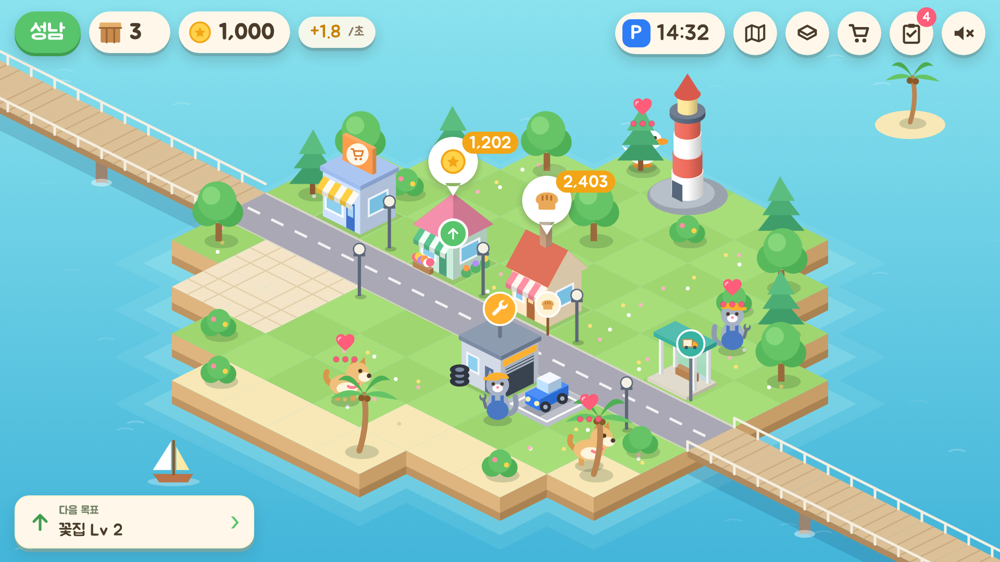

# HTML 목업: 내 차로 짓는 도시

대표 시나리오를 직접 조작해 볼 수 있도록 HTML로 만든 실험 목업입니다. 화면과 규칙은 [GOAL.md](../../projects/game/GOAL.md), [SCREENS.md](../../projects/game/SCREENS.md), [USE_CASES.md](../../projects/game/USE_CASES.md), [REQUIREMENTS.md](../../projects/game/REQUIREMENTS.md), [DECISIONS.md](../../projects/game/DECISIONS.md)의 D-003, D-004를 따릅니다.

## 1. 목적

- 1차 시연 영상에 쓸 수 있도록 실제로 조작되는 game 목업을 HTML로 만듭니다.
- [SCREENS.md](../../projects/game/SCREENS.md) 2절의 주요 장면이 한 화면 흐름으로 이어지는지 봅니다.
- 차량 신호는 화면 밖 시뮬레이터로 넣습니다(5절).

## 2. 실행

`index.html`을 Chrome이나 Edge로 엽니다. 빌드와 서버가 필요 없습니다.

- 글꼴 Jua(SIL OFL)를 Google Fonts에서 불러오고, 네트워크가 없으면 시스템 글꼴로 대체됩니다.
- 이미지 파일은 없습니다. 섬, 건물, 주민, 아이콘, 지도는 모두 캔버스·SVG path·CSS로 직접 그렸습니다.
- 진행 상태는 브라우저 localStorage에 저장됩니다.

## 3. 화면 구성

| 영역 | 내용 |
|---|---|
| 왼쪽: 차량 화면 | 16:9(1920×1080 기준)로 고정한 게임 화면으로, 창 크기에 맞춰 축소됩니다. 설명문 없이 섬 위의 물체와 위 줄 아이콘을 눌러 조작합니다 |
| 가운데: 폰 (열었을 때만) | 폰 화면 한 장면(D-004). 실제 연동 없이 같은 상태를 보여 주고, 좁은 창에서는 화면 위에 겹쳐 뜹니다 |
| 오른쪽: 차량 시뮬레이터 | 게임 밖에서 실제 차량이 해 줄 일만 대신 넣습니다 |

차량 화면의 새 화면:

| 화면 | 진입 | 내용 | 요구사항 |
|---|---|---|---|
| 본거지 고르기 | 처음 실행, `처음 상태로` | 지금 위치의 도시를 먼저 제안하고, `지도에서 고르기`로 다른 도시를 고를 수 있습니다 | GAM-038 |
| S13 전국 지도 | 위 줄 지도 아이콘, 본거지 이름 | 왼쪽 시·도 도식 지도(보유 수, 발자국 수), 오른쪽 권역의 도시들. 보유 도시 수, 초당 수익 합계, `모두 거두기`. 열 때 자리를 비운 동안의 수익과 새 발자국을 알립니다 | GAM-038, GAM-043, GAM-044 |
| S14 도시 카드 | 지도의 미보유 도시 | 여는 가격(자재), 내 자재, 연 뒤 다음 도시 가격 → `열기` → `확정`. 모자라면 모자란 양을 보여 줍니다 | GAM-039 |
| 도시 화면 | 지도의 보유 도시 | 등급과 다음 등급까지 남은 양, 초당 수익, `거두기`, 시설 3개의 레벨과 `올리기` | GAM-040~042 |
| S15 시설 말풍선 | 본거지 섬의 생산 시설 | 쌓인 양, 레벨, 초당 수익 변화, `거두기`, `올리기`(골드) 또는 `돌파`(자재+골드, 확인 창) | GAM-031, GAM-040, GAM-041 |

시뮬레이터 조작:

| 조작 | 대신하는 것 |
|---|---|
| `P 주차` / `D 주행` | 주차·주행 판단 신호 |
| 이동 거리(0~250km), 운전 시간 | Odometer 누적 거리, 트립 시간. 주차할 때 반영되고, 아래에 이번 주 누적 거리가 보입니다 |
| 급가속·급감속, 급제동, 방향 지시등 횟수 | 차량 속도 변화, 브레이크 페달, TurnSignal 관측 결과 |
| 정비 상태 `여유` / `임박` / `기준 도달` | 엔진오일 교체 주기의 남은 거리와 기간 |
| 차량 위치 (권역, 도시), 위치 권한 허용 / 거부 | FusedLocation 위치와 `FUSED_LOCATION` 권한. 주행 중 바꾼 위치가 주차 후 발자국이 됩니다 |
| 차량 관리 신호: 엔진오일 양, 워셔액 `정상` / `부족` / `읽기 실패` | Safety `getEngineOilLevelState`, `hasLowWasherFluidWarning`의 값 |
| 타이어 공기압, 엔진 과열 | 차량 경고 신호 켜고 끄기 |
| 시간 `+15분` ~ `다음 주` | 기기 시각. 생산, 쓰다듬기 충전, 휴식 인정, 일일·주간 초기화, 낮·저녁·밤 |
| `폰 화면 열기` | 연동된 폰을 집어 든 상황 |

## 4. 시연 순서

[SCREENS.md](../../projects/game/SCREENS.md) 9절의 시연 영상 순서를 따르고, 그 뒤에 도시 업그레이드, 폰, 섬 꾸미기 장면을 잇습니다.

| 순서 | 조작 | 보이는 것 | 요구사항 |
|---|---|---|---|
| 0 | (처음 상태) `여기로` | 본거지 고르기 → 위 줄에 도시 이름 | GAM-038 |
| 1 | — | 낮의 섬. 주민이 돌아다니고 빵집 굴뚝에 연기. 위 줄에 초당 수익 | S01, GAM-040 |
| 2 | 시뮬레이터 `D 주행`. 화면을 눌러 봄 | 내 차가 다리로 나가고 위 줄이 사라짐. "주행 중이에요" 한 줄. 눌러도 반응 없음 | S02, GAM-N01 |
| 3 | `P 주차` → 택배 트럭 말풍선 | 택배 카드: 11km, 거리 자재 +11, 안전운전 자재 +28, 이번 주 거리 구간. `근거` → `받기` | S03, GAM-001, GAM-003, GAM-025 |
| 4 | 위 줄 상점 → `시설` 탭 → 시장 → 정류장 옆 빈 땅 → ✓ | 미리보기 → 완공 | S11, S04, S05, GAM-004, GAM-019 |
| 5 | 빵집 → `거두기` → `올리기`. 상점에서 벤치 → `놓기` | 골드가 위 줄로 날아감. 레벨과 초당 수익이 오름. 장식 배치 | S06, S11, S15, GAM-031, GAM-033, GAM-040 |
| 6 | 시뮬레이터 `기준 도달` → 정비소 주민 → `교체 기록` → `저장` | 먼저 오는 기준 강조. 저장하면 주민 인사와 자재 +30 | S08, S09, GAM-006, GAM-007 |
| 6-1 | 시뮬레이터 워셔액 `부족` → `정상` | 정비소 말풍선, 퀘스트에 "워셔액 확인". 정상으로 돌리면 입력 없이 완료, 자재 +10 | GAM-048 |
| 7 | 시뮬레이터 `타이어 공기압`, `엔진 과열` | 맨 위에 실제 경고 카드. 길이 일렁이고 광장에 붉은 열기 | S10, GAM-009, GAM-N02 |
| 8 | 위 줄 지도 아이콘 | 전국 지도. 보유 1 / 161, 초당 합계, 모두 거두기 | S13, GAM-038 |
| 9 | 경기 → 미보유 도시 → `열기` → `확정` | 자재가 줄고 도시가 켜짐. 다른 도시의 가격이 오름 | S14, GAM-039 |
| 10 | 연 도시 → `올리기` | 도시 화면. 시설 레벨과 초당 수익, 등급까지 남은 양 | GAM-040, GAM-042 |
| 11 | `D 주행` 중 시뮬레이터 위치를 부산으로 → `P 주차` → 지도 | "새로 지나간 곳 1곳", 부산에 발자국 | GAM-043 |
| 12 | `폰 화면 열기` → 도시 → `올리기`, 돌파 단계 버튼 | 폰에서 골드로 올리기. 돌파·도시 열기는 "차에서 할 수 있어요". `D 주행`이면 폰도 막힘 | S16, GAM-045~047 |
| 13 | 지도 → 제주 → 도시 카드 | 첫 시설로 "제주 특산 · 감귤밭". 열면 도시 화면에 감귤밭·빵집·시장·카페 | GAM-049 |
| 14 | 위 줄 땅 아이콘 → 꽃밭 → 바다 칸 → ✓. `바꾸기`·`없애기` | 땅이 붙고 바깥 둘레는 값이 오름. 빈 땅 종류 바꾸기, 산 빈 땅 없애기 | GAM-051 |
| 15 | 빵집 길게 누르기 → 빈 땅 → ✓. 나무 길게 누르기(옮기기), 짧게 누르기 → `보관함에` | 레벨과 쌓인 골드가 그대로 따라감. 기본 나무·풀도 장식 | GAM-050, GAM-033 |
| 16 | 휠(핀치)로 확대 → 끌어서 이동 → 시설·주민 누르기 | 확대해도 말풍선·하트 크기는 그대로. 주민은 섬 전체를 돌아다니고 모두 쓰다듬기 | GAM-052, GAM-032 |

그 밖에 되는 것:

- 운전 시간을 120분 이상으로 두고 주행하면 음성 안내(자막과 TTS)가 나오고, 주차 후 `+15분`을 누르면 쉬어 가기가 완료되어 자재 +15를 받습니다(GAM-030).
- 이동 거리를 250km로 두고 주차하면 이번 주 누적이 200km를 넘어 2km당 1개 구간이 되고, `다음 주`를 누르면 다시 1km당 1개로 돌아갑니다.
- 레벨 10에서 `돌파`하면 확인 창 뒤에 건물 위에 별이 뜨고 수익이 두 배가 되며, 등급이 오르면 배너가 나옵니다.
- 차량 관리 신호가 `읽기 실패`이면 퀘스트를 만들거나 완료하지 않고, 같은 항목은 7일 안에 다시 보상하지 않습니다.
- 위치 권한을 `거부`하면 발자국 없이 동작하고 지도 아래에 "발자국 기록 꺼짐"이 보입니다.
- 같은 날 다시 운행해도 이미 달성한 항목은 다시 보상하지 않습니다.

## 5. 가정한 것

### SDK 기능

목업은 아래 기능을 모두 쓸 수 있다고 보고 만들었습니다.

| 가정 | 관련 |
|---|---|
| 주차·주행을 신호로 판단할 수 있다 | GAM-003, GAM-N01 |
| 운행 중 앱이 화면에 없어도 거리, 트립 시간, 속도, 브레이크, 방향 지시등, 위치를 기록할 수 있다 | GAM-024~030, GAM-043 |
| 공기압과 과열 경고를 신호로 받을 수 있다. 경고등 API에는 `PRIVATE_CAR_SAFETY` 권한이 필요하고, 경고명과 안내 문구는 목업용으로 썼습니다 | GAM-009 |
| 엔진오일 양과 워셔액 값이 에뮬레이터에서 들어오고 바꿀 수 있다 | GAM-048 |
| 위치가 어느 도시 권역인지 판정할 수 있다. 목업은 시뮬레이터에서 도시를 직접 고릅니다 | GAM-043 |
| 차종별 정비 주기 데이터가 있다. 화면에는 `예시 데이터`로 표시했습니다 | GAM-006 |
| 주행 중 TTS로 짧은 안내를 할 수 있다 | GAM-030 |
| 주행 중에도 섬 화면을 띄워 둘 수 있다 | GAM-N01 |
| 폰과 차량이 같은 상태를 본다. 목업은 같은 페이지의 상태를 함께 씁니다 | GAM-045, GAM-046 |
| 연동된 차가 주행 중이면 폰을 막는다 | GAM-047 |

### 숫자 (`js/state.js`의 `CFG`)

목업을 움직이려고 넣은 가정값이고, 요구사항의 값으로 옮기지 않습니다. 거리 자재의 200km만 공개 통계에서 가져왔습니다(GAM-001).

| 값 | 목업 | 관련 |
|---|---|---|
| 거리 자재 | 1km당 1개. 이번 주 누적 200km까지 1배, 400km까지 0.5배, 그 위는 0 | GAM-001 |
| 일일 항목 기준 | 운전 시간 20분 이상, 급가속·급감속 2회 이하, 급제동 1회 이하, 방향 지시등 3회 이상 (하루 누적) | GAM-026~029 |
| 일일 항목 보상 | 항목당 자재 7 (주간 최대 196 ≈ 200km) | GAM-025 |
| 쉬어 가기 | 연속 운전 120분, 휴식 인정 15분, 자재 15, 하루 1회 | GAM-030 |
| 엔진오일 주기, 보상 | 10,000km 또는 12개월, 자재 30 (주기마다 한 번) | GAM-006, D-004 |
| 차량이 확인하는 항목 | 자재 10, 같은 항목은 7일에 한 번 | GAM-048 |
| 시설 생산 | 1레벨 초당 골드 0.8~2. 레벨 L의 수익 = 1레벨 수익 × L × 2^(돌파 횟수). 약 60시간분까지 쌓임 | GAM-031, GAM-040 |
| 업그레이드 비용 | 골드 = 1레벨 초당 수익 × 600 × 1.22^(L−1). 최고 레벨 40 | GAM-040 |
| 단계 돌파 | 레벨 10·20·30에서 자재 15·30·60 | GAM-041 |
| 도시 여는 가격 | 보유 n곳일 때 자재 30 + 15(n−1) + (n−1)². 1곳 30, 2곳 46, 10곳 246, 30곳 1,306 | GAM-039 |
| 도시 등급 | 시설 레벨 합 0·8·20·40·70 → 새싹·잎새·꽃·열매·나무 | GAM-042 |
| 새 도시의 시설 | 그 권역의 특산 건물, 빵집, 시장, 카페 (각 1레벨). 특산 건물은 1레벨 초당 1.2 | GAM-049 |
| 쓰다듬기 쿨타임, 주민 수 | 4시간에 1회, 최대 3회. 주민은 기본 2명 + 생산 시설 수, 최대 6명 | GAM-032 |
| 시설 비용, 장식 가격 | 시장 8, 카페 12(자재, 섬에 하나) / 공원 1,600, 무대 3,000(골드, 제한 없음) / 소품 600~4,000, 자연 200~800(골드, 살 때마다 1.25배) | 원본 기획안 예시와 목업 가정 |
| 땅 넓히기 | 칸당 2,000(원래 섬 안의 바다)·8,000(첫째 둘레)·24,000(둘째 둘레) 골드. 최대 두 둘레(14×14, 114칸). 종류 바꾸기 무료, 산 땅 없애기는 환불 없음 | GAM-051 |

### 도시 목록

- `js/cities.js`에 17개 시·도, 161개 도시를 직접 적었습니다. 시·군 단위이고, 특별시·광역시·특별자치시는 하나의 도시로 셉니다(GAM-038).
- 2024년 행정구역 기준이라 2026-07-01 개편은 반영하지 않았고, 제품에서는 행정안전부 행정구역 자료를 기준일과 함께 씁니다.
- 지도는 시·도를 칸으로 놓은 도식이며, 실제 경계가 아니라는 점을 화면에도 적었습니다.

## 6. 참고한 자료

| 자료 | 가져온 것 |
|---|---|
| [Android Developers Blog: Bring your Android game to the car screen today](https://developer.android.com/blog/posts/bring-your-android-game-to-the-car-screen-today) (2026-09-21) | 게임은 parked app으로, 주행이 시작되면 조작을 막고 게임 소리를 멈추며, 다시 열면 상태를 복원하고 레터박스 없이 화면을 채웁니다 → 주행 모드, 저장, 16:9 전체 화면 |
| [Android for Cars 디자인 시스템: Sizing](https://developers.google.com/cars/design/automotive-os/design-system/sizing) | 최소 터치 영역 76×76dp, 아이콘 44dp → 게임 안 버튼은 76px 이상, 아이콘은 44px 이상 |
| Android for Cars 디자인 원칙 (2초 안에 읽힘, 0.25초 안에 반응) | 창마다 숫자와 아이콘 위주로 두고, 누르면 바로 반응하는 연출. [dev-environment.md](../../docs/contest/dev-environment.md) 7절의 App Market 기준과 같은 방향입니다 |
| [Ford SmartGauge with EcoGuide](https://awards.ixda.org/projects/ford-smartgauge) (운전 효율이 좋으면 계기판에 잎이 자람), Honda i-MID (잎이 쌓이고 깎임) | 차량 화면에서 운전 결과를 자라는 것으로 보여 준 선례입니다. 깎는 방식은 따르지 않았고(GAM-N06), 주행 중에 읽기 어렵다는 비평이 있어 결과는 주차 후 큰 숫자로만 보여 줍니다 |
| 아이소메트릭 섬 방치형 게임 (Idyll Isle, Tiny Isle, Enclaved, HTML/CSS/JS로 만든 Isometric Island) | 띄워 두고 보는 섬, 눌러서 거두기, 낮·노을·밤 전환 같은 장르 관습. 자원 표시가 가려진다는 Tiny Isle 리뷰를 보고 자원은 위 줄에 고정했습니다. 특정 게임의 그림, 이름, 배치는 가져오지 않았습니다 |
| 방치형 경영 게임의 장르 관습 | 지도에서 보유 지역 보기, 살수록 오르는 땅값, 레벨에 따라 오르는 업그레이드 비용, 구간 레벨의 외형 변화, 초당 수익 표시, 자리를 비운 동안의 수익 요약. 특정 게임의 그림, 이름, 배치는 가져오지 않았습니다 |
| 게임 필("juice") 관련 글 (GDC 2012 "Juice it or lose it" 등) | 눌림과 튕김(squash), 짧은 입자, 자원이 위 줄로 날아가는 연출, 소리와 화면 반응의 시차를 과하지 않게 썼습니다 |

## 7. 동작 확인과 한계

Playwright와 Chromium(1600×820, 900×900 창)으로 4절 시연 순서 0~16을 조작해 보았고, 콘솔 오류 없이 수치가 의도대로 바뀌는 것을 확인했습니다. 예를 들어 첫 택배는 거리 11과 안전운전 28을 합쳐 자재 42이고, 도시 하나를 열면 자재가 42에서 12로 줄고 다음 가격이 46이 됩니다. 새로 고침한 뒤에도 본거지, 보유 도시, 레벨, 자재가 유지됩니다.

한계:

- 차량 신호는 전부 시뮬레이터 값이며, Pleos SDK와 에뮬레이터에는 연결하지 않았습니다.
- 꾸밀 수 있는 섬은 본거지 하나입니다. 다른 도시는 섬 그림 없이 시설 카드 화면으로 보여 주고 그 권역의 특산 건물이 들어가며, 새 시설 짓기는 본거지에서만 됩니다.
- 폰은 같은 페이지의 상태를 쓰는 화면 한 장면이라 연동 동의(GAM-045), 네트워크 끊김, 동시 사용(GAM-046)은 없습니다.
- 튜토리얼(GAM-017), 음성 조회와 매뉴얼(GAM-010, GAM-015), 운전 습관 기반 주기(GAM-013), 배터리(GAM-014), 테마(GAM-021), 정비 기록 정정(GAM-023), 지역 랜드마크, 위치 권한 설명 창(GAM-UC-007 A3)은 넣지 않았습니다.
- 보관함(S12)은 상점 카드의 `놓기`로 줄였습니다.
- 화면 비율 16:9는 가정값이고, 터치 화면에서는 시험하지 않았습니다.

## 8. 결론

- SCREENS.md 2절의 주요 장면과 11절의 전국 지도 장면은 빌드 없는 HTML로 조작 가능한 수준까지 만들 수 있었습니다.
- 자재(차에서만)와 골드(매초)를 나눈 규칙이 화면에서 구분되고, 폰에서 막히는 버튼의 "차에서 할 수 있어요"가 차량특화성을 보여 줍니다.
- 그래픽을 코드로 그려서 외부 자산의 저작권 문제가 없습니다.
- 상태와 규칙(`js/state.js`)이 그리기(`js/render.js`), 화면(`js/ui.js`), 차량 신호 대역(`js/sim.js`)과 나뉘어 있어서, Android로 옮길 때 규칙 부분은 참고할 수 있고 UI는 다시 만들어야 합니다.

## 9. 파일

| 파일 | 내용 |
|---|---|
| `index.html` | 차량 화면, 폰, 시뮬레이터 패널 |
| `css/style.css` | 게임 UI, 지도·도시 화면, 차량 정보 스타일, 폰, 시뮬레이터 |
| `js/icons.js` | 아이콘 path (SVG와 캔버스 공용) |
| `js/cities.js` | 시·도 권역과 도시 목록, 도식 지도 칸, 권역별 특산 건물 |
| `js/state.js` | 상태, 가정값, 규칙(운행 판정, 주간 거리 자재, 택배, 생산, 레벨·돌파·등급, 도시 열기, 정비, 발자국, 시간, 건설·옮기기, 땅 넓히기·바꾸기·없애기, 주민) |
| `js/render.js` | 섬, 시설, 돌파 별, 주민, 탈것, 낮·밤, 경고 효과 그리기 |
| `js/ui.js` | 위 줄, 택배·상점(시설·장식·자연)·퀘스트·차량 관리·지도·도시 화면, 땅 막대, 다음 목표, 폰 화면, 누르기·끌기·확대 처리, 소리 |
| `js/sim.js` | 시뮬레이터 패널 |
