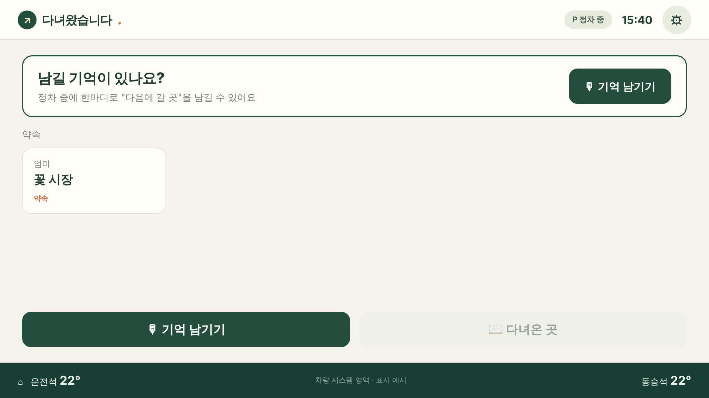

# 다녀왔습니다 · 14.6인치 차량 디스플레이 목업

대표 시나리오 SC-01~08을 **한 앱의 하루 흐름**으로 보여 주는 HTML 목업입니다. 홈의 지금 카드가 차량 상태에 따라 기억 남기기 → 약속·계획·승인 → 출발 준비 → 주행 → 동행 확인 → 다녀옴 기록으로 바뀌고, 첫 방문 기록을 저장하면 재방문 여정(파도 서가·어머니)과 발자국으로 이어집니다.

- 실행: `journey-demo.html`을 Chrome·Edge·Safari 같은 최신 브라우저에서 엽니다. 설치·빌드·서버가 필요 없는 단일 파일입니다. 글꼴(Gowun Batang, Nanum Pen Script, Noto Sans KR)만 Google Fonts에서 받고, 오프라인이면 기본 글꼴로 보입니다.
- 규격: 16:9 · 1920×1080 기준, 1280×720 논리 좌표로 작성하고 같은 비율로 확대·축소합니다. 화면 밖 "전체 화면" 버튼으로 넓혀 볼 수 있습니다. 자세한 기준은 [DISPLAY-SPEC.md](docs/DISPLAY-SPEC.md)에 있습니다.
- 데이터: 장소, 날씨, 이동 시간, 차량 상태, 음성, 내비 응답, 내 AI의 답은 모두 가상 데이터입니다. Pleos SDK와 외부 API에는 연결하지 않았습니다.

## 화면 언어: 실로 잇는 기억

| 요소 | 화면 | 뜻 |
|---|---|---|
| 실 | 홈 위쪽에 늘어진 빨랫줄. 지나온 구간은 꼬인 실, 아직 안 간 구간은 점선 | 기억과 약속이 이어져 있다 |
| 사진 | 다녀온 곳은 빨래집게로 건 폴라로이드와 손글씨 설명. 함께 간 사람은 사진 속 뒷모습 | 지난 기억 |
| 꼬리표 | 아직 가지 않은 약속은 손글씨 꼬리표. 할머니에게서 나온 약속이면 작은 얼굴 서명 | 다음 약속 |
| 빈 사진틀 | 기억을 남길 자리의 "?" 사진틀 | 지금 채울 기억 |
| 두 개의 빛 | 운전자(호박색)와 동행자(분홍, 얼굴 그림). 동행자 빛은 운전자가 답하기 전에는 점선의 흐린 원 | 함께 간다는 것 |
| 별빛 | 연결한 내 AI. 연결 전에는 점선 별빛 | 내 AI가 함께 찾는 중 |
| 매듭 | 방문을 확인하면 꼬리표가 사진으로 바뀌고 실에 매듭 | 약속을 지켰다 |
| 하늘빛 | 시각에 따라 아침·낮·늦은 오후·저녁 배경. 주행 중에는 화면 전체가 어두워지고 실이 전구 줄처럼 빛남 | 하루의 흐름 |

- 홈은 위쪽 실과 아래쪽 질문 한 문장, 큰 대답 둘입니다. 기억 남기기·약속·지난 발자국은 오른쪽 아래 작은 바로가기입니다.
- 메뉴는 브랜드 옆 글자 메뉴(홈·둘러보기·발자국·지도·내 AI·담은 곳)입니다.
- 입력은 음성이 기본입니다. 이번 여정, 여정 계획, 기억 남기기, 발자국 남기기 모두 마이크로 시작하고, 앱이 알아들은 내용을 칩으로 보여 주면 틀린 것만 고칩니다.
- 할머니는 사진이 아닌 역할 그림입니다. 도어 열림·닫힘은 흐린 빈 원만 띄우고, 빛을 채우는 것은 운전자의 [네, 함께 가요]입니다.

## 하루 흐름 (SC-01~07 → SC-08)

| 장면 | 주소 | 지금 카드 / 화면 | 시연 도구(화면 밖)로 바꾸는 것 |
|---|---|---|---|
| SC-01 기억 | `#SC-01` | 실에 지난 사진 두 장과 빈 사진틀, "남길 기억이 있나요?" → 기억 남기기: 마이크(누를 때만, 음성 시연) → `이대로 쓰기` → 바다 카페 → `다음 →` → 할머니 → `약속 저장` → 약속 상세 | 위치 `바다 카페 근처`(주변 후보), 외부 장소 검색 `실패`(후보 없음, 저장 안 함) |
| SC-02 계획과 승인 | `#SC-02` | 약속 상세 `여정 만들기` → 여정 계획(말로 날짜 정하기, 이번 일요일·10:30, 주차 미확인) → 승인(경로·공조·전송 각각 체크, 공조는 지원 미확인) → `계획 확정` | 날씨 맑음/비, 외부 장소 검색 정상/실패 |
| SC-03 출발 | `#SC-03` | 실에 집 → 할머니 댁 → 바다 카페 → 집과 약속 꼬리표, "오늘 10:30 할머니와 바다 카페" → 출발 준비: 연료·날씨, 주유소 경유 제안, `1구간 경로 적용` | 연료 20/40/80%, 내비 응답 성공/실패 |
| SC-04 할머니 댁으로 | `#SC-04` | 주행 모드: 어두운 화면, 빛나는 실 위의 운전자 빛, 할머니 댁까지 20분, 음성 안내 한 줄. 화면 입력 없음 | `D 주행` |
| SC-05 함께 출발 | `#SC-05` | 할머니 댁의 운전자 빛 옆에 할머니의 흐린 빈 원, "할머니와 함께 출발하시나요?"(관측: 도어 열림 → 닫힘) → 동행 확인 → `네, 함께 가요` → `2구간 경로 적용` | `P` 뒤 `도어 열림 → 닫힘` |
| SC-06 바다 카페로 | `#SC-06` | 주행 모드: 운전자와 할머니의 빛이 나란히, 바다 카페까지 25분, "할머니가 가보고 싶다고 하신 곳이에요." | `D 주행` |
| SC-07 다녀옴 | `#SC-07` | 집에 돌아온 두 빛과 아직 걸린 약속 꼬리표, "바다 카페에 다녀오셨나요?"(관측: 근처 정차) → `기록하기` → `네, 다녀왔어요` → 한 장짜리 발자국 남기기(장소·날짜·함께한 사람은 미리 채움, 틀리면 `고치기`) → 마이크로 한마디 → `이대로 남기기` → 약속 완료 | `P`(바다 카페 근처) → `D` → `P`(귀가) |
| SC-08 다시 가는 여정 | `#SC-08` | 실에 바다 카페 사진(할머니와 뒷모습)과 매듭, "파도 서가에 가볼까요?" → 아래 체험 순서 | 내비 응답, 외부 장소 검색, 내 AI 응답, 상태 확인 불가 |

- `P`와 `D`를 번갈아 누르면 여정이 이어집니다: 출발 전 → `D`(1구간) → `P`(할머니 댁) → `D`(2구간) → `P`(바다 카페 근처) → `D`(귀가 길) → `P`(집, 다녀옴 확인). 시각은 계획한 출발 시각을 기준으로 한 시연값입니다.
- 주소 `#SC-01`~`#SC-08`은 목업 틀과 캡처용 시작 상태입니다. 화면과 시연 도구에는 장면 이동 버튼이 없습니다. 주소 없이 열면 이 브라우저에 저장된 마지막 상태를 이어 가고, 처음이면 SC-01 상태입니다.
- 지키는 원칙: 음성은 마이크를 누를 때만(시연), 장소·동행자는 운전자가 고른 것만 저장(모르면 "미확인"), 승인한 작업만 그 시점에 실행, 경로는 내비 응답을 받은 뒤에만 "적용됨"(실패하면 계획 유지), 도어는 관측 근거로만 보여 주고 탑승은 운전자가 확인, 정차만으로 방문을 확정하지 않음, 주행·상태 확인 불가 중에는 화면 입력 차단, 주행 중 내 AI 호출 없음.

## 재방문 체험 순서 (`#SC-08`)

1. `#SC-08`로 열거나 첫 방문 기록을 저장한 뒤 홈의 `여정 준비`를 누릅니다.
2. **이번 여정:** 먼저 지난 동행 질문 "이번에도 어머니와 함께 가시나요?"에 `함께 가요` 또는 `혼자 가요`로 답합니다. 이어서 큰 마이크를 누르면 "파도 서가에 어머니랑 갈래. 조용한 곳이면 좋겠어."로 목적지·동행·취향 칩이 채워지고, 틀린 칩만 `고치기`로 바꿉니다. 마이크를 먼저 누른 뒤에는 동행 칩의 `고치기`로 함께/혼자를 비교합니다. 목적지 목록·종류·주제·"새로운 곳 먼저"는 접힌 `직접 고르기`에 있습니다.
3. **내 AI 연결:** `내 AI 연결하기`(또는 머리 메뉴 `내 AI`)에서 Claude·ChatGPT·Gemini 중 하나를 고르고 `휴대폰에서 연결했어요 · 시연`을 누릅니다. 실제 키 등록과 연결은 하지 않습니다. 연결되면 `추천 보러 가기`를 누릅니다.
4. **추천:** "○○가 … 근처를 살펴보고 있어요"(살펴본 출처, 보낸 조건: 운전자가 고르거나 확인한 취향만) → 두 곳. 카드마다 "○○가 정리한 이유 · 시연", 출처 칩, 미확인 칩이 있습니다. `그만 찾고 기본 추천 보기`나 `기본 추천 전체 보기`로 규칙 기반 추천과 비교합니다.
5. **말로 다시 고르기:** "어머니가 따뜻한 차를 좋아하셔"로 다시 고른 결과와 "이 취향을 어머니 기억에 남길까요?"가 나옵니다. `남기기`를 눌러야만 저장되고 `이번만 쓰기`는 저장하지 않습니다.
6. **담기와 내비 적용:** 경유 후보를 최대 두 곳 담고 `담은 곳`에서 순서와 마지막 목적지를 확인한 뒤 `이 여정으로 적용 · 시연`을 누릅니다. 확인 중 → 성공까지 기다립니다. 실제 내비는 바뀌지 않습니다.
7. **발자국 남기기:** 홈의 `여정 마치기` → `다녀온 곳 선택`. 한 장짜리 시트에서 장소·날짜를 확인하고 함께한 사람을 고릅니다(재방문에서는 예정 동행을 자동으로 고르지 않습니다). 마이크로 한마디를 남기고 `이대로 남기기`를 누르기 전에는 스탬프가 늘지 않습니다.
8. **발자국:** `다시 가기`로 재방문을 시작하거나 기록을 수정·추천 활용 제외·삭제합니다. 활용 제외는 스탬프를 지우지 않습니다.
9. **실패 시연:** 시연 도구에서 내 AI 응답 `실패`, 외부 장소 검색 `실패`, 내비 응답 `실패`, 주행·상태 확인 불가를 확인합니다. 실패해도 방문 기억은 남고, 차량 상태 미확인 때는 화면 조작을 막습니다.

주제 "바다 곁에서 / 지역의 맛 / 편안한 산책"과 "대한민국 명소발굴 추천지 · 예시" 칩은 예시 데이터이며 실제 대한민국 명소발굴 (100×100) 선정 목록과 연결하지 않았습니다.

## 시연 도구 (차량 화면 밖, 오른쪽)

차량 상태와 외부 응답만 바꿉니다. `?embed=1`이면 시연 도구와 테두리를 숨깁니다.

| 조작 | 대신하는 것 |
|---|---|
| `P 정차·주차` / `D 주행` / `상태 확인 불가` | 주행/정차 판단(공통 Q8·Q11). 주행이면 주행 모드, 확인 불가면 입력 차단 |
| `도어 열림 → 닫힘` | Vehicle Door 관측(`CAR_DOORS`). 할머니 댁 앞이면 동행 질문 카드가 뜹니다 |
| 연료 `20%` / `40%` / `80%` | Vehicle Fuel / EvBattery(`CAR_ENERGY`). 50% 미만이면 경유 제안 |
| 위치 `집` / `할머니 댁` / `바다 카페 근처` | FusedLocation. 기억 남기기의 주변 장소 후보 |
| 내비 응답 `성공` / `실패` | NaviHelper 경로 적용 요청의 결과 콜백(첫 방문 구간과 재방문 경유지 모두) |
| 날씨 `맑음` / `비` | 외부 날씨 API. 재방문 추천에서 비면 실내 우선 |
| 외부 장소 검색 `정상` / `실패` | 외부 장소 API. 실패하면 주변 후보 없음, 저장된 발자국만 |
| 내 AI 응답 `정상` / `실패` | 운전자가 연결한 외부 LLM(Claude·ChatGPT·Gemini)의 응답. 실패하면 기본 추천으로 대신 |
| `처음 상태로` | 이 브라우저의 시연 저장을 지우고 SC-01 상태로 |

## 파일

- `journey-demo.html`: 단일 파일 실행본.
- `src/`: HTML/CSS/JS 원본. `index.html`을 직접 열어도 동작합니다. `trip.js`·`trip.css`는 첫 방문 하루 흐름과 실 그림, `thread.css`는 화면 언어, `app.js`는 재방문·방문 기록 시트·내 AI입니다.
- `knowledge-graph.sample.json`: 초기 장소·속성·취향·방문·출처 그래프.
- `docs/DISPLAY-SPEC.md`: 화면 규격, 구성, 색과 글꼴, 검증 범위.
- `docs/PRODUCT-AND-KNOWLEDGE.md`: 지식 모델과 수집·검수·갱신 운영 방향.
- `docs/UC-PROPOSAL.md`: 목업에서 도출한 후보 UC-A·B·C와 기존 UC 보완안.
- `tests/`: jsdom 상호작용 테스트. Node.js 22.22.2 이상(22.x), 24.15 이상(24.x) 또는 26 이상에서 `npm ci` 후 `npm test`.

## 수정과 재생성

`src/`를 고친 뒤 `npm run build`로 `journey-demo.html`을 다시 만들고 함께 커밋합니다. 장면 캡처는 저장소 루트에서 `node spikes/mockup-frame/capture/grandma.cjs`로 만듭니다. 런타임 외부 의존성은 글꼴뿐이며 jsdom은 테스트에만 씁니다.

## 검증과 한계

- `npm test`: 그래프, 재방문 여정과 실패 처리, 첫 방문 하루 흐름, 주행 입력 차단, 내비 실패 시 계획 유지, 장면 주소, 시연 도구, 방문 기록 시트(동행 필수, 저장 전 미기록), 내 AI(미연결·실패 시 기본 추천, 동의 없는 취향 미저장, 주행 중 단계 없음)를 확인합니다.
- Chromium(Playwright) 1920×1080에서 SC-01~08과 주요 화면을 찍어 겹침과 잘림을 확인했습니다.
- 실제 차량 디스플레이의 터치 사용성, 밝기, 시야 거리, 음성 인식 정확도, Pleos SDK 연동은 검증하지 않았습니다.
- 시연 상태는 현재 브라우저의 localStorage에만 저장하고 서버로 보내지 않습니다. 파일 URL에서 저장이 제한되는 브라우저는 현재 세션만 씁니다.

## 연결 문서

[대표 시나리오와 시연 순서](../../projects/grandma/SCENARIO.md) · [Pleos SDK 활용과 외부 장소 데이터](../../projects/grandma/SDK.md) · [UC](../../projects/grandma/USE_CASES.md) · [ADR-0002](../../docs/decisions/0002-mockup-implementation.md)

이 목업은 AGENTS.md의 실험 코드 규칙에 따라 `spikes/`에 둡니다. ADR-0002가 정해지기 전까지 사용자 흐름과 지식 모델을 검토하는 실험이며, 차량 앱 구현은 포함하지 않습니다.
