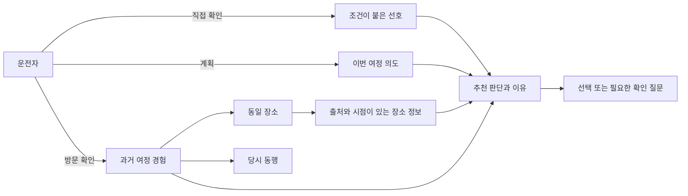

# 다녀왔습니다: 운전자를 이해하는 여정 지식 모델

**Draft · 설계 제안.** 접수 원고에는 아래 가치와 대표 사례만 요약합니다. 휴대폰 연계와 조건부 개인화는 설계 제안이며 HTML 목업의 구현 기능이 아닙니다.

## 1. 무엇을 더 잘 알아야 하는가

**운전자가 누구와, 왜 가려 했으며, 어떤 조건을 중요하게 여겼는지 기억하고 이번 여정의 선택에 돌려준다.** 장소 목록의 규모보다, 그 사람에게 지금 어떤 장소를 제안할지와 무엇을 확인해야 할지를 판단하는 데 전문성을 둔다.

현재 목업은 장소 속성·명시한 취향·동행 선호·방문 기억을 연결한다. 그러나 ‘조용한 곳을 좋아함’과 ‘오늘은 조용히 쉬고 싶음’, ‘다녀왔음’과 ‘다시 가고 싶음’을 충분히 구체화하지 못한다. 이를 구별하는 것이 다음 발전 방향이다.

| 서비스가 알아야 할 것 | 운전자가 확인한 예 | 추천에서 달라지는 것 |
|---|---|---|
| 지속적인 선호 | “나는 주차 후 오래 걷지 않는 곳이 좋아” | 주차장에서 입구까지 이동 정보가 있는 후보를 비교. 주차장 존재만으로 적합하다고 판단하지 않음 |
| 이번 여정의 의도·제약 | “오늘은 식사만 하고 바로 돌아갈래” | 산책·카페 추가를 줄이고 식사 후보에 집중. 시간 내 가능 여부는 이동·체류 정보가 확보될 때만 판단 |
| 허용할 이동 부담 | “오늘은 우회 운전을 15분까지만 할래” | 경로 조회 근거가 있을 때 추가 운전 시간을 비교. 자료가 없으면 시간 조건 미확인으로 표시 |
| 동행에 따른 조건 | “어머니와 갈 때는 계단 없는 입구가 필요해” | 해당 동행의 이번 조건으로 확인한 뒤 접근 정보를 검사. 관계명만으로 제약을 생성하지 않음 |
| 개인의 경험과 평가 | “지난번엔 주차 후 걷는 구간이 길었어” | 그날의 개인 경험을 기억하고 현재 조건을 다시 확인. 모든 방문객에게 적용되는 장소 사실로 바꾸지 않음 |
| 아직 실행하지 않은 의도 | “다음에는 함께 점심도 먹자” | 같은 장소로 갈 때 저장한 식사 의도를 다시 제안. 방문했다고 약속을 자동 완료하지 않음 |

‘운전자를 안다’는 것은 운전 실력·성격·감정·피로를 차량 신호로 알아낸다는 뜻이 아니다. 본인이 제공하고 확인한 정보가 근거다. 새 사용자에게는 목적지·이번 동행·원하는 경험 정도만 묻고, 기억이 없으면 일반 후보부터 보여준다.

제조사·지도 서비스도 개인화를 구현할 수 있다. 현재 비교 우위는 검증된 독점 기능이 아니라 **차 밖의 의도와 차 안의 실행, 다녀온 경험을 개인별로 이어 관리한다는 가설**이다. 지속적으로 정정된 기억과 조건별 선택의 품질을 검증해야 경쟁력으로 주장할 수 있다.

## 2. 사람 중심의 그래프 구성

단순한 `사람 → 좋아함 → 속성`에서, **누가 확인한 어떤 정보가 어느 상황에서 유효한가**를 표현하는 구조로 확장한다. 그래프 DB 채택 자체는 필수 조건이 아니며 초기에는 JSON·관계형 저장으로도 검증할 수 있다.

| 개체 | 담을 정보 | 반드시 구분할 것 |
|---|---|---|
| DriverProfile | 본인이 확인한 지속 선호와 추천 활용 범위 | 기기·차량과 사용자 식별은 별개. 여러 운전자의 기억을 합치지 않음 |
| PreferenceAssertion | 선호 또는 필수 조건, 적용 상황, 주체, 확인 출처·시점 | 선호/필수 조건, 본인 진술/동행자 진술/전달받은 내용, 이번만/지속 적용 |
| TripIntent | 목적지, 목적, 동행 예정, 이번 제약, 선택한 계획 버전 | 계획·예정과 실제 방문·탑승. 이번 선택으로 장기 프로필을 덮지 않음 |
| VisitEpisode | 실제 방문 일시·동행, 사용자가 남긴 평가·불편·다음 의도 | 방문/호감/재방문 의사/약속 완료는 각각 확인 |
| PlaceAssertion | 장소 조건과 관측 범위, 출처·유효 시점·검증 상태 | 공공 사실/시점별 관찰/개인 경험. 장소 연결 기준은 [SDK.md](../../../projects/grandma/SDK.md) 6.2절 |
| RecommendationDecision | 입력 기억·계획·장소 근거의 버전, 후보, 제시 이유, 확인이 필요한 항목 | 왜 추천했는지 재현할 수 있는 기록. 원자료 삭제 시 설명용 사본도 보존 정책에 따라 정리 |

PreferenceAssertion의 최소 필드는 `subject, condition, predicate, value, strength, source, confirmedAt, validScope, useForRecommendation`로 제안한다. 예를 들어 본인이 확인한 ‘이번 어머니 동행에서는 계단 없는 입구 필요’는 현재 TripIntent에만 적용한다. 지속 선호로 저장하려면 따로 확인한다.

지속 선호·이번 의도·과거 경험이 충돌하면 이번에 확인한 조건을 우선 적용하고 장기 선호는 보존한다. 동행자들의 필수 조건이 충돌하면 평균 점수로 해결하지 않고 대안을 보여주거나 사용자에게 확인한다. 출처가 서로 다른 장소 주장도 임의로 하나의 사실로 합치지 않는다.

## 3. 전문성이 드러나는 추천 과정

1. **관련 기억 찾기:** 동일 장소, 이번 동행, 여정 목적에 관련되고 활용이 허용된 기억만 불러온다. 예전 동행을 지금 동행으로 확정하지 않는다.
2. **이번 조건 확인:** 과거 기억으로 답을 단정하기보다 필요한 질문 하나를 고른다. “이번에도 어머니와 함께 가시나요?”처럼 답이 추천을 바꿀 때만 묻는다.
3. **필수 조건 검사:** 계단 없는 입구 등 반드시 필요한 조건을 먼저 확인한다. 알 수 없으면 ‘충족 미확인’으로 분리하며 다른 취향 가점으로 상쇄하지 않는다. 후보가 없으면 조건을 몰래 완화하지 않는다.
4. **선호와 실행 부담 비교:** 조건을 충족하는 후보에서 이번 의도, 명시한 선호, 확인된 경험, 새 장소 탐색 의사를 반영한다. 우회 시간·영업·주차 정보가 없으면 그 조건의 적합성을 보장하지 않는다.
5. **이유와 한계 제시:** 두 후보와 각 한 줄 이유를 보여준다. 상세에서는 사용한 기억·장소 근거를 확인한다. 필수 조건의 미확인은 선택 전에 드러낸다.
6. **경험으로 갱신:** 방문 후 ‘다시 가고 싶어요 / 걷는 구간이 부담됐어요 / 이번만 그랬어요’처럼 평가와 적용 범위를 확인한다. 반복된 명시 평가에서 선호 후보를 만들 수 있지만, 지속 적용할지는 사용자에게 확인한다. 클릭·무응답·방문 횟수만으로 취향을 확정하지 않는다.

예시 장소 A·B의 정보와 취향을 고정한 비교 시연을 권장한다. 아래는 현재 HTML에 구현되지 않은 조건부 판단 예다.

| 바뀐 맥락 | 판단 | 사용자에게 설명할 문장 예 |
|---|---|---|
| 어머니와 함께, 계단 없는 입구를 필수로 확인 | 입구 조건이 확인된 A 우선 | “이번에 고른 ‘계단 없는 입구’ 조건에 맞아요.” |
| 같은 운전자, 오늘은 혼자, 새 장소 탐색 선택 | 위 동행 조건은 제외하고 미방문 B 검토 | “바다 전망을 좋아하셔서, 아직 안 가본 곳을 골랐어요.” |
| A의 입구 정보가 만료됨 | A의 조건 충족을 미확인으로 전환 | “입구 정보는 다시 확인해야 해요.” |

핵심 증거는 **같은 후보라도 운전자의 확인된 맥락에 따라 선택·질문·이유가 달라지고, 잘못된 기억을 수정하면 그 변화가 설명된다는 것**이다. 현재 목업의 단순 가감점은 이 판단 체계를 구현한 결과가 아니다.

## 4. 모바일과 차량의 역할

모바일은 **차 밖에서 의도와 경험을 정리하는 접점**, 차량은 **현재 여정에 맞게 확인하고 승인한 계획을 실행하는 접점**으로 제안한다. 차량에서 프로필을 길게 입력할 필요를 줄이면서도, 폰의 선택을 차량 실행 승인으로 취급하지 않는다.

| 우선 제안 시나리오 | 모바일에서 | 차량에서 | 연결·범위 |
|---|---|---|---|
| 출발 전 ‘함께 가고 싶은 곳’ | 운전자가 장소 링크를 직접 추가하고 누구와 왜 가려는지 선택. 장소·지점 일치 확인 | 정차 중 계획을 불러와 이번 동행을 확인하고 주변 후보를 비교. 내비 적용은 별도 승인 | UC-002·003·012·018 후보. 첫 모바일 시연으로 권장 |
| 다녀온 뒤 기억 보완 | 귀가 후 실제 동행·불편·다음 의도를 선택. 사진은 본인이 고른 것만 선택적으로 추가 | 다음 여정에서 갱신된 기억으로 질문·추천 | UC-008·014·016 후보. 기존 차량 기록과 동일 방문 ID를 수정해 스탬프 중복 방지 |
| 가족과 후보 조율 | 가족은 설치 없이 공유 웹에서 시간·장소 후보에 응답 | 운전자가 응답을 검토하고 최종 계획을 승인 | 기존 UC-004·GRD-004 확장. 가족 응답은 실제 동행 확정이 아님 |
| 다른 지원 차량에서 이어가기 | 본인 확인 후 사용할 기억·이번 계획을 선택 | 지원 차량에서 해당 범위를 불러오고 현재 차량 상태를 새로 확인 | UC-013 후속. 모든 차종·제조사 계정 연계를 약속하지 않음 |

대표 흐름: 집에서 운전자가 카페 링크에 ‘어머니와 다음에 점심도’를 남김 → 차량에서 같은 장소를 선택하자 이번 동행을 질문 → 답에 맞는 식사 후보 제안 → 경로 승인 → 귀가 후 실제 경험 확인 → 다음 방문에서 재사용. 대화·사진첩·연락처 전체를 자동으로 읽을 필요는 없다.

첫 검증은 모바일 웹의 링크 입력·선택 화면으로 충분하다. OS 공유 메뉴로 받기, 푸시, 오프라인 편집이 필요하면 이후 네이티브 앱을 검토한다. 웹에서 해당 기능이 모든 기기에서 지원된다고 전제하지 않는다. 운전자용 모바일 접점은 가족에게 앱 설치를 강제하는 변경이 아니다.

**연동 경계:** 기기 간 전달은 앱 자체의 인증·저장·동기화 설계가 필요하다. Pleos가 개인 계정이나 폰-차량 동기화를 제공한다고 가정하지 않는다. Trip/Visit ID와 버전으로 중복·충돌을 확인하고, 폰에서 수정한 초안이 이미 적용한 차량 경로를 자동 변경하지 않게 한다. 연결 실패 시 마지막 확인 계획과 미전송 상태를 유지하며, 모바일이 없어도 차량의 수동 선택·기록 흐름은 사용할 수 있어야 한다.

**기존 문서와의 정합성:** 현재 UC의 접점 표는 차량 앱만 나열하고 실행·외부 전송 승인을 차량에서 하도록 기술한다. 모바일에서 동기화·가족 공유를 승인하는 확장은 승인 주체와 범위를 먼저 정해야 한다. 위 흐름은 합의 전 제안이며 실제 연동·전송 기능을 추가한 것이 아니다.

## 5. 현재 구현과 다음 검증

| 구분 | 상태 |
|---|---|
| 현재 HTML | 가상 권역 후보, 명시한 본인·동행 취향, 비 조건, 방문 기억 기반 순위, 동일 장소 재방문 질문, 두 장 비교, 선택·음성 시연 기록, 활용 제외·수정·삭제 |
| 그래프 원천 | `src/core.js`의 Person·Place·Destination·Trait·Visit·Source와 `NEAR / HAS_TRAIT / PREFERS / CONFIRMED_VISIT / AT_PLACE / WITH_PERSON`. `KB.graph()`로 JSON 내보내기 |
| 실행 시연 | 홈 → 준비 → 내비 승인·응답 시연 → 실제 방문 확인. 담기·내비 성공·여정 종료는 스탬프 생성과 별개. 주행·상태 미확인 시연에서 입력 제한 |
| 저장 | 현재 브라우저 localStorage. 활용 제외는 방문·스탬프 보존, 삭제는 별도 확인. 계정·모바일 동기화 없음 |
| 미구현 | 위 조건부 선호·필수 조건 검사·판단 버전 기록, 실제 장소 검수·만료·충돌 운영, 외부 API·실제 차량 신호·내비·음성 인식·모바일 연동 |

검증은 세 가지 비교에 집중한다. 수치 목표나 효과를 이미 달성한 것처럼 제시하지 않는다.

- 같은 장소 목록에서 일반 인기순·단순 취향·조건부 개인화를 비교: 선택 수고, 제약 누락, 이유 이해도, 불필요한 질문을 관찰한다. 인기순 기준은 실제 근거가 확보된 경우만 사용한다.
- 잘못된 동행·일회성 선호·만료된 장소 정보를 넣고 정정: 다음 질문과 추천에 오류가 남는지 확인한다. 방문과 만족을 혼동하지 않는지 확인한다.
- 모바일 준비 → 차량 확인 → 모바일 회고를 연결: 재입력량, 계획 버전 충돌, 기록 중복, 차량에서의 조작 수를 측정한다. 실제 연동 전에는 명시한 시연으로만 평가한다.

외부 장소 정보와 대한민국 명소발굴 (100×100)([SDK.md](../../../projects/grandma/SDK.md) 6절)은 개인 판단에 쓸 재료, Pleos API([SDK.md](../../../projects/grandma/SDK.md) 3·7절)는 차량 실행 수단이다. 제출 설명에서는 이들을 나열하기보다 **운전자의 어떤 맥락이 어떤 선택을 바꾸었는지**를 먼저 보여준다.
